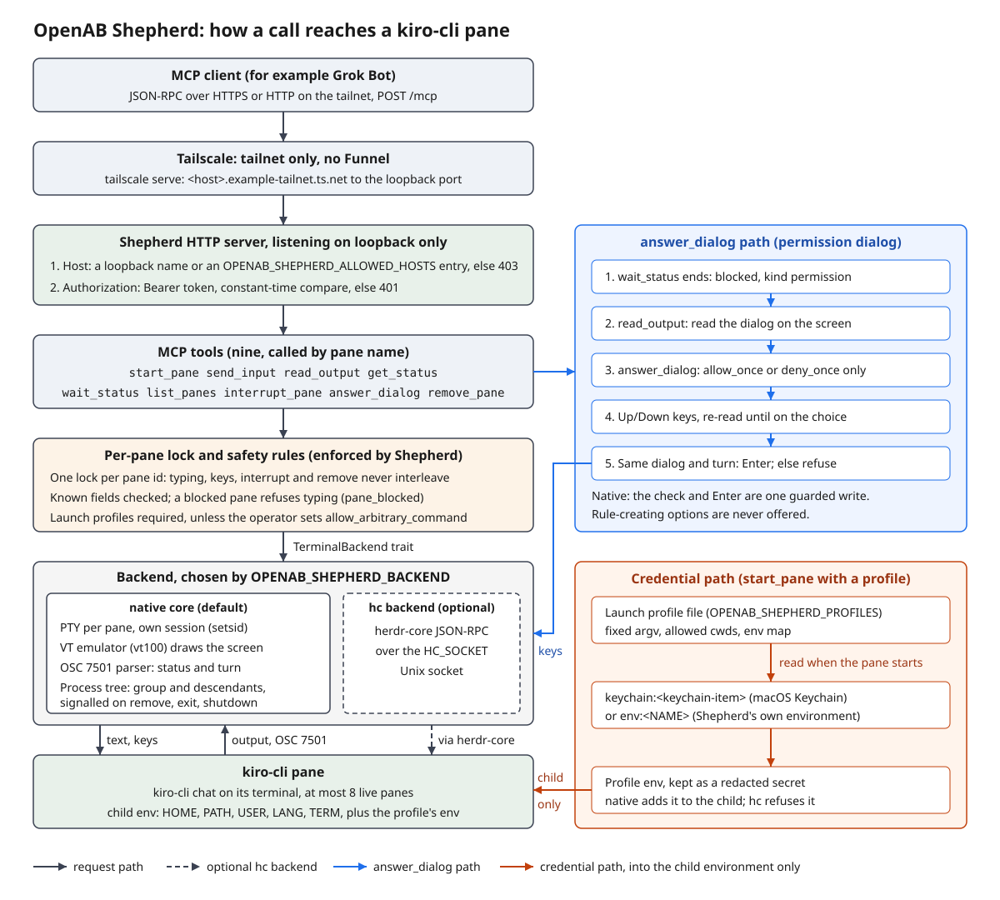

# OpenAB Shepherd

## Goal

Shepherd is a bearer-protected MCP server that lets an MCP client, such as Grok Bot,
start and drive coding CLIs like Kiro in terminal panes. The client starts a pane,
types a prompt, waits for the turn to finish and reads the screen, all through MCP
tools. The safety rules are enforced by Shepherd, not by the agent: which programs
may start, where they run, which credentials they get, when typing is refused, and
which answers a permission dialog may receive.

## Features

- **Loopback-only server with bearer auth.** `--host` accepts only the literal IPv4
  or IPv6 loopback address, and IPv4 loopback is the default. Every request needs `Authorization: Bearer <token>`, compared in constant
  time. The Host header is checked first, against loopback names and an optional
  allowlist (`OPENAB_SHEPHERD_ALLOWED_HOSTS`) for use behind `tailscale serve`.
- **Pane lifecycle tools.** Nine MCP tools: `start_pane`, `send_input`,
  `read_output`, `get_status`, `wait_status`, `list_panes`, `interrupt_pane`,
  `answer_dialog` and `remove_pane`. Panes are addressed by name.
- **Blocked-dialog handling.** `send_input` refuses to type while a pane is blocked
  on a dialog and returns `pane_blocked`. `answer_dialog` accepts only `allow_once`
  or `deny_once`; the rule-creating options cannot be chosen. It re-checks the
  dialog, its kind and its turn number before it presses Enter.
- **Launch profiles.** `start_pane` starts only what the operator's profiles file
  allows: a fixed `argv`, a list of allowed working directories, and environment
  variables. Each variable is a literal value or is read when the pane starts from
  a `keychain:` (macOS Keychain) or `env:` source. Caller-chosen commands are off
  unless the file sets `"allow_arbitrary_command": true`, and such panes never get
  a profile's environment. Without a profiles file, `start_pane` starts nothing.
- **Native terminal core.** The default backend runs each pane on its own PTY with a
  `vt100` emulator, a cleared child environment and at most 8 live panes. Programs
  report their state (`idle`, `working`, `done`, `blocked`, ...) with OSC 7501
  escape sequences, which Shepherd parses into a status and a turn counter. An
  optional backend drives panes through herdr-core instead.
- **Process-tree cleanup.** `remove_pane`, a program's own exit and Shepherd's
  shutdown signal the pane's process group and every descendant Shepherd has seen,
  then kill what is left. Descendants are found by looking at the process table
  about every 250 ms, so a process that fully detaches faster than that is missed
  (see [Status and known limits](#status-and-known-limits)).
- **Container image.** The `Dockerfile` builds a Debian image that runs as uid 1000
  under tini, with kiro-cli pinned to 3.1.0 and checked against a SHA-256. The image
  holds no token and no profiles file.

## How it works



1. The MCP client sends JSON-RPC over HTTP `POST /mcp` to the loopback listener,
   directly or through `tailscale serve`. Shepherd checks the Host header, then the
   bearer token.
2. The tool layer validates the arguments it recognizes (unrecognized keys are
   ignored, not rejected), then applies the safety rules: launch profiles, the
   per-pane lock, refusing input to a blocked pane, and the dialog checks. It reaches panes only through the `TerminalBackend` trait.
3. `start_pane` resolves a launch profile, reads its credentials, and the native
   backend spawns the program on a PTY with only `HOME`, `PATH`, `USER`, `LANG`,
   `TERM` and the profile's variables.
4. The program's output feeds the terminal emulator, which draws the screen and
   passes OSC 7501 status reports to Shepherd. `wait_status` returns when a turn
   ends (`done`), the pane blocks on a dialog (`blocked`), the program exits, or
   the wait times out.
5. When a pane is blocked on a permission dialog, the client reads the screen with
   `read_output` and answers with `answer_dialog`. When the work is done,
   `remove_pane` stops the program and its descendants and frees the slot.

## Quick start

Build on a build host with a Rust toolchain:

```sh
cargo build --release
```

Create a token file and a launch profiles file, both outside any git repository:

```sh
umask 077
openssl rand -hex 32 > <token-file>
chmod 600 <token-file>
```

```json
{
  "allow_arbitrary_command": false,
  "profiles": [
    {
      "name": "kiro",
      "argv": ["kiro-cli", "chat"],
      "cwds": ["<work-dir>"],
      "env": { "KIRO_API_KEY": "keychain:<keychain-item>" }
    }
  ]
}
```

On Linux, use `"env:<NAME>"` instead of `keychain:`; Keychain sources are macOS only.
Start the server:

```sh
OPENAB_SHEPHERD_TOKEN_FILE=<token-file> \
OPENAB_SHEPHERD_PROFILES=<profiles-file> \
./target/release/openab-shepherd --port 8765
```

Point the MCP client at `http://<loopback-address>:8765/mcp` with the header
`Authorization: Bearer <token>`. To reach it from another machine on the tailnet,
put it behind `tailscale serve` and allow that name, for example
`OPENAB_SHEPHERD_ALLOWED_HOSTS=<mcp-host>.example-tailnet.ts.net:8445`.

Every variable, profile field, tool argument, error code and bound is described in
[docs/operations.md](docs/operations.md).

## Status and known limits

Shepherd is an MVP (version 0.1.0). The native backend was verified against
kiro-cli 3.1.0 with a real-Kiro probe; the results are in
[MVP-REPORT.md](MVP-REPORT.md), and the native core's design is in
[docs/adr/native-core.md](docs/adr/native-core.md).

- **No multi-client authorization.** Anyone holding the token controls every pane.
- **Two dialog choices only.** `answer_dialog` answers `allow_once` or `deny_once`
  and nothing else. Other dialog kinds (`question`, `auth`) are not answered.
- **Text-based dialog parsing.** The dialog is parsed from screen text and is tested
  only against kiro-cli 3.1.0 (V3) shell permission dialogs.
- **A fast detached descendant escapes cleanup.** A descendant that is re-parented
  and fully detaches (new session, no terminal, parents gone) within the 250 ms
  between looks at the process table is never seen and survives. macOS has no
  unprivileged way to close this gap; a Linux subreaper is a follow-up.
- **Panes do not survive a server restart.** Native panes are children of Shepherd
  and end with it.

The full list, including the hc-only race on Enter and the output filter's limits,
is in [docs/operations.md](docs/operations.md#known-limits-mvp-scope).

## License

MIT. See [LICENSE](LICENSE).
