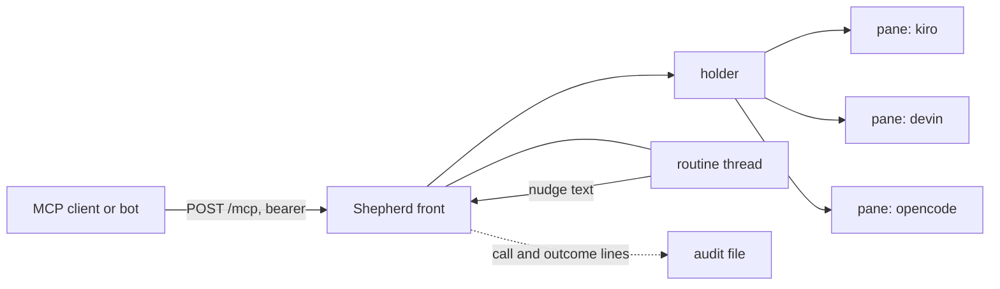

# OpenAB Shepherd

## Goal

Shepherd is a bearer-protected MCP server that lets an MCP client, such as Grok Bot,
start and drive coding CLIs like Kiro in terminal panes. The client starts a pane,
types a prompt, waits for the turn to finish and reads the screen, all through MCP
tools. The safety rules are enforced by Shepherd, not by the agent: which programs
may start, where they run, which credentials they get, when typing is refused, and
which answers a permission dialog may receive.

## Overview

- **Pane model.** Shepherd owns the panes, not the client. Each pane is a program on its own
  PTY, addressed by name. Under `openab-shepherd hold`, a holder process owns the PTYs and a
  restartable front serves MCP; a bare `openab-shepherd` does both in one process.
- **Tools and scopes.** Fourteen tools. A client holds explicit scopes (`observe`, `read`,
  `control`, `start`, `start:arbitrary`, `start:args`, `dialog`, `remove`, `routine`, and the reserved
  `attach`, `attach:write`, `lease:preempt`); no scope implies another. See
  [Scopes](docs/operations.md#scopes) and [docs/credentials.md](docs/credentials.md).
- **Restart survival.** Under `hold`, the front can be killed or restarted with `SIGUSR2` and
  the panes keep running; the new front adopts them and replays their output silently.
  See [Restart survival](docs/operations.md#restart-survival).
- **Routine.** Shepherd can type a line into an idle pane on a schedule: a profile's idle
  nudge, or an `every N seconds` routine an agent creates with `routine_create`.
  See [docs/routine.md](docs/routine.md).
- **Trust model.** Shepherd assumes one operator account and trusted pane programs. It
  limits which programs start, with which credentials, and which dialog answers are sent;
  it does not isolate panes from each other or from the account. See
  [docs/adr/trust-model.md](docs/adr/trust-model.md).

## Features

- **Loopback-only server with bearer auth.** `--host` accepts only the literal IPv4
  or IPv6 loopback address, and IPv4 loopback is the default. Every request needs `Authorization: Bearer <token>`, compared in constant
  time. The Host header is checked first, against loopback names and an optional
  allowlist (`OPENAB_SHEPHERD_ALLOWED_HOSTS`) for use behind `tailscale serve`.
- **Pane lifecycle tools.** Ten MCP tools: `start_pane`, `send_input`,
  `read_output`, `get_status`, `wait_status`, `list_panes`, `interrupt_pane`,
  `answer_dialog`, `remove_pane` and `draft_clear`. Panes are addressed by name.
  Four more, `routine_create`, `routine_list`, `routine_update` and `routine_delete`,
  need the `routine` scope (see the routine feature below). `draft_clear` needs the
  `lease:preempt` scope; the other nine tools need `observe`, `read`, `control`, `start`,
  `dialog` or `remove`. The scope table is in
  [docs/operations.md](docs/operations.md#scopes).
- **Blocked-dialog handling.** `send_input` refuses to type while a pane is blocked
  on a dialog and returns `pane_blocked`. `answer_dialog` accepts only `allow_once`
  or `deny_once`; the rule-creating options cannot be chosen. It reads the dialog
  for the pane's agent (`kiro`, `devin`, or `opencode`), re-checks the dialog, its kind and its
  turn number before it presses Enter. A Devin dialog never selects `Bypass mode`.
- **Launch profiles.** `start_pane` starts only what the operator's profiles file
  allows: a fixed `argv`, a list of allowed working directories, and environment
  variables. Each variable is a literal value or is read when the pane starts from
  a `keychain:` (macOS Keychain) or `env:` source. A profile names its `agent`
  (`kiro`, `devin`, or `opencode`) and a `permission_mode` (`normal`, `accept-edits`, or
  `bypass`). Caller-chosen commands are off
  unless the file sets `"allow_arbitrary_command": true`, and such panes never get
  a profile's environment. Without a profiles file, `start_pane` starts nothing.
- **Routine (optional, per profile).** A proactive in-process client for an
  unattended agent that ends a turn with work left while no MCP client supervises
  it. A profile's `routine` section makes Shepherd type its `nudge_text` into a
  pane whose finished turn sits idle past `idle_timeout_secs`, with limits and a
  stderr log. Off unless a profile sets it; see
  [docs/routine.md](docs/routine.md).
- **Agent-created routines (optional, per profile).** An agent, or any client with the
  `routine` scope, can ask Shepherd to type a line into a pane every N seconds with
  `routine_create`: "every hour, check whether any todo work is left". A profile opts
  in with `dynamic_routines`, which sets the shortest interval, the number per pane and
  the longest life; without the key nothing changes. Missed or busy ticks are skipped,
  never queued. See [docs/routine.md](docs/routine.md#agent-created-routines) and the
  `routine` scope in [docs/operations.md](docs/operations.md#scopes).
- **Native terminal core.** The default backend runs each pane on its own PTY with a
  `vt100` emulator, a cleared child environment and at most 8 live panes. Programs
  report their state (`idle`, `working`, `done`, `blocked`, ...) with OSC 7501
  escape sequences, which Shepherd parses into a status and a turn counter. It is
  the only backend. `OPENAB_SHEPHERD_BACKEND` accepts only unset, empty or `native`;
  any other value exits with status 2.
- **Process-tree cleanup.** `remove_pane`, a program's own exit and Shepherd's
  shutdown signal the pane's process group and every descendant Shepherd has seen,
  then kill what is left. Descendants are found by looking at the process table
  about every 250 ms, so a process that fully detaches faster than that is missed
  (see [Status and known limits](#status-and-known-limits)).
- **Container image.** The `Dockerfile` builds a Debian image that runs as uid 1000
  under tini, with kiro-cli pinned to 3.3.0 (the version the Kiro dialog parser was measured on) and checked against a SHA-256. The image
  holds no token and no profiles file. Its default command runs the pane holder
  (`openab-shepherd hold -- ...`); override the command with the bare
  `openab-shepherd --host ... --port ...` for the single-process behaviour.

## How it works



A bare `openab-shepherd` runs the front and the panes in one process, with no holder.
Under `openab-shepherd hold` the holder owns the panes and starts the front, so the front can restart while the panes keep running.

1. The MCP client sends JSON-RPC over HTTP `POST /mcp` to the loopback listener,
   directly or through `tailscale serve`. Shepherd checks the Host header, then the
   bearer token.
2. The tool layer validates the arguments it recognizes (unrecognized keys are
   ignored, not rejected), then applies the safety rules: launch profiles, the
   per-pane lock, refusing input to a blocked pane, and the dialog checks. It reaches panes only through the `TerminalBackend` trait.
3. `start_pane` resolves a launch profile, reads its credentials, and the native
   backend spawns the program on a PTY with only `HOME`, `PATH`, `USER`, `LANG`,
   `TERM` and the profile's variables.
4. The program's output feeds the terminal emulator, which draws the screen and
   passes OSC 7501 status reports to Shepherd. `wait_status` returns when a turn
   ends (`done`), the pane blocks on a dialog (`blocked`), the program exits, or
   the wait times out.
5. When a pane is blocked on a permission dialog, the client reads the screen with
   `read_output` and answers with `answer_dialog`. When the work is done,
   `remove_pane` stops the program and its descendants and frees the slot.

## Quick start

Build on a build host with a Rust toolchain:

```sh
cargo build --release
```

Create a token file and a launch profiles file, both outside any git repository:

```sh
umask 077
openssl rand -hex 32 > <token-file>
chmod 600 <token-file>
```

```json
{
  "allow_arbitrary_command": false,
  "profiles": [
    {
      "name": "kiro",
      "argv": ["kiro-cli", "chat"],
      "cwds": ["<work-dir>"],
      "env": { "KIRO_API_KEY": "keychain:<keychain-item>" }
    }
  ]
}
```

On Linux, use `"env:<NAME>"` instead of `keychain:`; Keychain sources are macOS only.
Start the server:

```sh
OPENAB_SHEPHERD_TOKEN_FILE=<token-file> \
OPENAB_SHEPHERD_PROFILES=<profiles-file> \
./target/release/openab-shepherd --port 8765
```

To keep panes alive across a server restart, run it under the holder:

```sh
OPENAB_SHEPHERD_TOKEN_FILE=<token-file> OPENAB_SHEPHERD_PROFILES=<profiles-file> \
./target/release/openab-shepherd hold -- --port 8765
```

`kill -USR2 <holder-pid>` then restarts only the front. The container image runs this by default.

Point the MCP client at `http://<loopback-address>:8765/mcp` with the header
`Authorization: Bearer <token>`. To reach it from another machine on the tailnet,
put it behind `tailscale serve` and allow that name, for example
`OPENAB_SHEPHERD_ALLOWED_HOSTS=<mcp-host>.example-tailnet.ts.net:8445`.

Two optional variables add named clients with limited scopes and an audit log:
`OPENAB_SHEPHERD_CLIENTS` (path of the clients file, JSON, mode 0600, outside any git
repository) and `OPENAB_SHEPHERD_AUDIT_FILE` (path of the audit log, JSON Lines, in a
mode 0700 directory; required when a clients file is set). Without them, the single
token (client `default`) keeps every scope that existed before shared panes. It holds none of `attach`,
`attach:write`, `lease:preempt` and `routine`, so `draft_clear` and the four `routine_*` tools answer it with `forbidden`; they need a clients file. With a clients file, a token file or token variable is a startup
error: each caller gets its own entry in the clients file. See
[Clients, scopes and the audit log](docs/operations.md#clients-scopes-and-the-audit-log).

Every variable, profile field, tool argument, error code and bound is described in
[docs/operations.md](docs/operations.md).

How the operator signs in to the coding CLI or supplies its key is described in
[docs/credentials.md](docs/credentials.md).


Notes on using Shepherd from a human terminal client, including a proposed
pairing with openab-pty, are in
[docs/terminal-clients.md](docs/terminal-clients.md).

## OpenCode CLI

The OpenCode notes (launch, the permission dialog, the highlight check) are in
[docs/opencode.md](docs/opencode.md).

## Status and known limits

Shepherd is an MVP. The latest release is 0.5.0 (see
[CHANGELOG.md](CHANGELOG.md)). The native backend was verified against
kiro-cli 3.1.0 with a real-Kiro probe; the results are in
[MVP-REPORT.md](MVP-REPORT.md) (a dated record, not a current status), and the native core's design is in
[docs/adr/native-core.md](docs/adr/native-core.md).
The trust model (one account, pane programs trusted) and the non-goals are in
[docs/adr/trust-model.md](docs/adr/trust-model.md). The restart-survival and shared-pane design
is in [docs/adr/restart-survival-and-shared-panes.md](docs/adr/restart-survival-and-shared-panes.md).

- **No pane ownership.** With the single token, anyone holding it controls every pane.
  With a clients file each client has its own scopes and an audit trail, but any client
  with a scope can use it on every pane. Pane ownership is a non-goal (see the trust model).
- **Two dialog choices only.** `answer_dialog` answers `allow_once` or `deny_once`
  and nothing else. Other dialog kinds (`question`, `auth`) are not answered.
- **Text-based dialog parsing.** The dialog is parsed from screen text. Measured
  agents: kiro-cli 3.3.0 (V3 shell, edit, MCP and web fetch permission dialogs; web search and wrapped commands are refused; see docs/operations.md for the measured and not-measured kinds), Devin CLI 3000.12.43 and 3000.12.57
  (shell commands) and OpenCode v2.2.7 (shell and edit dialogs, see below). For OpenCode,
  `deny_once` is answered with Esc; `allow_once` presses Enter only when the styled
  screen cells show `Allow once` with a background that differs from the other two options, which match each other.
- **A fast detached descendant escapes cleanup.** A descendant that is re-parented
  and fully detaches (new session, no terminal, parents gone) within the 250 ms
  between looks at the process table is never seen and survives. macOS has no
  unprivileged way to close this gap. On Linux the holder is deliberately not a subreaper;
  an orphan that escapes the scan is reaped by PID 1 (tini in the image).
- **Panes survive a server restart only under `hold`.** A bare `openab-shepherd` owns
  its panes and they end with it. `openab-shepherd hold -- <server flags>` runs a holder
  that owns the panes and restarts the server (`SIGUSR2`), but stopping the holder ends
  them. See [Restart survival](docs/operations.md#restart-survival).

The full list, including the output filter's limits,
is in [docs/operations.md](docs/operations.md#known-limits-mvp-scope).

## Documentation

- [docs/operations.md](docs/operations.md): operator reference (variables, profiles, tools, errors, scopes, audit, restart survival, image).
- [docs/routine.md](docs/routine.md): the idle routine and agent-created routines.
- [docs/credentials.md](docs/credentials.md): coding CLI credentials and an agent as an MCP client.
- [docs/terminal-clients.md](docs/terminal-clients.md) and [docs/opencode.md](docs/opencode.md): terminal clients and OpenCode notes.
- [docs/adr/](docs/adr/): design records (native core, trust model, restart survival and shared panes).
- [docs/operator-e2e/](docs/operator-e2e/README.md): operator end-to-end runbooks.
- [CHANGELOG.md](CHANGELOG.md).

## License

MIT. See [LICENSE](LICENSE).
