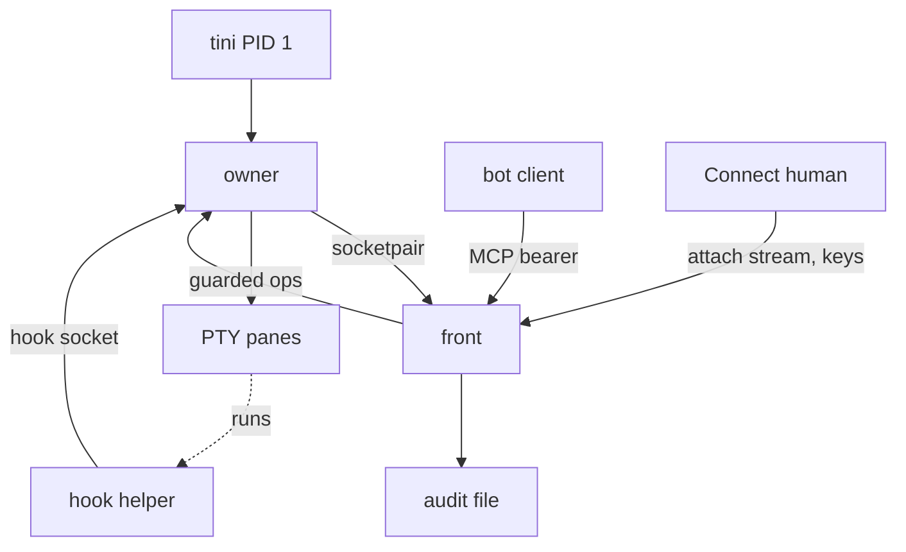
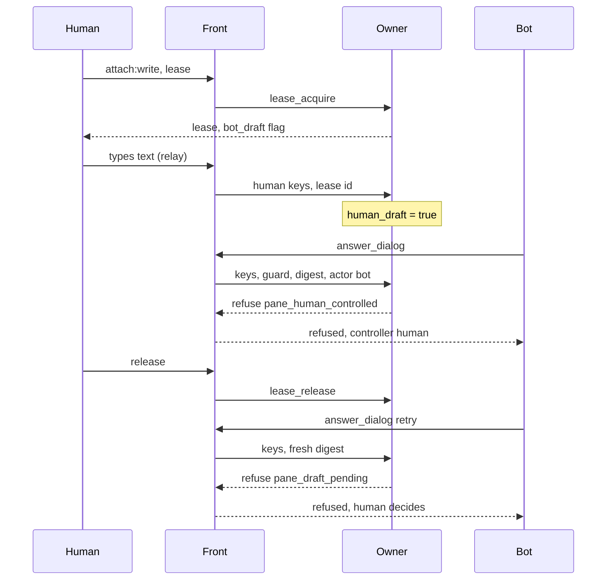

# ADR: Restart survival, shared panes and hook approvals

- **Status:** Proposed. Awaiting the maintainer's decision on direction (§11). Do not merge before that decision.
- **Date:** 2026-11-14
- **Author:** chaodu-agent
- **Based on:** `origin/main` at `3aae51c` (0.4.0 plus #62, which makes `send_input` refuse over a shown permission dialog and changes `src/tools.rs`, `src/tool_flows.rs` and `src/native/mod.rs`). Code and line numbers were read and rechecked at that commit with `git show origin/main:<path>`. Nothing was built or run for this ADR.
- **Related:** issue #66 (restart survival), issue #4 (multi-client authorization and audit), `docs/adr/native-core.md`, openabdev/openab-pty#97 (what OpenAB Connect speaks).

Labels used below: **verified** means checked against the code at the base commit, or against the documentation URL given, while writing this ADR. **reported** means taken from an engineer's report and not rechecked. **unverified** means not checked. **decided** means chosen here, subject to the maintainer's answers. **open** means listed in §11.

The maintainer answered three questions on #66: restart survival is a requirement for the next version (YES), humans and bots will share a pane, for example through OpenAB Connect (YES), and Claude Code and Codex will be supported (YES). This ADR designs for those three answers.

---

## 1. Context

Today one process does everything: HTTP and MCP serving, the PTYs, the VT emulator, the guarded write and the pane agent state. When it restarts, every pane ends.

- `NativeBackend` reports `survives_restart: false` (`src/native/mod.rs:92`, verified).
- `end_panes_on_exit_signals` ends all panes on SIGINT, SIGTERM and SIGHUP (`src/main.rs:133`, verified).
- The HTTP front is thread-per-request (`src/http.rs:52`, verified).
- The image runs `tini` as PID 1 (`Dockerfile:91`, verified).
- Each pane is its own session (`setsid`, `src/native/pty.rs:241`, verified). The backend reaps only its own children with `waitid` (`pty::wait_exited`, `src/native/pty.rs:601`, called from `reap` at `src/native/mod.rs:1085`, verified), so a descendant that detached and was re-parented to PID 1 needs `tini` to reap it.

Three requirements follow from the maintainer's answers.

1. **R1, restart survival.** Restarting or reloading the HTTP front, or changing a profile or a client, must not end panes.
2. **R2, shared panes.** A human (OpenAB Connect) can attach to a pane a bot is driving, type into it, and the bot must not corrupt what the human is typing. This needs attach, draft protection and an arbitration policy. It overlaps #4, which adds identities, scopes and audit for several clients.
3. **R3, hook approvals.** Claude Code and Codex document permission hooks. A hook gives a structured approval request and a structured answer, so approval need not go through screen scraping and a dialog dialect.

The constraint that makes this hard: the guard check and the write must stay atomic. `write_guarded` checks the guard and writes under one pane `state` lock (`src/native/mod.rs:780`, verified). `keys_if_screen` runs the screen check inside that lock (`src/native/mod.rs:1342`, verified). The guard needs the emulator's screen, so whatever holds the PTYs must also hold the emulator.

## 2. Decision summary

| Topic | Decision |
|---|---|
| Process split | An **owner** holds PTYs, the VT emulator, OSC 7501 status and turn, the guarded write, input leases, draft flags, hook approvals and opaque pane labels. A restartable **front** holds HTTP/MCP, #4 identity, scopes and audit, profiles, credentials, dialect parsers, `answer_dialog`, the watchdog and the attach relay. |
| Owner boundary | The owner has no code that depends on an agent version. It does hold policy that must be atomic with the write (leases, drafts, approval compare-and-set). |
| Link | The owner spawns the front over an anonymous socketpair: no path, no key. One front at a time. |
| PID 1 | `tini` stays PID 1. The owner is its child. |
| Survival | Front restart, crash or reload keeps panes, screens, status, turn, labels, leases and approvals. An owner restart or crash ends panes in v1. |
| Arbitration | Enforced in the owner. Default controller is the bot. A human takes one lease per pane. Bot writes are refused, never queued, while a human holds the lease or a draft is pending. |
| Hook approvals | A helper subcommand of the same binary runs as the agent's hook command and talks to a capability-free socket on the owner. **A pane can reach that socket, which is an exception to "no socket reachable from a pane" (§5.2, Q4).** There is no control socket in v1 (§3.2). A client with `dialog` answers by `approval_id`. Only allow or deny is ever returned. Hook mode is a boundary only under managed settings (§5.2 item 7). |
| Phases | P0 refactor with no behaviour change, then split, then attach, then lease and draft, then hooks, then optional handover (§9). |

## 3. The split: owner and front

### 3.1 Protocol

- Framing: 4-byte length and JSON, at most 1 MiB, `{"v","id","op","args"}`. Both sides send `hello` with `proto_major`, `proto_minor`, `owner_build` and capabilities. A major mismatch makes the front refuse. A minor is additive, and an unknown op returns `unsupported_op`. The front accepts an owner one major back for one release.
- Ops mirror `TerminalBackend` (`src/backend.rs`, verified): `run get list read send keys wait interrupt remove`, plus `set_labels`, `read_styled`, `attach`, `lease_*`, `approval_*`, `receipts` and `events`. A `RemoteBackend` implements the trait in the front.
- `ScreenCheck` is a closure (`src/backend.rs:579`, verified) and cannot cross a process. It becomes `expect_screen {rows, digest}` and the owner recomputes the digest under the same `state` lock. Today the closure in `answer_dialog` re-parses the styled screen and refuses unless the whole dialog, including its subject (the command being approved), equals the one read (`src/tools.rs:1825`, the `keys_if_screen` call; its check there is `opencode_dialog::verify_selected` at `:1814`, which runs on OpenCode's allow path only, and Kiro and Devin have no such check today, verified). So the range is every row of the region the dialect parser scans, not only the rows it consumed, plus the cursor position, so that a second dialog drawn elsewhere in that region changes the digest. The digest is over full styled cells (text, attributes such as reverse video, colours) in a fixed canonical encoding. P0 tests must refuse a changed subject row, a moved highlight with equal text, and a change in a row inside the range but outside the selection.
- `InputGuard` fields are plain data and cross as they are (`src/backend.rs:277`, verified). `send` runs whole in the owner. A partial write returns `bytes_written` and `committed`.
- `wait` is sliced to about 30 s on the wire and the front loops. An owner handler must never block on a wait, otherwise a fixed handler pool can deadlock.
- Every state-changing request carries `idem`. The owner keeps the last 256 receipts per pane, as lengths only, plus a hash for bot input. They never cover human attach input, so no hash of keystrokes exists anywhere (§4). A front that crashed can record the missing outcome from them (`recovered: true`).

### 3.2 Lifecycle

- Front death: the owner keeps panes, drops waits and streams, and respawns the front with backoff. Owner death: the front exits 3. A front that refuses its config exits 2, and the owner then exits 2.
- `SIGUSR2` on the owner restarts the front (reload). SIGHUP keeps its pane-ending meaning, so operators are not taught two meanings of it. A pane has the same UID and can already signal a same-UID process today, so signals add no new reach; they are the existing, accepted control path (§3.2, no control socket).
- The front is spawned with a default signal mask and only the pair fd inherited. The owner blocks exit signals (`src/native/pty.rs:635`, verified) and a mask survives `exec`.
- Protecting the pair fd (Linux). The owner sets `PR_SET_DUMPABLE=0` (prctl(2), https://man7.org/linux/man-pages/man2/PR_SET_DUMPABLE.2const.html, unverified) at startup, before it spawns any pane. A normal `execve` resets the flag to 1, so the front cannot inherit it and must set it itself (the prctl(2) page does not list a plain exec among the cases that keep it, and the kernel resets it when it execs a new image; unverified here). With dumpable 0 a same-UID pane cannot `ptrace` or `pidfd_getfd` the process, and `/proc/<pid>/environ` and `/proc/<pid>/fd` become root-owned (proc(5), https://man7.org/linux/man-pages/man5/proc.5.html, unverified). The panes are started with `env_clear()` (`src/native/pty.rs:175`) and the pair fd is `CLOEXEC` in every pane child (verified for the environment, `docs/adr/native-core.md` §10; the fd flag is a P1 test). Yama `ptrace_scope` 1 also blocks non-descendants, but a container may not set it, so the claim does not rely on it (unverified for the target images).
- **Residual risk: the exec-to-prctl window on every front respawn.** The front is exec'd with the pair fd inherited, and sets dumpable 0 as the first thing in `main`. Between the exec and that call, a same-UID pane that polls `/proc` for a new front pid could `pidfd_getfd` or `ptrace` it and take the pair, which carries `send` and `keys` without #4 authorisation or audit. The window is short, but panes are alive during a respawn by design. v1 accepts this as a residual risk (§6, Q11). A passing bootstrap socket does not close it, because a pane that stole the bootstrap fd could race the front to receive the real pair. The candidate fix is a front that is forked from a single-threaded launcher child of the owner and never exec'd, since dumpable survives `fork` (unverified). The P1 test measures the window: a same-UID process tries to take the pair fd in a loop during 100 respawns, and the result is recorded in the PR, not asserted as zero.
- **Token and profile file: this ADR does not protect them from a pane.** The owner reads a token given as `OPENAB_SHEPHERD_TOKEN` once, passes it to the front over the pair fd with the profile data, and keeps it in no struct or log. That does not hide it. `tini` is PID 1 under the same UID, holds the same environment in `/proc/1/environ`, and dumpable 0 on the owner and front does not cover it (proc(5), unverified here; found by review). The preferred mode, `OPENAB_SHEPHERD_TOKEN_FILE`, and the profiles file (which carries credentials) are 0600 files owned by the same UID (`src/config.rs:198`, mode check `0o077` at `:232`, verified), so every pane can read them. This is the same-UID case that #4 declares out of scope. A boundary for them needs the token and profile files under a different UID than the panes (decision D8, Q11). The Dockerfile sets no token: `Dockerfile:91-92` are `ENTRYPOINT` and `CMD`, and the pod supplies the token.
- **macOS has no equivalent that this ADR has verified.** A same-UID pane on macOS could be able to attach to the owner or front and obtain the pair fd or the token. In v1 the split is supported as a security boundary on Linux only (the pod and p1). On macOS (macmini e2e, Connect Macs) it is a development and single-user mode with no isolation against a hostile pane, as `MODE=single` is today. Whether `PT_DENY_ATTACH` or hardened-runtime entitlements close this is unverified. P1 gate: a test that a pane child cannot read the pair fd, run on Linux; on macOS the test is recorded as expected-fail. No test or claim covers the token or profile file (previous bullet).
- Values from `profile_env` cross the pair to the owner. They are never written to receipts, `panes.json`, logs or events.
- **No control socket in v1.** An earlier draft had `owner-ctl.sock` with `status`, `drain` and `stop`. Its only defence was refusing a peer that maps to a pane. A process that left the pane tree (`nohup sh -c ... &`, then the parent exits and `tini` adopts it; the ADR already says descendants leave the session, `src/native/pty.rs:241`, verified) maps to no pane and would be allowed to end every pane of every client, and a same-UID check cannot prove it is not a pane. So the socket is dropped. Operators use signals from outside the container: SIGUSR2 reload, SIGTERM stop. `status` is the front's `list_panes` plus `proto` in `--version`. Drain is replaced by stop until handover exists (P5). If a control socket returns, it must be opt-in, off in pods, and its peer check must be an allow-list (a different UID), never a deny-list.
- Orphan sweep: `panes.json` records pid and start time and is checked on owner start. It finds descendants that left the session (`src/native/pty.rs:241`, verified).

### 3.3 What survives

| Event | Panes |
|---|---|
| Front restart, crash, config or client reload | Survive, with screens, status, turn, labels, leases (10 s grace, §4) and approvals |
| Owner restart, crash or upgrade | End in v1 (stop and start). Handover is a later experiment |
| Pod rollout | End. Survival means front restarts inside a pod |

No scrollback is written to disk in v1.

## 4. Arbitration policy (shared panes)

All of it is enforced in the owner, in `write_guarded` next to `check_guard`, as a check that runs for every caller of `write_guarded`, whether or not `guard` is `Some` (`check_guard` runs only for `Some`, and `interrupt` calls `write_guarded(None, ...)`, `src/native/mod.rs:1429`). Hook approval decisions are covered as well (§5.2 item 4).

- The default controller is the bot, so a pane with no human behaves as it does today. Roles: observer (any number, read-only) and lease holder (one per pane).
- `lease_acquire` takes the pane `input` mutex, so it waits for an in-flight bot paste and Enter and never interleaves with them.
- While a human holds the lease, bot `send`, `keys`, `answer_dialog`, watchdog nudges and `interrupt_pane` fail with `pane_human_controlled` and write nothing. Reads stay open and show `controller`, `viewers` and `draft`, never the draft text. Trade-off: `interrupt_pane` is refused too, for up to 300 s of lease idle time, so a bot without `lease:preempt` cannot stop a runaway agent while a human holds the lease. v1 accepts this: the human is present and in control, and a supervisor with `lease:preempt` can take over. An audited interrupt-only scope is a possible later addition (Q7).
- The owner refuses instead of waiting, because a waiting tool call has no bound.
- Draft: any human byte sets `human_draft`. It clears only on an observed signal that the text is gone: the turn advances after the human's bytes were submitted (OSC 7501, for agents that emit it; a turn the agent starts by itself while the human's unsent text still sits in the input box does not clear the flag, and where the input box survives a turn is measured before P3), the human sends `draft_clear`, or a human Enter is observed on the input path. **There is no timer clear.** After the lease is released the owner refuses observer input, so "no human byte for 10 s" would be a plain timer, and the bot's `send` plus Enter would then submit the human's unsent fragment together with the bot's text, which is the harm R2 exists to prevent. While `human_draft` is set, a bot `send` or Enter is refused with `pane_draft_pending`. Bot text left unsubmitted in the input box (`pasted_unsubmitted`) sets `bot_draft`, which is returned when the lease is acquired.
- Way out of a stuck draft. A human who typed and then left (released, disconnected, closed Connect) leaves the flag set, and on panes with a turn the bot cannot advance it. Any principal with `lease:preempt` may call `draft_clear` (audited, with the principal), and so may the same human on re-attach. Reads show `draft: pending`, `controller: none` and the time since the last human byte, so a supervisor can see the stall. This is accepted: a stall is safer than submitting a fragment, and decision D3 already accepts it for Kiro and Devin. A later optional improvement is a screen check of the input row supplied by the front's dialect as `expect_screen`, so the owner still checks atomically (not in v1). P3 tests: human types, releases, waits 11 s, bot `send` is refused; the same on a pane with a turn; `lease:preempt` holder clears it; the bot then succeeds.
- The lease ends on release, on idle expiry (300 s), or on `lease:preempt` takeover (admin, audited). If the holder disconnects, including when the front crashes, the lease holds for a grace and then releases. The grace is a fixed 10 s, and the front respawn backoff cap is held below 5 s so that a normal reload fits inside it; a reload slower than that loses the lease but not `human_draft` (the draft flag has no timer). The human sees a reconnecting state during that time. After release the owner refuses observer input at protocol level.
- A human Enter written while the pane is `blocked` is recorded as `{actor: human, principal, turn, kind}`.
- The attach stream strips OSC 52 (clipboard), title sets, OSC 8 hyperlinks and terminal queries (DA, DSR, XTVERSION, OSC 10 and 11 colour queries, DECRQSS, CSI 21t) before relay. The owner already answers queries itself (`docs/adr/native-core.md` §8). The viewer's replies to anything that still gets through are not accepted as keys: the relay drops viewer input that is a terminal report and passes plain user keys only. A test prints `ESC [ 5 n` and `ESC P $ q m ESC \` and asserts that no bytes reach the pane. Geometry is fixed at 200x120 in v1. At most 4 viewers per pane.
- New #4 scopes: `attach`, `attach:write`, `lease:preempt`. `attach` and `lease:preempt` imply nothing else. `attach:write` is equal to raw key access, which includes Enter on a permission dialog, and lease-holder writes are not subject to the status guard. So `attach:write` is authorised as if it also held `control` and `dialog`: the clients file must grant all three, and the docs say so. The clients file marks each principal `human` or `bot`, and `attach:write` is refused for a `bot` principal. The "human" actor is thus derived from the principal's declared kind, not from the scope alone. Every write made while the pane is `blocked` records the principal, the status kind and the turn if any. Audit lines carry counts and times, never keystrokes and not even a hash of them. Owner-side events (lease changes, human Enter on a blocked pane, approval decisions) reach #4's front-side audit through the `events` op.
- Attach snapshot uses vt100's `state_formatted` and `input_mode_formatted`. They are present in vt100 0.18.1 (verified, https://docs.rs/vt100/0.18.1/src/vt100/screen.rs.html, `screen.rs:299` and `:507`). This is the genuine technical risk of R2, and the fallback is a raw-ring replay.

## 5. Hook approvals (Claude Code and Codex)

### 5.1 What the documentation says

Fetched while writing the recommendation behind this ADR. Cite and recheck before building.

- Claude Code, https://code.claude.com/docs/en/hooks (verified): `PermissionRequest` runs when Claude is about to show a permission dialog. The output field `decision.behavior` is `allow` or `deny`. `updatedInput`, `updatedPermissions` (can add rules or change mode) and `interrupt` exist. Exit code 2 without a decision leaves the flow unchanged. `allow` does not override a deny rule. In a non-interactive session with no decision the call is denied. `onFailure: "block"` makes a failed or timed-out `PermissionRequest` hook deny (from v2.1.295). The default hook timeout is 600 s.
- Codex, https://learn.chatgpt.com/docs/hooks (verified; the Codex URL redirects there): `PermissionRequest` handlers can allow, deny or decline (the normal prompt continues). Any deny wins. `updatedInput`, `updatedPermissions` and `interrupt` fail closed. Hooks come from `hooks.json` or `[hooks]` in `config.toml`. A non-managed hook is skipped until it is trusted by hash. Managed hooks (system, MDM, `requirements.toml`) are trusted by policy. `--dangerously-bypass-hook-trust` exists. Handlers are `command` or `mcp_tool`. The default timeout is 600 s.
- Claude hooks from user, project and local settings add to each other (https://code.claude.com/docs/en/hooks, verified). That page does not say that hooks passed by `--settings` merge, and mentions `--settings` only for `disableAllHooks` (unverified for hooks). With `allowManagedHooksOnly` true, only hooks from managed settings, SDK hooks and force-enabled plugin hooks run; user, project, local and other hooks are blocked (https://code.claude.com/docs/en/settings-reference, section on `allowManagedHooksOnly`, verified). The page does not name `--settings`, so that a hook delivered by `--settings` is dropped in that mode is an inference (unverified), tested in P4. Codex hook input carries a `turn_id` (https://learn.chatgpt.com/docs/hooks, verified); Claude's `PermissionRequest` input has no turn id. Its common input fields carry `prompt_id`, a UUID of the prompt being processed (hooks page, "Common input fields", verified by review). That is not a turn id, but it is stored as a check field next to `gen` where present. The Codex URL `https://developers.openai.com/codex/hooks` answers 308 to the `learn.chatgpt.com` URL (verified).
- Claude's decision object is `hookSpecificOutput` with `hookEventName: "PermissionRequest"` and `decision.behavior` inside it (verified). For `AskUserQuestion` and `ExitPlanMode`, an allow needs `updatedInput`, which this design never returns, so the helper declines (exit 0, no output) for them and the matcher excludes them (verified).
- The `non-interactive` denial in Claude applies to sessions that cannot show a prompt, such as background subagents. It is not a general rule for non-interactive runs (verified; wording corrected).
- Unverified: whether Claude shows its dialog while a `PermissionRequest` hook is still running (the design assumes the hook holds first; test before P4); Whether `--settings` hooks merge and in what order; Codex per-invocation hook delivery (`-c`, `CODEX_HOME`, the trust record format); `LOCAL_PEERPID` on macOS (a `getsockopt` option in `<sys/un.h>`, not checked here); whether either agent emits OSC 7501 (`docs/adr/native-core.md` §5 describes how Shepherd gets status).

### 5.2 Design

1. A helper, `openab-shepherd hook` (same binary), runs as the agent's hook command. It reads the agent's JSON on stdin, connects to the owner's hook socket and blocks.
2. The hook socket grants nothing. Its only ops are `approval_request` and the wait for its answer. The owner identifies the pane from the kernel-reported peer pid (`SO_PEERCRED` on Linux, https://man7.org/linux/man-pages/man7/unix.7.html, verified; `LOCAL_PEERPID` on macOS, unverified; the mask and ancestry walk are Linux-tested only until P4) and an on-demand ancestry walk to a pane leader. After the walk it rechecks the peer's start time, or on Linux 6.5+ uses `SO_PEERPIDFD` (not in unix(7); unverified), because a pid can be reused during the walk. **The helper also authenticates the server before it sends anything.** It reads `SO_PEERCRED` on its connected socket and proceeds only if the peer pid is an ancestor of the helper (the owner is the parent of every pane leader) and the peer's start time matches `/proc/<pid>/stat`. Otherwise it exits 0 with empty output (screen path). Without this, a same-UID pane could `unlink` the socket path or squat it while the owner is down and answer `allow`, so the agent would approve its own call with no `blocked`, no approval and no audit line. On macOS `LOCAL_PEERPID` is unverified, so the check and hook identity there are advisory (Q12). A P4 test has a pane process rebind the path; the helper must refuse. An unmapped client peer is refused and the helper exits 0 with empty output, so the agent shows its own dialog (or denies, where it cannot prompt) and the screen path applies; this is the one exit used for every refusal, so `onFailure: "block"` is not triggered by it. No token is placed in the pane environment. Discovery: the socket path is a fixed path under the state directory, written into the hook command's argv in the profile's `--settings` or managed hook, never into the pane environment.
3. The owner stores one live approval per pane, `{id, gen, tool, sha256(input), summary, expires, helper_pid}`. A request from a different helper process supersedes an unanswered one, which is dropped and its helper gets "no decision". So a forged request cannot hold the slot against the real hook. The summary shows the whole tool input. Input above 8 KiB is not summarised, and the approval is declined to the screen path instead of showing a cut command.
4. A client with `dialog` calls `answer_dialog(approval_id, allow_once|deny_once)`. The front sends `approval_decide`. The owner does a compare-and-set on `{id, gen, state}` under the pane `state` lock and delivers once. `gen` is a per-pane counter that the owner increments on each new approval and on helper disconnect. It does not depend on OSC 7501. Where the agent supplies a turn (Codex `turn_id`), it is stored as a check field as well. If the helper's connection is closed before the answer (agent interrupted, Esc, agent exit), the approval is dropped and `answer_dialog` returns `not_delivered`, never success. The check `pane_human_controlled` applies to `approval_decide` inside the same critical section, so a bot cannot approve through the hook what the lease forbids through the screen. The lease check runs for every caller of `write_guarded`, including `write_guarded(None, ...)` used by `interrupt` (`src/native/mod.rs:1429`, verified by the reviewers), and for `flush_replies`, which writes only terminal query replies and is therefore exempt as a whole. This is the hook counterpart of the atomic guarded Enter, and no PTY write occurs.
5. Only `behavior`, and a bounded `message` on deny, is ever returned to the agent. Never `updatedInput`, `updatedPermissions` or `interrupt`. There is no auto-approve.
6. The hold is 120 s, below the agents' 600 s. On expiry the helper exits 0 with empty output. If the agent can prompt, it shows its own dialog and status reports `approval_via: screen_unsupported`. If it cannot prompt (a Claude background subagent), Claude denies the call when no hook decides (https://code.claude.com/docs/en/hooks, verified), so there is no dialog to fall back on and the helper's silence is a deny. If the owner is unreachable, the helper does the same (exit 0, empty output), so the agent falls back to its dialog, or to a deny where it cannot prompt. Hooks may tighten what status reports, never loosen it. While the approval is pending the screen path is refused, but only while the helper connection is live (item 8).
7. **Hook mode is a boundary only under managed settings.** Claude merges hooks from every settings level, so a same-UID agent can add a `PermissionRequest` hook that returns allow, and Shepherd then sees no `blocked`, no approval and no audit line. Codex trust is a hash record in the user's own config. Therefore: a profile may claim `approval_via: hook` as enforcing only with managed hooks (managed settings plus `allowManagedHooksOnly` for Claude, managed hooks for Codex; both available in pods). Without them hook mode is **advisory**, status says so, and the ADR does not call it an approval authority. Claude enforcing profile: the `PermissionRequest` hook (with `onFailure: "block"`) lives in **managed settings** and `allowManagedHooksOnly` is true. A managed hook alone is not enough, because the agent can also stop the hook from firing: it runs only when Claude is about to ask (https://code.claude.com/docs/en/hooks, verified), and an allow rule or a bypass default mode written to the agent's own user or project settings means no ask. So the enforcing set also includes `allowManagedPermissionRulesOnly` (ignores allow, ask and deny rules from user, project, local and `--settings`) and `permissions.disableBypassPermissionsMode: "disable"` (https://code.claude.com/docs/en/settings-reference, verified by review). Profile load checks what it can read, and a missing item makes status report `approval_via: hook (advisory)`. The hook command therefore cannot be profile-specific: the managed entry runs `openab-shepherd hook` and the helper finds the socket at the fixed state-directory path, with no per-profile argv. Claude advisory profile: `--settings` JSON in the profile argv, which a same-UID agent can add to or override (the `--settings` merge test is a P4 gate). Codex enforcing set: a managed hook, `allow_managed_hooks_only = true` (skips user, project, session and plugin hooks; matching hooks run concurrently and an `allow` from any one lets the request proceed without a prompt), and `[features].hooks = true` pinned in `requirements.toml` so a user cannot disable hooks (https://learn.chatgpt.com/docs/hooks, verified by review). The agent can still edit its own approval policy and sandbox config for later sessions, and constraining those through `requirements.toml` is unverified, so Codex stays a guardrail and is never reported as complete enforcement. A Shepherd-owned `CODEX_HOME` with pre-seeded trust writes agent config and a trust record that the agent can edit, so it is not used. `--dangerously-bypass-hook-trust` and any never-ask policy are refused. This answers Q9.
8. While a pane has a pending hook approval with a live helper connection, the screen path is refused for it, for at most 120 s counted from the first request of a chain. A superseding request does not restart that clock, and once it runs out the screen path stays open for that pane for the next 10 minutes. If the helper connection closes, the screen path is open again at once. A forged live connection can therefore stall the bot's screen path for at most 120 s per 10 minutes. This is an availability loss only (the forger never receives an allow for the real call, and a human can answer on screen). Kiro, Devin and OpenCode stay on screen dialects. `AgentDialect` gains `approval: Screen | Hook | Both`.
9. Claude profiles that pass `--dangerously-skip-permissions`, `--permission-mode bypassPermissions` or set `bypassPermissions` as the default mode are refused at profile load, as are the Codex bypass options (item 7). Such modes never ask, so no hook would run. This is decided here, and not checked against the Claude CLI reference (unverified). The agent's own settings files can also set a bypass mode; item 7 covers that with the managed locks.
10. **Coverage gaps.** Claude does not run `PermissionRequest` for a sandboxed command's network permission prompt, and Codex hooks do not cover hosted tools (both hooks pages, verified by review). Those prompts stay on screen with no Claude or Codex dialect. Status reports `blocked` with `approval_via: screen_unsupported`, and a human or `interrupt_pane` resolves them. The same holds for the whole of Claude and Codex approval if the maintainer declines the hook socket (Q4): no approval path through Shepherd, only `screen_unsupported`.

The pane can reach the hook socket. That is a literal exception to the existing rule that no token or socket is reachable from a pane (`docs/adr/native-core.md` §10, child environment). It is capability-free, and a forged request from inside the pane's own tree produces only a request the supervisor can see. The opposite direction, a forged server that answers `allow`, is closed by the helper's check of the server's pid (item 2). This is open question Q4. A same-UID process that forges a request cannot obtain an allow for the real call, because the answer returns on the forger's own connection. Supersession (item 3) and the capped screen-path refusal (item 8) bound the denial of service to 120 s per 10 minutes per pane.

## 6. Consequences

- **R1 is met for front changes.** Config, client and profile reloads, front crashes and front upgrades keep panes. Revocation by restart (#4) stops ending panes once the split ships.
- **An owner crash or upgrade still ends every pane.** The owner is larger than a bare PTY holder, so it is a larger crash surface. Owner upgrades are stop-and-start.
- **A new protocol surface.** An engineer's profile of Orca reported many endpoint defects over several review rounds in its daemon notes. No public URL was checked, so the count is dropped and this is context, not evidence. Mitigations: no named endpoint, one front at a time, one shared conformance suite run against `FakeBackend` and `RemoteBackend`.
- **Residual security limits, stated plainly.** Panes can read the token file, the profiles file and, through `tini`, the token environment (§3.2). The pair fd is exposed in the exec-to-prctl window of each front respawn (§3.2). On macOS the split gives no isolation from a hostile pane. Hook mode is advisory unless the full managed set is in place (§5.2 item 7).
- **The screen digest can refuse spuriously** on spinners or cursor-adjacent cells. It needs measurement on OpenCode and Kiro fixtures.
- **Hook identity** fails to the screen path for a hook process that escaped the tree. A same-user agent cannot be proven to be the real hook. A forged request can only supersede or be superseded (§5.2 item 3). A same-user agent can add its own hooks, so only managed settings enforce the channel (§5.2 item 7); elsewhere hook mode is advisory.
- **Claude and Codex status is unknown.** Without OSC 7501 there is no `turn` and no `wait_status done` for them. The approval check is therefore defined without `turn` (§5.2 item 4), and the draft clears only by `draft_clear` or a human Enter on those panes (§4).
- **A human draft has no timer clear.** A human who typed and left stalls the bot on that pane until `draft_clear` by a `lease:preempt` holder or the human, and one who only looked sets nothing (no byte, no draft). Lease idle expiry may surprise users.
- **A dual-mode period** (`MODE=single` and split) doubles the test matrix until the single mode is only a test mode.
- **#4 stays valid, but the overlap is larger than the constructor.** P0 also changes the `answer_dialog` check closure and moves `PaneAgent` (`src/tools.rs:101`) to labels, and #4 PR 1 touches `src/mcp.rs` (`call_tool`, `mcp.rs:81`) and, in `src/tools.rs`, `send_text_within` (`tools.rs:947`) at the audit seam. Expect conflicts in `tools.rs`. #62 (merged at the base commit) added a read-only screen check in `send_input` (`screen_shows_permission_dialog`, `src/tools.rs`, read from the diff) that refuses a send over a shown dialog. It does not touch the `answer_dialog` closure or `keys_if_screen`, so the overlap list is unchanged, but P0 must keep that refusal working over `RemoteBackend`, where it stays front-side and is not atomic with the write, as before. Order: #4 PR 1 first, then P0 rebased on it, unless the maintainer prefers the reverse. Every #4 module (`clients.rs`, `audit.rs`, `http.rs`, `mcp.rs`, config) stays front-side. The #4 per-pane ownership map must live in the owner's labels, not in front memory. Owner-side events reach #4 audit through `events` (§4).

## 7. Alternatives considered

Two engineers, sol and opus5, each wrote two rounds. Both end on the same architecture. The table lists what each proposed and where they still differ.

### 7.1 Architectures

| Option | Verdict |
|---|---|
| **A. PTY-only holder** (as herdr does: a small process holds PTYs, all logic in the front; herdr's design is unverified here, taken from the engineers' reports, no URL checked; the rejection rests on the code argument below, not on herdr) | Rejected. The guard needs the emulator, so check and write would be split across two processes and could not be atomic (`src/native/mod.rs:780`, `:1342`). opus5's round 1 proposed a minimal holder and withdrew it after round 2. |
| **B. Owner with all agent-agnostic state, front restartable** | Chosen. |
| **C. Single process with state persisted and panes re-adopted** | Rejected. Re-adopting a live PTY master after an exec is not possible without passing fds, which is a holder again. |
| **D. Owner handover on upgrade** | Deferred to P5. Orca's defect count argues for experiment first. |

### 7.2 Link between owner and front

- **sol:** an inherited anonymous socketpair. There is no path and no key to steal. A pane has the same UID, so an HMAC key in `owner.key` could be read and replayed, and a raw `keys` request with no guard would bypass #4 scopes and audit.
- **opus5 (round 1):** a named `owner.sock` with an HMAC challenge on a 0600 `owner.key`, which allows starting a front by hand. After round 2 opus5 accepts the socketpair, and sol added `owner-ctl.sock` (status, drain, stop only) for operator needs. Review found that socket's peer check fails open, so it was dropped (§3.2).
- **Chosen:** the socketpair. `owner-ctl.sock` was dropped after review (§3.2).

### 7.3 Who supervises the front

- **opus5 (round 1):** a third `supervisor` role keeps the front from being the container's only child. Withdrawn after round 2.
- **sol:** the owner supervises. A third long-lived process whose crash ends the container adds machinery. sol conceded that the owner as PID 1 would not reap detached descendants (`pty::wait_exited`, `src/native/pty.rs:601`, reaps only its own children), so `tini` stays.
- **Chosen:** owner supervises, under `tini`.

### 7.4 Hook channel versus the "no socket reachable from a pane" constraint

- **opus5 (round 1):** a per-pane token and socket path in the pane environment. The token would sit in `/proc/<pid>/environ` of every descendant and allow cross-pane request spam.
- **sol:** a capability-free socket, with the pane identified from the peer pid and ancestry. It leaks nothing, but ancestry fails for a process that escaped the tree.
- **Chosen:** sol's channel. opus5 accepts it after round 2. The remaining conflict with the literal constraint is Q4.

### 7.5 Phase order

- **sol:** attach and lease (P2, P3) before hooks, because R2 is not blocked by any unknown.
- **opus5:** hooks first, because Claude and Codex are the larger gain and a hook is cheaper than an attach stream.
- **Evidence that settles it:** whether Claude and Codex emit OSC 7501. If not, hooks need a separate status design and go after attach. **Chosen here:** attach first. Open question Q3.

### 7.6 Smaller disagreements

| Topic | sol | opus5 | Settled by |
|---|---|---|---|
| Draft clear rule | Turn advance or explicit clear only | Also Ctrl-C, Esc and Ctrl-U | Recorded human discard bytes on Kiro and Devin. Until then no timer and no discard-byte clear. |
| Lease on front loss | Survives with 300 s expiry | 10 s grace | A front-restart e2e measuring refusal time. Chosen: 10 s grace. |
| Codex hook delivery | Owned `CODEX_HOME` or unsupported | Managed hook or prepared `CODEX_HOME` | Run `codex` with `-c` and `CODEX_HOME` on a build host and list hooks (no model call). |
| Attach transport | WebSocket if Connect needs it (`Request::upgrade` exists in tiny_http 0.12.0, verified, https://docs.rs/tiny_http/0.12.0/src/tiny_http/request.rs.html, `request.rs:305`) | Same, plus output sanitising | What Connect speaks (openab-pty#97). The handshake needs SHA-1 and base64, so this is also a dependency decision (Q6). |
| Same-UID owner takeover | Out of scope, as in #4 | List separate-UID panes as an option | Whether the pod can run the owner with `CAP_SETUID`. |
| Default mode | `single` default until soaked (round 1) | Split default | Both now agree: split becomes the default after the P1 e2e, because a default-off flag would not meet R1. |
| Wait handling | Multiplexed long waits (round 1) | Slice to 30 s | sol adopted slicing. |

## 8. Risks not covered above

- The owner is a single point of failure for all panes. Keep it small in agent-specific code, and cover it with the conformance suite.
- Quiet-period and timer rules in the owner are policy that must be tested against clock and scheduling noise.

## 9. Phased plan

Each phase is shippable and ships in one binary.

| Phase | Content | Gate |
|---|---|---|
| P0 (after #4 PR 1) | No behaviour change. `ScreenCheck` closure becomes the `expect_screen` digest (closure kept for tests). Labels on `run`, `list` and `set_labels`, with `PaneAgent` rebuilt from them. `wait` slicing inside `NativeBackend`. `idem` and receipt types. | Existing suites pass. New tests: the digest refuses a changed subject row, a moved highlight with equal text, a change in a row inside the range but outside the selection, and an extra dialog drawn elsewhere in the scanned region. 20 concurrent waits, then one send, completes. |
| P1 | Wire types, `RemoteBackend`, owner serve loop, roles, `SIGUSR2`, orphan sweep, `proto` in `--version` and `list_panes`. Split becomes the default and `MODE=single` stays as a fallback and test mode. | Tool tests run against `FakeBackend` and `RemoteBackend`. Kill-front e2e on macmini and p1. N-1 owner against N front in CI. Zombie test under `tini`. A pane child cannot read the pair fd in steady state (Linux), and the exec-to-prctl window is measured and recorded (§3.2). The token and profile file are not covered (§3.2). No owner endpoint other than the pair and the hook socket exists. |
| P2 | Read-only attach (snapshot, credit flow, OSC 52 stripping), scope `attach`, transport decision. The attach route reuses `clients.rs` `authenticate`, maps to the `attach` scope outside `mcp::call_tool` (so #4 PR 1's one-`authorize` invariant is unchanged), and writes audit lines for connect, disconnect and lease changes. | #4 PR 1 |
| P3 | Lease, draft, `pane_human_controlled`, `pane_draft_pending`, human-Enter attribution, `attach:write`, `lease:preempt`. | #4 PR 2 for per-pane ownership |
| P4 | Hook channel, helper, `approval_id` in `answer_dialog`, Claude adapter. Codex after the trust measurement. Measure OSC 7501 for both agents first. Tests: a pane process rebinds the socket path and the helper refuses it; the managed-settings set of §5.2 item 7 is checked at profile load. | P1, and Q4 answered (if Q4 is declined, Claude and Codex have no approval path through Shepherd, §5.2 item 10) |
| P5 (optional) | Owner handover, opt-in resize, opt-in checkpoint. | Experiment results |

## 10. Verification plan

- P0 and P1 are checked by the gates above. The e2e runs on macmini and p1, not on the laptop.
- Hook identity: a test that ancestry maps a real hook to its pane on Linux and on macOS, and that the helper refuses a server that is not its ancestor (a squatter on the socket path).
- Hook install: run `codex` with `-c` and `CODEX_HOME` and list hooks; test whether Claude `--settings` hooks merge, and that a hook in managed settings runs under `allowManagedHooksOnly`. Neither needs a model call.
- OSC 7501 recording for Claude and Codex needs model calls and an owner for that run (Q5).

## 11. Open questions for the maintainer

1. **Q1.** Accept that an owner upgrade or crash still ends panes in v1, while front changes do not?
2. **Q2.** Is it acceptable to delay the split default until the P1 e2e is green on macmini and p1, with `MODE=single` as fallback?
3. **Q3.** Phase order: attach and lease before hooks (recommended), or hooks first?
4. **Q4.** May a pane reach one capability-free hook socket, or must Claude and Codex stay screen-only until dialects exist?
5. **Q5.** Who runs the OSC 7501 recording for Claude and Codex (it needs model calls)?
6. **Q6.** Attach transport and dependency: a WebSocket (needs SHA-1 and base64, or a hand-written version) or chunked HTTP plus POST? Decide together with #4's `sha2` question.
7. **Q7.** Lease defaults: 300 s idle expiry, 10 s grace, and who holds `lease:preempt`?
8. **Q8.** Is `attach:write` (raw key access) an acceptable scope, audited by lengths only?
9. **Q9.** Recommended answer (§5.2 item 7): `approval_via: hook` is enforcing only under the full managed set. Claude: the hook (with `onFailure: "block"`) plus `allowManagedHooksOnly`, `allowManagedPermissionRulesOnly` and `permissions.disableBypassPermissionsMode: "disable"`. Codex: a managed hook plus `allow_managed_hooks_only = true` and `[features].hooks = true`, still a guardrail. `--settings` is advisory only. Confirm?
10. **Q10.** Is Shepherd the PTY owner for panes that Connect attaches to (recommended, because it keeps the atomic guard)?
11. **Q11.** Panes can read the token file, the profiles file and the `tini` environment, and the pair fd is exposed for a short window on each front respawn (§3.2). Accept this as the same-UID case #4 already leaves out of scope, or require the token and profile files under a different UID than the panes (D8)?
12. **Q12.** The shared-pane client, OpenAB Connect, runs on Macs, where the split and hook identity have no verified isolation from a hostile pane. Accept advisory hook identity and a single-user security model on macOS until P4 measures it?

## 12. Links

- Issue #66: https://github.com/openabdev/openab-shepherd/issues/66
- Issue #4: https://github.com/openabdev/openab-shepherd/issues/4
- Claude Code hooks: https://code.claude.com/docs/en/hooks
- Codex hooks: https://learn.chatgpt.com/docs/hooks (`https://developers.openai.com/codex/hooks` redirects here)
- Claude Code settings reference: https://code.claude.com/docs/en/settings-reference
- prctl PR_SET_DUMPABLE: https://man7.org/linux/man-pages/man2/PR_SET_DUMPABLE.2const.html (unverified)
- proc(5): https://man7.org/linux/man-pages/man5/proc.5.html (unverified)
- vt100 0.18.1 source: https://docs.rs/vt100/0.18.1/src/vt100/screen.rs.html
- tiny_http 0.12.0 source: https://docs.rs/tiny_http/0.12.0/src/tiny_http/request.rs.html
- unix(7), `SO_PEERCRED`: https://man7.org/linux/man-pages/man7/unix.7.html
