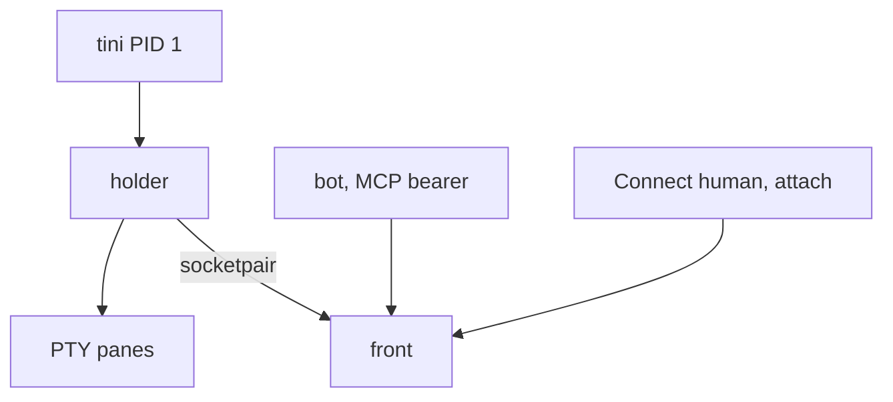

# ADR: Restart survival and shared panes

- **Status:** Proposed. Do not merge before the maintainer approves (§8).
- **Date:** 2026-11-14 (rescoped)
- **Author:** chaodu-agent
- **Related:** #66 (restart survival), #4 (client identity, scopes, audit; first PR #68 merged), `docs/adr/native-core.md`, openabdev/openab-pty#97 (what OpenAB Connect speaks).
- **Sources:** herdr-core c84d6e7 and Orca, as profiled in `.agents/tasks/arch-comparison/` (`profile-herdr.md`, `profile-orca.md`). Nothing was built or run for this ADR.

The maintainer answered #66: restart survival is a requirement (YES), humans and bots will share a pane, for example through OpenAB Connect (YES), and Claude Code and Codex will be supported (YES).

## 1. Trust model

Shepherd is used by one user on one OS account, like herdr-core and Orca's local desktop. Programs running in a pane are inside the trust boundary. This ADR does not defend against them. Remote MCP bots are separate principals: they get per-client tokens, scopes and audit (#68).

## 2. Context

One process does everything: HTTP/MCP, PTYs, VT emulator, guarded write, pane status. A restart ends every pane (`survives_restart: false`, `src/native/mod.rs`; `end_panes_on_exit_signals` in `src/main.rs`). `write_guarded` checks the screen and writes under one pane lock. That atomicity must stay.

Requirements: **R1** restarting or reloading the front, or changing a profile or client, does not end panes. **R2** a human can attach to a pane a bot is driving and type into it without the bot corrupting the input. **R3** Claude Code and Codex are supported. Structured hook approval for them is deferred (§5); until then R3 is only partially met until the hook ADR: the interim path in §5 (OSC 7501 or screen parsing where available, otherwise a human answers through attach).

## 3. Decision: holder and front

Copy herdr's holder (it owns every PTY, "spawn, pump, resize, signal, reap, no parsing, no policy", about 1 MiB output tail; core rebuilds its screens from the tail). Do not copy Orca's daemon, which holds a headless emulator, checkpoints history and does generation handover, and where its review history concentrates defects (profile-orca §10).

- **Holder** (`openab-shepherd hold`, child of `tini`). Per pane: spawn, write, resize, signal, kill, reap, a ~1 MiB output tail with a per-pane `seq`, and an opaque `meta` blob (set/get). It streams every output byte to the front and parses nothing. It spawns the front over an anonymous socketpair and respawns it with backoff; it never exits because the front failed. Protocol: length-prefixed frames, one integer `HOLDER_VERSION`, exact match. Ops: `spawn write resize signal kill list meta_set meta_get` (`list` returns each pane's cols/rows and tail range); events: `output(pane, seq, bytes)`, `exited(pane, status)`. An exited pane stays in `list` with its status until a front reads it, so no exit is lost while no front runs.
- **Front** (today's process minus PTY ownership). HTTP/MCP, #68 clients/scopes/audit, profiles, VT emulator, OSC 7501 status and turn, dialect parsers, guarded write, `answer_dialog`, watchdog, attach, lease and draft. The only code seam is a `PtyHost` trait: in-process impl for `MODE=single` and tests, holder client for the split. Tools and `TerminalBackend` are unchanged.
- **Guard stays atomic with no new protocol.** The emulator and the guarded write both stay in the front under the per-pane lock, so no screen digest crosses a process boundary. The holder hop widens the unfed-bytes window (output the PTY produced but the emulator has not consumed); the existing settle check in `write_guarded` covers it, and the replay and `replayed` rules in §3.1 cover the restart case. The holder never blocks PTY reads: if the front is slow or down, the holder keeps filling the tail and drops the stream, and the front catches up from the tail by `seq`.
- **`meta`** (front writes through on change): labels, agent kind, status, `turn`, `human_draft`. It keeps `turn` monotonic and the draft flag fail-closed across a front restart, and lives and dies with the panes. The front calls `meta_set` for `human_draft` before it forwards the human's byte to the PTY, so a crash between the two leaves the flag set, never missing. `turn` is stored together with `turn_seq`, the output `seq` at which it advanced, in the same `meta_set`.

### 3.1 Restart survival

- **Survives:** front crash, front restart, reload (SIGUSR2 to the holder), config, client and profile change. In-place front binary replacement (p1, macmini): replace the file, then send SIGUSR2 to the holder; panes survive while `HOLDER_VERSION` is unchanged. If it changed, the new front exits with a version-mismatch error, the holder logs it and keeps backing off (the bad-config case), and panes live until the holder is restarted.
- **Layout and service managers:** the holder is the unit's main process (under `tini` in pods). Stopping or restarting the service (`systemctl restart`, `launchctl kickstart`) stops the holder and ends the panes. No `KillMode` or `AbandonProcessGroup` tricks, and no separate holder unit. The supported front restart is SIGUSR2 to the holder, and `docs/operations.md` says so.
- **Ends panes:** service restart or stop, holder crash, holder upgrade, host reboot, pod rollout (a new image replaces the holder). Stated plainly, as herdr does. In a pod a front upgrade is a new image, so it ends panes too.
- **Adoption:** the new front reads `list` and `meta`, and replays each tail into a fresh emulator with the emulator's reply output discarded (DA, DSR, XTVERSION and mode queries in the tail must not be answered into the live PTY). The replay starts at the first line start in the tail; a cut escape sequence at the very start can leave one wrong cell, which the next repaint fixes. Replay is silent: it emits no OSC 7501 events and triggers no waits or watchdog. `turn` is restored from `meta`, and only output past `turn_seq` advances it, so a crash never double-counts a turn. Status is set from the last OSC 7501 state found in the tail (state only, no event); with a wrapped tail and none found, status is `unknown` until the first fresh event, so output produced while no front ran is never shown as stale `working`. Replay uses the pane's cols/rows, which the holder keeps per pane and returns in `list`.
  - **Accepted cost:** terminal queries (DA, DSR, XTVERSION) a program asks while no front runs go unanswered, because the holder parses nothing.
  - **Complete tail** (tail start is 0, so the tail is the pane's whole output): the emulator is exact and the pane is live at once.
  - **Wrapped tail** (tail start > 0, whatever the downtime): a fresh emulator misses modes set earlier (alt screen, scroll region, cursor), so the pane is `replayed`, guarded writes and `answer_dialog` are refused, and the front resizes the pane by one row and back once to make a TUI repaint. This adoption nudge is the only resize without a lease, and it runs only for a wrapped tail. A front that falls off the tail while running (slow front) takes the same path. The pane leaves `replayed` on the first output after the nudge. An idle shell does not repaint, so it stays `replayed` until any output arrives. A human keystroke through attach does it. A pane driven only by a bot, sitting idle at a shell prompt with a wrapped tail, therefore needs a human to touch it once; this is accepted, and the bot gets `pane_replayed` rather than a write against an unknown screen. A wrapped tail then costs a refusal, never a write against a wrong screen. Measure replay on Claude, Codex, Kiro and OpenCode fixtures before #66 closes; if a mode set before the tail window is missed, the front stores a mode snapshot in `meta`.
- **In flight:** `wait`s die with the front and clients retry. A `send` whose reply was lost has an unknown outcome; the bot rereads the screen. No idempotency receipts.
- **Bad config:** the holder keeps respawning the front with backoff. Panes are untouched, MCP is down, and the front logs the config error on every attempt. Accepted cost for one user.
- `tini` stays PID 1 in pods and reaps orphans. A holder crash closes the PTY masters, so panes get SIGHUP and end; no orphan sweep and no `panes.json`. Nothing restarts a crashed holder except the pod or service manager.

## 4. Decision: shared panes

All in the front, in memory. This is correctness, not security.

1. **Attach.** A first-paint snapshot of the emulator, then the raw byte stream with credit-based flow control (herdr's `terminal.attach`). Any number of read-only observers. Viewer-side terminal reports (DA, DSR, XTVERSION replies) are dropped, because the emulator already answers and a second answer corrupts the pane. Transport follows what openab-pty#97 already speaks (§8, Q1).
2. **Lease.** One human lease per pane. Human input without a lease is refused. `lease_acquire` waits on the pane input mutex so it never interleaves with a bot paste. Idle expiry 300 s.
3. **Refuse, never queue.** While a lease is held or `human_draft` is set, bot `send`, `keys`, screen-path `answer_dialog`, watchdog nudge, `interrupt_pane` and `remove_pane` are refused (`pane_human_controlled`, `pane_draft_pending`). The check runs inside `write_guarded`, so it is atomic with the write. A principal with `lease:preempt` may take the lease or run `draft_clear`.
4. **Draft.** Any human byte sets `human_draft`. It clears only on a human Enter through the lease or on `draft_clear`. Not on a turn advance (an agent finishing a bot-started turn says nothing about the fragment in the input) and not on a timer. Bots cannot hold `lease:preempt`, so a stale draft stalls bot input until a human returns or runs `draft_clear`. That is accepted: refusing is the safe side.
5. **Front restart.** Leases drop and the human re-acquires. The draft flag survives in `meta`, so a fragment is never submitted over.
6. **Geometry.** 200x120 until an attach. Only the lease holder resizes. Observers never do (§8, Q2).

Scopes added to #68: `attach`, `attach:write`, `lease:preempt`. Bots are simply not granted `attach:write` or `lease:preempt` in the clients file, and the legacy token holds none. This is configuration of who may take a lease, not a security claim.

**Kept from the earlier ADR:** `answer_dialog` is guarded and fails closed (it re-reads the styled screen and refuses unless the dialog and its subject match at write time); the token is never put in pane env; directories 0700, token and profile files 0600; audit lines carry counts and times, never keystrokes.

## 5. Decision: hook approvals leave this ADR

Moved to a later ADR, not an optional section here. Reasons: Orca's hook is Claude-only, held about 122 s, fails open to the agent's own dialog, and only observes for other agents; herdr has no approval engine ("status comes only from OSC 7501"). Neither makes hooks a prerequisite of R1 or R2. Nearly all of the earlier §5 existed to defend the hook channel from a pane, which §1 removes.

- **Interim for R3:** Claude and Codex report OSC 7501 `blocked` where they emit it (to be recorded, issue 3), otherwise `approval_via: screen_unsupported`, and a human answers through attach.
- **Seam:** hooks are a second evidence source inside the same `write_guarded` check, front-only, holder unchanged. `answer_dialog` can later take an optional `approval_id`. A later ADR should copy Orca's shape: fail open to the agent's own dialog, per-request never blanket, one open prompt per pane, never return `updatedInput`.
- **Not dropped:** a placeholder issue tracks it (Q5, issue 3), because the maintainer answered YES to Claude and Codex.

## 6. Non-goals

Not designed against, by decision. Each is a same-account attack and Shepherd has one account:

- `ptrace`, `pidfd_getfd`, `/proc/<pid>/environ` and `tini`'s environment; `PR_SET_DUMPABLE`, `fs.suid_dumpable`, pair-fd or fd-inheritance windows; `PT_DENY_ATTACH` and other macOS hardening.
- Socket squatting or a forged holder or front peer.
- Root-owned binaries or managed policy files; kernel-attested hook channels.
- A pane reading the token or profiles beyond 0600/0700 hygiene; a pane calling MCP with a token it found.
- A pane or compromised front forging `actor: human`; a trusted-versus-untrusted front.
- Pane output reaching the viewer's terminal (OSC 52, titles); resource exhaustion by a pane.
- Holder handover, scrollback on disk, cold restore, surviving holder crash or reboot.

**Possible later option, not designed.** If the trust premise changes (untrusted code in a pane, or several people), run pane programs in a container or under a separate UID with the holder outside. The holder is already the only parent of pane processes, so that is where such a boundary would attach.

## 7. Deleted from the earlier ADR, and what each cost

| Deleted | Cost |
|---|---|
| `KillMode=process` / `AbandonProcessGroup` service-restart survival | Restarting the service ends panes; only SIGUSR2 keeps them. |
| Owner holding emulator, guard, leases, drafts, approvals; `expect_screen`, digest, `digest_alg`, `read_styled` round trip | Screens are rebuilt after a front restart, not kept. Mitigated by tail replay, repaint and `replayed` fail-closed. |
| Idempotency receipts | A lost `send` reply has an unknown outcome; the bot rereads. Rare duplicate on blind retry. |
| `RemoteBackend` op set (`lease_*`, `approval_*`, events); N-1/N skew rule, `front_incompatible`, exit 3 | Holder is about 8 ops with an exact version match. Front and holder upgrade together. |
| 0711 binary, `PR_SET_DUMPABLE`, `suid_dumpable`, `pidfd_getfd` and pair-fd tests, token/profile protection and macOS analysis, no-control-socket analysis | None under §1 (non-goals). |
| `panes.json` orphan sweep | After a holder crash, pane processes end by SIGHUP; a process that ignores it can linger until the pod or host restarts. |
| `--check-config`, exit-code rules | Bad config is a log loop with MCP down while panes live. |
| Lease grace, `lease_resume`, the 12-row operation-by-state table | The human re-acquires after a front restart. Five rules replace the table. |
| Attach output filter (OSC, DCS, APC, CSI) | Pane output reaches the viewer, as in herdr. Only viewer-side terminal reports are dropped. |
| All of the earlier hook section, hook phase, handover phase, Q4, Q9, Q11, Q12 | No structured approval until the later hook ADR. R3 is deferred, not dropped. |

## 8. Open decisions for the maintainer

Where the two council reviewers still differed, this ADR picked the smaller option. Approve or override:

- **Q1. Attach transport.** WebSocket or chunked HTTP plus POST: follow whatever openab-pty#97 Connect already speaks. One choice, to be made in the shared-panes issue.
- **Q2. Resize authority.** One reviewer: last active viewer sets size (herdr). Other: only the lease holder resizes. Chosen: lease holder only, since a resize changes layout under a bot's dialog parser.
- **Q3. Link.** Chosen: anonymous socketpair, holder is always the parent of the front. Alternative: a named socket in a 0700 directory with a single writer, which is herdr's literal shape but brings stale-socket handling back.
- **Q4. Persisted pane state.** Chosen: `meta` inside the holder. Alternative: a front-written `registry.json`, which needs reconcile logic after a crash.
- **Q5. Placeholder hook issue.** Chosen: file it now, no work scheduled. Alternative: file nothing until someone asks.
- **Q6. Bad config.** Chosen: log loop with MCP down. Alternative: a fast container fail on first deploy, which needs `--check-config` back.

Issue drafts: `.agents/tasks/adr-restart/issues-draft.md` (three issues).

## 9. Consequences

Panes survive the process that changes most. Attach, lease and draft need no new boundary because the guard stays in one process. The cost is that a holder crash, reboot or pod rollout still ends panes. If holder upgrades later matter, handover can be added to a roughly 500-line holder without touching the front.

## 10. Links

- #66: https://github.com/openabdev/openab-shepherd/issues/66
- #4: https://github.com/openabdev/openab-shepherd/issues/4
- Architecture comparison inputs: `.agents/tasks/arch-comparison/`
