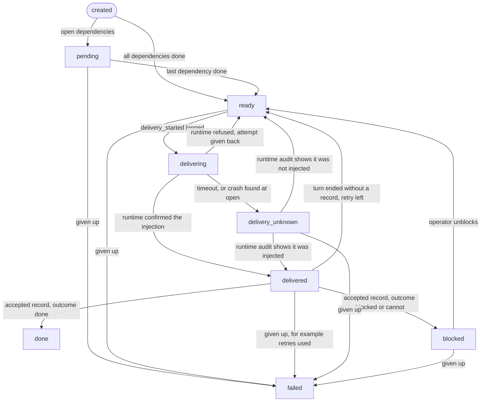

# Task ledger: on-disk format and guarantees

The ledger records what was dispatched to which worker session, in which state, and whether that
worker reported the work complete. It is a self-contained component: no network, terminal or
tool-protocol code, and no reference to anything outside its own module (`src/ledger/`). Its
public surface is the types and functions re-exported from `ledger`.

It is not wired into any running code. Nothing in the server creates a ledger or reads one.

## What a dispatch is

| Field | Meaning |
|---|---|
| `id` | Opaque, unique, stable across retries. Letters, digits and `. _ : -`, at most 128 bytes |
| `content` | SHA-256 and byte length of the text to type. The text is never stored |
| `owner` | The one worker session the dispatch is delivered to and completed by |
| `created_by` | A short code naming who created it |
| `depends_on` | Dispatches that must be `done` first. They must already exist, so a cycle cannot be written |
| `attempt` | The open attempt: deliveries that may have reached the worker. 0 before the first |
| `max_retries` | Redeliveries allowed after the first. Attempts allowed: `max_retries + 1` |
| `state` | See below |
| `created_at`, `updated_at`, `delivered_at` | Milliseconds since the Unix epoch, from an injected clock |

## States



`delivering` exists only between two log writes. The only ways out of `delivery_unknown` are the two
runtime answers above, or `failed`. The ledger never re-injects from it on its own, because a second
injection would run the same text twice.

## The log

One file, JSON Lines, append-only, mode 0600, held under an exclusive advisory lock so a second
writer cannot interleave records. One record per line:

```json
{"at":5,"content_len":3,"content_sha256":"ba78...15ad","created_by":"operator","depends_on":[],"id":"d1","max_retries":2,"owner":"s1","seq":1,"type":"created","v":1}
```

- `v` is the format version, 1.
- `seq` starts at 1 and rises by exactly 1. A gap is corruption.
- `type` is one of the event names below; `at` is the time of the event.
- A record exists only if its terminating newline was written.

| `type` | Fields besides the envelope | Effect |
|---|---|---|
| `created` | `id`, `content_sha256`, `content_len`, `owner`, `created_by`, `depends_on`, `max_retries` | `pending` or `ready` |
| `delivery_started` | `id`, `attempt`, `request_id` | `ready` to `delivering`, attempt rises by one |
| `delivered` | `id`, `attempt` | `delivering` or `delivery_unknown` to `delivered` |
| `delivery_refused` | `id`, `attempt`, `reason` | `delivering` to `ready`, attempt given back |
| `delivery_unknown` | `id`, `attempt`, `reason` | `delivering` to `delivery_unknown` |
| `delivery_not_injected` | `id`, `attempt` | `delivery_unknown` to `ready`, attempt given back |
| `retry_requested` | `id`, `attempt` | `delivered` to `ready`, only while a retry is left |
| `record_accepted` | `id`, `attempt`, `session`, `outcome`, optional `summary_sha256` and `summary_len` | `done`, or `blocked` for outcomes `blocked` and `cannot`. Closes the attempt |
| `record_rejected` | `claimed_id`, `claimed_attempt`, `claimed_session`, `reason` | None. Evidence only. Claimed strings are cut to 128 characters |
| `unblocked` | `id` | `blocked` to `ready` |
| `failed` | `id`, `reason` | `failed`. Final |

Write order: every event is validated against the current state, appended and synced, and only then
applied in memory. A caller performs the effect an event describes after the call that logs it
returns, so `delivery_started` is on disk before anything is typed.

## Replay and recovery

The state is derived from the log and from nothing else. Replay reads complete lines in order,
checks `v` and `seq`, and applies each event through the same transition code the live path uses.
Replaying the same bytes always gives the same state.

- **Torn final record.** Bytes after the last newline are a write that did not finish. Open cuts
  them off and reports how many. A record is never half-applied.
- **Corruption.** A complete line that is not valid JSON, has the wrong `v` or `seq`, names an
  unknown event, or does not fit the state, is an error. The ledger refuses to open and does not
  guess. This includes a `record_accepted` event that the matching rule would not accept: a forged
  `done` in the file does not replay.
- **Crash between `delivering` and `delivered`.** At open, each dispatch left in `delivering` gets a
  `delivery_unknown` event with reason `recovered_after_restart`. It is never moved to `ready` or
  `done` by recovery. A second open finds nothing to repair.

## The matching rule for a worker record

A record is accepted only if all of these hold. The first check that fails is the recorded reason.

1. It names an existing dispatch (`unknown_dispatch` otherwise).
2. Its session, as stamped by the transport and never read from the message body, is the dispatch's
   `owner` (`wrong_session`).
3. No accepted record closed that attempt before, and the dispatch is not `done` (`already_closed`).
4. It names the open attempt: not an older one (`stale_attempt`), not one never delivered
   (`future_attempt`).
5. The dispatch is in `delivered` (`not_delivered`). Because `delivered` is entered only through a
   logged event, a record cannot satisfy a dispatch before its delivery was logged.

A rejected record is appended as `record_rejected` with the reason. It changes no dispatch. There is
no "latest record wins" and no fallback to any other signal. The rule is the pure function
`match_record`.

## Failure policy

If the log cannot be written or synced, the operation returns an error and the in-memory state does
not change. The ledger then refuses every further write until it is reopened, because after a failed
sync the file may or may not hold the record. Reads keep working. A write that fails part way is cut
back by the file backend where it can be. A record whose sync failed may still be on disk, so after
a reopen it can replay as if it had been accepted. The file backend also refuses to append after a
failed sync.

## What this guarantees, and what it does not

`worker_done` is the agent's own claim. The ledger cannot know whether the work was done.

It does guarantee, given a correct transport:

- A record for another dispatch, an earlier attempt, a different session, a second record for the
  same attempt, or a record before delivery never moves a dispatch to `done`.
- A dispatch interrupted between the intent to inject and its confirmation is never treated as
  delivered, not delivered, or complete without an answer from the runtime.
- Every rejected record leaves a trace in the log.
- State survives a crash and restart, up to the last record whose append returned success. A record
  whose append returned an error may or may not be in the log after a reopen.

It does not guarantee:

- That the work is complete or correct. A session that holds its own credentials can claim `done`
  for its own current dispatch, and the ledger will accept it. Turning the claim into evidence needs
  a check outside the agent, which this component does not include.
- That the session identity is true. It is whatever the caller passes; protecting it is the
  transport's job.
- Protection against someone who can write the file. The log is accountability, not tamper-proofing.
- Anything about the text of a dispatch. Only its hash and length are stored.

## Storage

The log sits behind the `Store` trait: load all bytes, append one record durably, truncate. The file
backend, `FileStore`, is the only implementation. Another backend must keep the same contract: an
append that returns success is durable, and one that fails is treated as not written.
