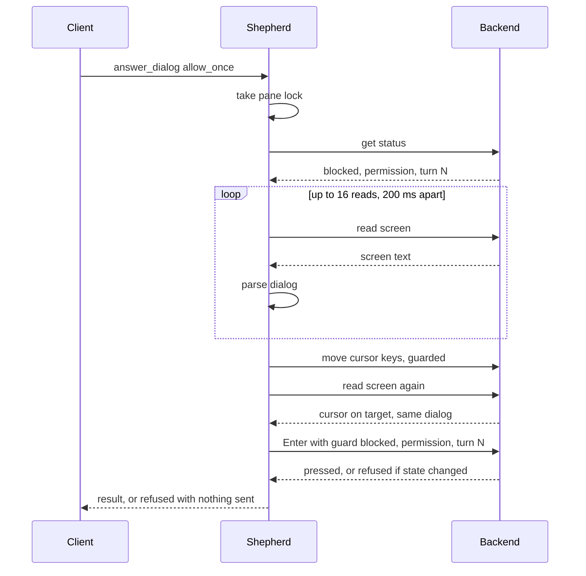
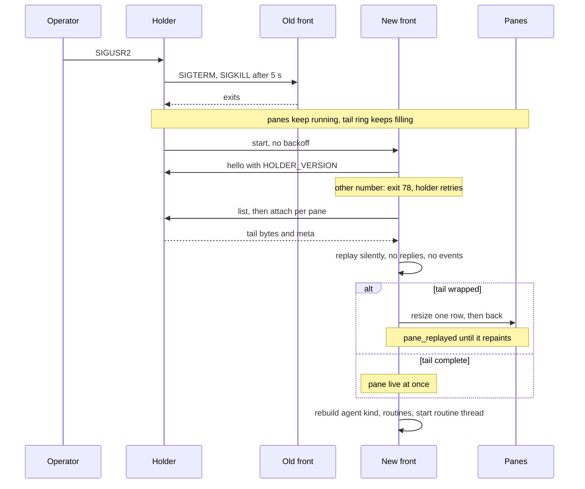

# OpenAB Shepherd: operations reference

This is the operator reference: how to run the server, its environment variables,
launch profiles, the tools, the backends, the Host check and the token rules. For
the overview, see the [README](../README.md). For what Shepherd does and does not defend
against, see the [trust model](adr/trust-model.md).

Shepherd is an MCP server that exposes terminal panes as MCP tools. It listens on
loopback only and requires a bearer token. The panes are run by a terminal backend
behind a trait (see [Terminal backend](#terminal-backend)): the native core is the
only backend. Status: MVP. Test and probe results are in
[`MVP-REPORT.md`](../MVP-REPORT.md), a dated record rather than a current status.

## Language: Rust

- Shepherd is written in Rust. Build it on any machine with the pinned Rust toolchain
  (see `rust-toolchain.toml`).
- The release build is one native binary with no interpreter or virtualenv to
  manage on the machine that runs it.
- `serde_json` parses and emits JSON-RPC. `tiny_http` provides the HTTP listener.
  The native core adds `libc` and `vt100` (pinned to `=0.18.1`), and `sha2` hashes
  client tokens. Five direct dependencies in total.

## MCP SDK or hand-written: hand-written

The MCP surface this server needs is small: `initialize`, `notifications/initialized`,
`ping`, `tools/list`, and `tools/call`, over HTTP POST with JSON replies. `src/mcp.rs`
and `src/http.rs` implement it, and unit tests exercise both.

An official Rust MCP SDK was not used: its current API was not checked offline, and
its streaming and session features are unused here. Replacing this layer with an SDK
later is a contained change.

## Layout

| File | Purpose |
|------|---------|
| `src/main.rs` | Arguments, startup, exit codes (a thin binary over `src/lib.rs`) |
| `src/config.rs` | Bind check, token source and location check, backend choice, socket path |
| `src/profiles.rs` | Launch profiles: parsing, the cwd allowlist, env sources (`keychain:`, `env:`) |
| `src/input.rs` | Input rules for text sent to panes |
| `src/ansi.rs` | Escape-sequence filter for pane output |
| `src/backend.rs` | The `TerminalBackend` trait and Shepherd's own types: `TerminalInfo`, `ProgramStatus`, `Capabilities`, `InputGuard`, `BackendError`, ... |
| `src/native/mod.rs` | `NativeBackend`: pane table, reader and reaper threads, guarded writes, the trait impl |
| `src/native/term.rs`, `status.rs`, `keys.rs` | The `vt100` emulator and query replies; OSC 7501 parsing and turns; key encoding |
| `src/native/host/pty.rs`, `procs.rs` | PTY spawn and child env; the process table and descendant tree used by cleanup |
| `src/native/host/` | The process half, behind the `PtyHost` trait: `local.rs` (PTYs and process trees in this process), `tail.rs` (the per-pane tail ring), `wire.rs`, `server.rs` and `client.rs` (the holder link), `supervisor.rs` (`hold`), `front.rs` (what `front` does at start) |
| `src/native/meta.rs`, `replay.rs` | The per-pane record the front keeps in the holder, and silent replay of the tail on adoption |
| `src/native/tests.rs` | Test-only: native tests with real programs |
| `examples/native_probe.rs` | The real-Kiro probe for the native backend |
| `examples/native_leak_check.rs` | Real-Kiro leak check: removes a pane and verifies no descendant process survives (issue #10) |
| `examples/record_tail.rs` | Records a program's raw output and final screen as a replay fixture (user-run; see [Restart survival](#restart-survival)) |
| `src/tools.rs` | The fourteen tools (the ten pane tools and the four `routine_*` tools), their schemas, the safety rules, and the backend calls each one makes |
| `src/routine.rs` | The per-pane routine state and its nudge decision (the tools run its thread) |
| `src/dialog.rs` | Text parser for the kiro-cli permission dialog |
| `src/devin_dialog.rs` | Text parser for the Devin CLI permission dialog |
| `src/opencode_dialog.rs` | Text parser for the OpenCode permission dialog and the styled-cell highlight check |
| `src/agent.rs` | The agents a profile can name (`kiro`, `devin`, `opencode`), their dialects, and `permission_mode` |
| `src/panelock.rs` | The per-pane lock that serializes calls typing into one pane |
| `src/mcp.rs` | MCP message handling |
| `src/http.rs` | Loopback Host check, bearer auth, POST handling |
| `src/clients.rs`, `src/audit.rs` | Clients, scopes and token checks; the audit log |
| `src/registry.rs`, `src/shared_panes.rs`, `src/tool_flows.rs` | The tools layer's per-pane records (rebuilt after a restart), the shared-pane refusals, shared tool flows |
| `src/routine_model.rs`, `src/schedule.rs` | Agent-created routines: the record and its limits; the `every` schedule |
| `src/native/human.rs`, `src/native/lease.rs` | The input lease, the draft flag and the lease holder's resize |
| `src/native/host/contract.rs`, `held.rs`, `mod.rs` | The `PtyHost` contract and the holder's per-pane state |
| `src/testutil.rs` | Test-only helpers: scratch dirs, git init, an in-memory `FakeBackend` |

## Run

Build the release binary (see Build offload).
Create the token file outside any git repository:

```sh
umask 077
openssl rand -hex 32 > <token-file>
chmod 600 <token-file>
```

Start the server. It runs panes on its own native terminal core, the only backend
(see [Native backend](#native-backend)). `OPENAB_SHEPHERD_BACKEND` may be unset,
empty or `native`; it needs nothing else.

The command below is documentation for the operator. The operator runs it by hand,
outside the agent's command guard. No script in this crate runs it.

```sh
OPENAB_SHEPHERD_TOKEN_FILE=<token-file> \
OPENAB_SHEPHERD_PROFILES=<profiles-file> \
./openab-shepherd --port 8765
```

Without `OPENAB_SHEPHERD_PROFILES` the server has no launch profiles and allows no
arbitrary commands, so `start_pane` starts nothing (see
[Launch profiles](#launch-profiles)).

- Endpoint: `http://<loopback-address>:8765/mcp`, where `<loopback-address>` is the
  address given to `--host` (IPv4 loopback by default). Every request sends
  `Authorization: Bearer <token>`.
- `--host` accepts only the literal IPv4 loopback address (the default) or the literal
  IPv6 loopback address. Any other value, including the all-interfaces wildcard
  address and the name `localhost`, exits with status 2 before anything listens.
- No token, both token variables set, a token shorter than 16 characters, an
  `OPENAB_SHEPHERD_BACKEND` that is set to anything other than empty or `native`
  (including `hc`, which was removed) also exit with status 2. The reason goes to
  stderr.
- Token variables: `OPENAB_SHEPHERD_TOKEN_FILE` (preferred) or `OPENAB_SHEPHERD_TOKEN`.
  Use one of them, not both.
- `OPENAB_SHEPHERD_CLIENTS` (clients file) and `OPENAB_SHEPHERD_AUDIT_FILE` (audit
  log): see [Clients, scopes and the audit log](#clients-scopes-and-the-audit-log).
  A clients file without an audit file, or beside `OPENAB_SHEPHERD_TOKEN`, exits with
  status 2.
- A launch profiles file that is unreadable, inside a git repository, or invalid
  also exits with status 2.
- An invalid `OPENAB_SHEPHERD_ALLOWED_HOSTS` entry also exits with status 2 (see
  [Behind tailscale serve](#behind-tailscale-serve)).
- The startup line names the backend: `(backend: native)`.

### Token file rules

- The file must be mode 0600 or stricter (no group or other bits).
- It must not be inside the project folder (the folder the server starts from),
  and it must not be inside any git repository that the project folder or the
  token's own folder belongs to. Repository roots come from
  `git rev-parse --show-toplevel`. If git cannot be run, or fails for another
  reason, the server refuses to start.

### Launch profiles

`start_pane` starts what the operator's launch profiles allow. The file is JSON, named
by `OPENAB_SHEPHERD_PROFILES`, and follows the token file's location rule: outside
the project folder and outside any git repository (symlinks resolved first). It must
also be a regular file owned by the user Shepherd runs as and writable by no one else
(`chmod 600` or `644`); Shepherd checks and reads the same open file. Otherwise
Shepherd refuses to start.

Without a profiles file, `start_pane` refuses every start with `profile_required`. Create a
profiles file with the programs you start, or set `"allow_arbitrary_command": true` in it
to allow caller-chosen `argv`/`line` (without credentials). The file holds at most 64
profiles and is at most 1 MiB.

```json
{
  "allow_arbitrary_command": false,
  "profiles": [
    {
      "name": "kiro",
      "argv": ["kiro-cli", "chat"],
      "extra_args": ["--trust-workspace"],
      "cwds": ["/path/to/work"],
      "env": { "KIRO_API_KEY": "keychain:<keychain-item>" }
    },
    {
      "name": "devin",
      "agent": "devin",
      "argv": ["devin"],
      "cwds": ["/path/to/work"]
    }
  ]
}
```

- `name`: the pane-name rules (1-32 of `a-z`, `0-9`, `-`, `_`, `.`); unique.
- `argv`, then `extra_args` (optional): the fixed program and arguments. A caller
  cannot change or replace them; a client that holds `start:args` may append flags
  after them with the call-level `extra_args` (see
  [Call-level `extra_args`](#call-level-extra_args-for-a-profile-start); this key is
  the operator's, that one is the caller's). `argv[0]` is a program name or an absolute path, not a
  relative path. A name is looked up when the pane starts, before any credential is
  read, in Shepherd's `PATH` (default `/usr/bin:/bin:/usr/sbin:/sbin`), skipping empty
  and relative entries such as `.`, so the caller's `cwd` never decides which
  executable gets the profile's environment. The pane runs that absolute path (its
  `argv` shows it); no executable found fails `start_pane` with `not_found`.
- `cwds`: 1 to 32 absolute directories, which must exist at startup. A caller's
  `cwd` must resolve (symlinks and `..` resolved) to one of them or a directory
  below one; without `cwd` the first is used. The pane runs in the resolved path.
- `env` (optional, at most 32): variables for this profile's panes only. A name is
  `[A-Z_][A-Z0-9_]*` and may not be `TERM`, `PATH`, `SHEPHERD_PANE`, `DYLD_*`, `LD_*`,
  `OPENAB_SHEPHERD_*` or `HC_*`. A value
  is one of:
  - `keychain:<service>`: read when the pane starts with
    `/usr/bin/security find-generic-password -s <service> -w` (clean environment,
    10 s limit). macOS only; elsewhere the file is refused. Create the item with
    `security add-generic-password -s <service> -a "$USER" -w` (it prompts).
  - `env:<NAME>`: copied from Shepherd's own environment when the pane starts. It may
    not name `OPENAB_SHEPHERD_*` or `HC_*`.
  - anything else: a literal, for **non-secret settings only**; it sits in the file.

  A value read from a source goes only into that child's environment. It is never
  written to the config, state, logs, argv, tool results or errors; an error names
  the variable and its source, not the value. A source that cannot be read fails
  `start_pane` with `profile_unavailable`, and nothing starts.
- `allow_arbitrary_command` (default false): when true, `start_pane` also takes a
  caller-chosen `argv` or `line` (and `env`). Such a pane never gets a profile's
  environment, whatever program it runs. A caller can also declare which agent that
  program is with `start_pane`'s `agent` field (see [Declaring an agent](#declaring-an-agent-for-an-argv-or-line-pane)).
- `agent` (optional, default `kiro`): `kiro`, `devin` or `opencode`. It decides which permission
  dialog `answer_dialog` reads for panes this profile starts, and, for `devin`, the
  launch flag below. For `opencode`, `answer_dialog` sends Esc for `deny_once` and presses Enter for `allow_once` only after
  it verifies the highlight from styled cells (see [opencode.md](opencode.md)), and its profiles must use `permission_mode` `normal`. A pane started any other way has no agent (unless an `argv` or `line` start declares one, see [Declaring an agent](#declaring-an-agent-for-an-argv-or-line-pane)), so `answer_dialog`
  refuses it with no keys sent. Panes started before this Shepherd process have no
  record of their agent, so they are refused too.
  A profile whose `argv` or `extra_args` names `opencode` (case-insensitive substring) and contains an auto-approve spelling (`--auto`, `autoaccept`, `auto-accept`) is refused at load. This prevents accidental configuration; it does not defend against a renamed binary, a wrapper script, or `allow_arbitrary_command`.
  `send_input` refuses `/yolo` (trimmed, case-insensitive) on a Devin pane, because it may switch to Bypass mode. This is a name-based check against accidental use, not a defense against a different spelling or a wrapper.
- `permission_mode` (optional, default `normal`): what the agent may do without
  asking.
  - `normal`: a `devin` pane runs `devin --permission-mode auto`. Shell commands and
    writes ask for approval. A `kiro` pane gets no flag; its arguments are its own
    `argv`.
  - `accept-edits`: `devin` only, `devin --permission-mode accept-edits`. Refused for
    `kiro`, because no Kiro mode was measured.
  - `bypass`: `devin` only, `devin --permission-mode dangerous`, which approves every
    tool. It is never a default: a profile must say `"permission_mode": "bypass"`.
    For `kiro` it needs `"allow_bypass": true`, and Shepherd adds no flag: the Kiro
    arguments in `argv` still decide trust. kiro-cli 3.3.0 has `-a` /
    `--trust-all-tools`; `permission_mode` does not add it, and a profile may carry `-a`
    whatever its `permission_mode` says. See
    [Kiro `-a` (trust all tools)](#kiro--a-trust-all-tools).
- `allow_bypass` (optional, default false): lets a `kiro` profile declare
  `permission_mode` `bypass`. It has no effect on a `devin` profile.
- `routine` (optional): a timer-driven nudge for unattended panes that stop with work
  left; off unless set. Scenario, fields and limits are in
  [routine.md](routine.md).
- `dynamic_routines` (optional): lets an MCP client with the `routine` scope create
  routines on this profile's panes with `routine_create`. An object with three optional
  keys, `min_every_secs` (60 to 604800, default 600), `max_per_pane` (1 to 10, default
  3) and `max_expires_secs` (3600 to 2592000, default 604800); `{}` uses the defaults.
  Absent means off: `routine_create` is refused with `routines_not_allowed` and nothing
  else changes. It may be set without `routine`. An older Shepherd refuses a profiles
  file that uses the key (unknown keys are errors). See
  [Agent-created routines](routine.md#agent-created-routines).
- A `devin` profile's directory must already be trusted in Devin. On a fresh directory
  Devin asks "Do you trust the authors of this directory?". Shepherd never answers
  that prompt. `start_pane` reads the screen for about 3 s after the start, closes the
  pane and returns `trust_prompt` when it shows. Trust the directory once (run `devin`
  there and choose `1`), then start the pane again. A prompt that appears after the
  window is not detected; `answer_dialog` then finds no dialog and refuses.
- A `devin` profile may not put `--permission-mode` (or `--permission-mode=`) in
  `argv` or `extra_args`, or set `DEVIN_PERMISSION_MODE` in `env`. The mode is set
  in one place only, so the Devin config file cannot change it: Devin's flag takes
  precedence over its own config, and `normal` passes `auto` explicitly for that reason.
  It may not set `--respect-workspace-trust` either (any value): that flag turns off the
  trust check Shepherd relies on for `trust_prompt`.
- Unknown fields are refused, so a typo cannot silently drop a restriction.
- `list_panes` returns `profiles` (each profile's `name` and `cwds`, never its argv or
  env) and `allow_arbitrary_command`, so a caller can see what it may start.
- Programs a profile's pane runs (Kiro's tools, for example) inherit its
  environment. A profile's credential is as exposed as anything that program does.

For how the operator signs in to the coding CLI or supplies its key, see
[credentials.md](credentials.md).

### Kiro `-a` (trust all tools)

kiro-cli 3.3.0 accepts `-a` / `--trust-all-tools`. Shepherd passes it through like any
other argument in a profile's `argv` or `extra_args`, or in a call-level `extra_args`
([below](#call-level-extra_args-for-a-profile-start)), and does not police it; the Kiro
arguments decide trust. `permission_mode: bypass` with `allow_bypass: true` adds no
flag, so the label and the real behaviour can disagree. (Measured on 3.3.0: with `-a`
no `requires approval` dialog appears and the status never reports `blocked`; 3.3.0 is
the version in the container image.)

**Every `-a` start shows a warning first, unless the operator has persisted the choice.**
Kiro prints "Warning: Kiro is running in trust all tools mode" with the choices
`No, exit` (the default), `Yes, I accept` and `Yes, and don't ask again`. Kiro does not
report it as blocked: the status stays `idle`. Typed text is ignored and Enter picks
`No, exit`, which ends the session. The warning also appears with `--trust-all-tools`
spelled out, and with `-a` plus an agent that trusts nothing. (Measured on 3.3.0, the
version in the container image.)

Shepherd never answers this warning. Instead `send_input` (and a routine nudge) refuses
with `pane_needs_trust_acceptance` and types nothing, when all of these hold: the pane is
a Kiro pane, it has not finished a turn (`turn` is absent or 0), its status is `idle`, and
the visible screen shows both the title phrase `trust all tools mode` and the dialog's
`No, exit` option line. The pane stays open. A person attaches, accepts the warning, and
then `send_input` works. The check reads the screen once per send until the first turn,
and not at all afterwards. It refuses only on a positive match: a blank screen (a send
right after the start can beat the first render), a backend without screen text, a failed
read, or the phrase alone (typed text, a restored transcript) all send as before. After
the warning is accepted the phrase is gone within a second and never returns; the footer
then reads `Trust All Tools active, confirmations are off`, which the guard does not match.

What Kiro remembers (measured on 3.3.0):

- `Yes, and don't ask again` writes `chat.disableTrustAllConfirmation: true` to
  `$HOME/.kiro/settings/cli.json`. The next `-a` launch with the same HOME starts at the
  prompt with no warning, and an unattended pane can type into it at once.
- `Yes, I accept` persists nothing: the file stays empty and the warning returns on every
  launch.
- The setting belongs to the HOME, so it covers every Kiro started with that HOME. It
  removes the only human gate on the `-a` warning there. Setting it is an operator
  decision that Shepherd never makes.

To run an unattended `-a` pane that Shepherd can restart, set the key once in the HOME the
pane's Kiro uses: start Kiro with `-a` in a disposable HOME and a disposable directory,
choose `Yes, and don't ask again`, and start the pane with that HOME. (The dialog's
third option is the way measured to set the key; writing the file by hand was not
tried.) The HOME must survive a restart, or the warning comes back; then the guard refuses and the pane is
unavailable but not damaged. Where the key is not set, accept by hand: start the pane,
attach, choose `Yes, I accept`, detach.

- The risks of an unattended trust-all pane: a routine nudge into it runs anything with
  no gate; there is no `answer_dialog` audit record for what the model runs (only the
  `send_input` text is audited); Kiro's tools inherit `KIRO_API_KEY`. Pair such a profile
  with a disposable `cwd`, a small `max_consecutive_nudges` and no `dynamic_routines`.
- The test fixture for the warning screen
  (`tests/fixtures/kiro-3.3.0/trust-all-warning.screen.txt`) is the screen measured on
  Kiro 3.3.0.

### Routine (optional, per profile)

A routine is a proactive client inside Shepherd: a timer thread that types a profile's
`nudge_text` into an unattended pane whose finished turn sits idle, with limits and a
stderr log. It is off unless a launch profile sets a `routine` section. The scenario,
fields, limits and flowchart are in [routine.md](routine.md).

A second kind, the agent-created routine, types a fixed line into a pane every N seconds
and is made through the `routine_*` tools. It is off unless the pane's profile sets
`dynamic_routines`. See [Agent-created routines](routine.md#agent-created-routines).

## Tools

Panes are identified by **name**: pass the name `start_pane` returned as `terminal`
to every other tool. Every pane Shepherd starts has one: give `start_pane` a `name`,
or Shepherd picks `pane-` plus 12 hex digits and returns it. The backend's own
reference (an internal id) stays inside Shepherd, where the pane lock keys
on it; pane objects do not carry it. A pane started outside Shepherd without a name
is listed by `list_panes` with `name: null` and cannot be addressed through Shepherd.

Every tool that takes `terminal` first resolves it with a `get`, and goes on only if
the pane found carries exactly that name. A call naming an internal id, whether of an
unnamed pane or of a named one, fails with `not_found` and nothing else reaches the
backend. Calls after the lookup use the pane's internal id. `send_input`,
`interrupt_pane`, `answer_dialog`, and `remove_pane` resolve the pane twice (see
[Pane lock](#pane-lock)). The implementing function is in
`src/tools.rs`; the backend calls are the `TerminalBackend` trait methods listed in
[Terminal backend](#terminal-backend).

| MCP tool | Backend calls | Parameters | Result |
|----------|---------------|------------|--------|
| `start_pane` | `run` | `profile` (a [launch profile](#launch-profiles)), `cwd` (one the profile allows), `name` (optional; generated when missing), `extra_args` (optional list of flags appended after the profile's arguments; needs `start:args`, see [Call-level `extra_args`](#call-level-extra_args-for-a-profile-start)); or, only with `allow_arbitrary_command`, `argv` or `line` (exactly one), `agent` (optional: `kiro`, `devin` or `opencode`), `cwd`, `name`, `env` (optional object, this pane only) | a [pane object](#pane-object) |
| `send_input` | `get` (twice), `send` | `terminal`, `text` | `terminal`, `turn`, `started`, `status` (a state word or null); on refusal, error `pane_blocked` with `kind` |
| `read_output` | `get`, `read` | `terminal`, `lines` (0 to 10000) | `text` (escapes stripped), `complete`, `source` (`screen`, `history`, `stitched`, or `other`), `reason` (why only the screen was read: `blocked`, `other`, or null) |
| `get_status` | `get` | `terminal` | a [pane object](#pane-object) plus `terminal` |
| `wait_status` | `get`, `wait`, then `get` if it ended blocked without a kind | `terminal`, `timeout` (1 to 1800 s, default 30) | `terminal`, `outcome`, `turn_complete`, `ended`, `reason`, `status` (a state word), `kind`, `exit_code`, `turn`, and `status_now` when the extra `get` ran |
| `list_panes` | `list` | `all` | `panes` (pane objects), `hidden_finished` (finished panes left out; null if the backend does not say), `live_panes` (running panes now), `live_pane_limit` (how many may run at once: 8 on the native backend; null for a backend with no limit), `profiles` (`name` and `cwds` of each launch profile), `allow_arbitrary_command` |
| `interrupt_pane` | `get` (twice), `interrupt` | `terminal`, `timeout` (1 to 60 s, optional) | `terminal`, `key` (the stop key the backend chose: `esc`, `ctrl+c`, or `other`), `outcome` (`stopped`, `exited`, `still_working`, `unknown`, or `other`) |
| `answer_dialog` | `get`, `read`, `keys` | `terminal`, `choice` (`allow_once` or `deny_once`) | `terminal`, `choice`, `selected`, `title`, `command`, `options`, `moves`, `keys_result` (`status`, `turn`) |
| `remove_pane` | `get` (twice), `remove` | `terminal`, `timeout` (0 to 60 s, default 2: the grace before the kill) | `name`, `was_live` (the program was running), `stopped` (`exited`, `killed`, `other`, or null when it had already finished), `exit_code` (128 + the signal number when a signal ended it; null when unknown). See [remove_pane](#remove_pane) |
| `draft_clear` | `get`, then the person side's `draft_clear` (no pane lock: it types nothing) | `terminal` | `terminal`, `cleared` (whether a draft was set). Needs the `lease:preempt` scope. See [draft_clear](#draft_clear) |
| `routine_create` | `get` | `terminal`, `trigger` (`{"type": "every", "every_secs": N}`), `text`; optional `todo_file`, `expires_secs`, `max_runs` | `routine` and `ceiling`. Needs the `routine` scope and a profile with `dynamic_routines`. See [routine.md](routine.md#agent-created-routines) |
| `routine_list` | `get` when `terminal` is given | `terminal` (optional) | `routines`: the agent routines and the profile's read-only idle routine (`id` `profile`). Needs the `routine` scope |
| `routine_update` | `get` | `terminal`, `id`, and at least one of `every_secs`, `text`, `todo_file`, `expires_secs`, `max_runs` | `routine`. Needs the `routine` scope |
| `routine_delete` | `get` | `terminal`, `id` | `terminal`, `id`, `deleted`. Needs the `routine` scope |

Tool results carry `structuredContent` and a text copy. Unknown tool names are
JSON-RPC errors.

Every word field in a result (`status`/`state`, `source`, `reason`, `key`,
`outcome`) uses Shepherd's own words only. A word the backend sends that Shepherd
does not know is reported as `other`, never verbatim. `wait_status`'s `reason` is
null when the backend gave none.

### Pane object

`start_pane`, `get_status`, and each entry of `list_panes` return the same shape.
This replaced the herdr-core terminal object that earlier versions passed through
unchanged (a breaking change of the result shape; no client depended on it).

| Field | Meaning |
|-------|---------|
| `name` | The pane's name. Null only for a pane started outside Shepherd without one |
| `live` | False once the program has ended |
| `exit_code` | The exit code once ended, else null |
| `status` | `{state, kind}`, or null if the program never reported a status (or has ended). `state` is `idle`, `working`, `done`, `blocked`, `error`, or `other` (a word Shepherd does not know). `kind` is set only for `blocked`: `permission`, `question`, `auth`, or `other` (a dialog kind Shepherd does not know) |
| `reported` | Whether the program ever reported a status (OSC 7501) |
| `turn` | Goes up each time the status leaves `working` |
| `status_ms` | When the status last changed, ms since the epoch |
| `argv`, `cwd` | What it was started with, when the backend says |
| `human` | Only on `get_status` and `list_panes` entries, and only while a person is at the pane: `{lease, draft}`. `lease` is null or `{holder, idle_secs, expires_in_secs}`; `draft` is whether they typed and have not pressed Enter. The field is left out when there is neither, and on a server where nobody can take a lease, so output there is unchanged |

### Errors

A tool failure returns `isError: true`. The text is `<code>: <message>`, and
`structuredContent` always holds `error` (the code) and `message`, plus details that
depend on the code (`terminal`, `kind`, `next`, ...). Codes and messages are
Shepherd's own. The backend's original error text is kept only in `backend_detail`,
for debugging; do not parse it.

| Code | When |
|------|------|
| `invalid_input` | An argument failed validation (nothing was sent), or the backend refused the request's parameters |
| `pane_needs_trust_acceptance` | `send_input` (or a routine nudge) was refused because a Kiro pane that has not finished a turn shows Kiro's trust-all-tools warning. Nothing was typed: Enter there chooses `No, exit` and ends the session. Shepherd never answers this dialog; the pane stays open. A person attaches and accepts it, or the pane is started without `-a`. See [Kiro `-a`](#kiro--a-trust-all-tools) |
| `pane_blocked` | Typing was refused because the program is blocked on a dialog; nothing was typed. `kind` names the dialog (for example `permission`) when known; `next` says to read the screen, then use `answer_dialog`; for `kind=auth`, `next` says to tell the operator, who must log in |
| `not_found` | No pane is named `terminal` (a backend address is not a name); for `start_pane`, the program or working directory was not found |
| `name_taken` | `start_pane` with a name that is already in use (or, rarely, a generated name that collided; retry) |
| `status_mismatch` | A backend-side input condition did not hold; nothing was sent |
| `pane_finished` | The pane's program has ended |
| `pane_replayed` | The pane was picked up by a new server after a restart and its screen is not yet trusted, so nothing was typed. Refused for `send_input`, `answer_dialog` and the routine's nudge. It clears when the program repaints; see [Restart survival](#restart-survival) |
| `pane_human_controlled` | A person holds the pane's input lease, so nothing was typed. Refused for `send_input`, key presses (`answer_dialog`), `interrupt_pane`, `remove_pane` and the routine's nudge, and never queued: look again later. `idle_secs` and `expires_in_secs` say how long the person has been quiet and when the lease ends if they stay so (300 s without input). No client can take a lease yet, so a server started as before never answers this. `draft_clear` does not end a lease |
| `pane_draft_pending` | A person typed into the pane and has not pressed Enter, so nothing was typed. Refused for the same operations as `pane_human_controlled`, and never queued. Only a person's Enter clears it, not a turn advance and not time. A server restart under `hold` keeps it. A client with `lease:preempt` can clear it with [`draft_clear`](#draft_clear) when the person is gone. No client can create a draft yet |
| `routines_not_allowed` | `routine_create` on a pane that was not started from a profile with `dynamic_routines`; nothing was created. `terminal` names the pane |
| `routine_invalid` | A routine argument is outside a limit (interval, text, `todo_file`, expiry, `max_runs`) or the trigger type is not `every`; nothing was changed. `field` names the argument and `limit` the allowed range |
| `routine_limit` | The pane already has `max_per_pane` active routines. Carries `field` (`routines`), `limit` and `max` |
| `routine_not_found` | The pane has no routine with that `id` |
| `routine_read_only` | `routine_update` or `routine_delete` on `id` `profile`, the idle routine that the profile sets |
| `routine_not_saved` | A routine change could not be kept for a restart; nothing was changed. Try again |
| `pane_not_live` | A routine tool named a pane whose program has ended; routines end with their pane |
| `audit_unavailable` | The `call` line of a mutating tool could not be written; nothing was done. See [Audit log](#audit-log) |
| `terminal_changed` | The name pointed at a different pane while waiting for the pane lock; nothing was sent |
| `refused` | `answer_dialog` refused; see [answer_dialog](#answer_dialog) |
| `unavailable` | The backend cannot be reached |
| `timeout` | The backend did not answer in time |
| `unsupported` | The backend cannot do this (for example a screen read from a backend without screen text) |
| `profile_required` | `start_pane` without `profile` while arbitrary commands are not allowed; nothing started |
| `profile_unavailable` | A launch profile's `keychain:` or `env:` source could not be read; nothing started |
| `trust_prompt` | A `devin` pane stopped at "Do you trust the authors of this directory?" within about 3 s of starting. Shepherd never answers it: the pane is closed, and the error names the prompt. Trust the directory once in Devin, then start the pane again |
| `backend_error` | Any other backend failure, or a reply Shepherd cannot use |

### wait_status outcome

Branch on `outcome`:

| `outcome` | When | `turn_complete` |
|-----------|------|-----------------|
| `done` | `ended`, `reason: "status"`, `status: "done"` | true |
| `exited` | `ended`, `reason: "exit"` | true |
| `blocked` | `ended`, `reason: "status"`, `status: "blocked"`. `kind` comes from a follow-up `get` when the wait did not report it (a backend's wait may not report it) | false |
| `cancelled` | `ended`, `reason: "status"`, `status: "idle"`, after `answer_dialog` on this process answered this pane's dialog (a Devin `deny_once` or Esc returns to idle, not done) | false |
| `timeout` | `ended: false`, `reason: "timeout"`: a check-in, the pane is still running | false |
| `other` | anything else (`idle`, `error`, a message to the caller, `not_started`). Read `status` and `reason` | false |

`turn` advances on blocked too, so a changed `turn` is not a completion signal. A
wait reply the backend cannot read (for example, no boolean `ended`) is reported as
error `backend_error`, never as idle. If the follow-up `get` shows the pane is no
longer blocked, `kind` is null and `status_now` shows the current status.

### send_input

`idle` and `done` are both sendable (kiro-cli stays in `done` after a turn). The tool
never forces input. While the program is blocked, nothing is typed and the tool
returns error `pane_blocked` with `kind` (the dialog, for example `permission`) and
`next`, which says to read the screen and use `answer_dialog`. For `kind=auth` the
CLI is not logged in: `next` says to tell the operator, and `answer_dialog` is not the way.
A Kiro pane that has not finished a turn and shows the trust-all-tools warning gets
`pane_needs_trust_acceptance` instead; see [Kiro `-a`](#kiro--a-trust-all-tools).

Who refuses depends on the backend's `conditional_input` capability. The native
backend has it: its send refuses a blocked program in the same step as the write. If
the refusal does not name the dialog, Shepherd reads the pane once more for `kind` (and
uses the status read before the send only if that read fails). A
backend without it would get the check from Shepherd: the status read inside the pane lock
must not be `blocked`, then the text is sent, still inside the lock.

**A forged status.** A pane can print its own status marker. Shepherd does not treat status
forgery as a security boundary under its [trust model](adr/trust-model.md): pane programs are trusted.

### answer_dialog



This is the Kiro and Devin path. OpenCode skips the cursor moves and presses Enter in one guarded step from the styled cells.

1. Take the pane lock, then `get`: refuse unless `status.state` is `blocked` and
   `status.kind` is `permission`. Record the `turn` number.
2. `read` (screen): parse the dialog. kiro-cli 3.1.0 and 3.3.0 (V3) report
   `blocked`/`permission` before it has drawn the dialog, so the tool re-reads the
   screen every 200 ms (`RENDER_POLL_INTERVAL`) for up to 3 s (`RENDER_WAIT`, 16
   reads) until the dialog parses. Before each re-read it calls `get` and
   refuses, sending nothing, if the pane is no longer `blocked` with kind
   `permission` or the `turn` changed; the refusal says which. If the dialog still
   does not parse after the wait, it refuses, sending nothing, and says it timed out
   waiting for the dialog to render. The dialect comes from the pane's `agent`:
   - `kiro`: the dialog needs a line ending in `requires approval`, the next line as
     `<tool> → <command>`, then exactly four options in this order: `Allow once`,
     `Deny once`, `Create allow rule...`, `Create deny rule...`, with one `❯` cursor.
   - `devin`: the dialog needs a line reading `Running command` (optionally preceded by
     one `⏺` and spaces), then `$ <command>` (optionally preceded by `└ `),
     then three option rows in this order: `Allow` (its scope selector may follow on
     the same row), `Bypass mode`, `Deny`, with one `❭` on the highlighted row.
   - `opencode` (OpenCode v2.2.7): the dialog needs a line starting `△ Permission required`,
     then `$ <command>` or `→ Edit <path>` (an edit may show a diff preview), then one row of
     `Allow once`, `Always allow`, `Reject` in that order, followed by the `ctrl+f fullscreen`
     hint. `deny_once` skips steps 3 and 4 below: after the re-check it sends `esc` (equal to
     `Reject`) once, never `enter`, `right` or any move key, and never selects `Always allow`.
     `allow_once` skips steps 3 and 4 too, and replaces step 6: the backend reads the styled
     cells (foreground, background, reverse; internal only) and presses `enter` in one step,
     under the status, kind and turn guard (`TerminalBackend::keys_if_screen`). It presses only
     when the same text checks pass and `Allow once` has a background that differs from both
     other labels while those two share one background (a relative rule, compared as colour
     values without converting between palette and RGB, so it works with palette or
     truecolor); all three equal, the highlight on another option, any other pattern, a label
     with mixed backgrounds, a default background on `Allow once`, reverse video on any label,
     text changed since the first read, a screen mid synchronized update, or a backend without
     styled cells all refuse with no key sent. Not measured: other themes, and the foreground
     colour is not checked.

   Anything else is refused.
3. Move the cursor. For `kiro`, `up` or `down` keys (`keys`) go out in one batch:
   `allow_once` from the default cursor needs no moves; `deny_once` needs one `down`.
   For `devin`, one key goes out at a time, and the screen is read after each key. The
   highlight must be on the next row before another key is sent, so it never passes
   the target. `deny_once` from `Allow` sends `down`, `down` and stops on `Deny`.
   The highlight must start on `Allow`, or the tool sends `esc` and refuses. `up` is
   never sent.
   After moving, the status must still be `blocked`.
4. Read the screen again, up to 5 times 200 ms apart, until the same dialog shows the
   cursor on the target option. A different dialog stops it at once.
5. `get` again: refuse unless the pane is still `blocked` with kind `permission`
   and `turn` is unchanged. The refusal says which of the two changed.
6. Only then press `enter`. The lock is released when the call returns.

Every key is sent with an `InputGuard` (state `blocked`, kind `permission`, the
recorded turn). A backend with the `conditional_keys` capability enforces it in the
same step as the key press, and Shepherd then skips step 5. The native backend has
it. A backend without it would run step 5 as described.

If a check fails, the tool never sends `enter`, and returns error `refused` with
`structuredContent` holding `reason`, `seen` (the status or the last 40 screen lines),
and `keys_sent`. For `kiro`, it sends nothing more. For `devin`, when the pane is still
blocked on this turn's permission dialog, it sends `esc`, which cancels the request,
and then refuses; the cancel is recorded for `wait_status`. The rule-creating options
cannot be chosen. A Devin dialog never selects `Bypass mode`: the target is `Allow` or
`Deny` only. Follow a successful answer with `wait_status`.

Devin answers: `allow_once` presses `enter` on `Allow` (the scope defaults to `Once`).
It refuses, sending `esc`, when the Allow row shows another scope than `Once`.
`deny_once` moves to `Deny` with one `down` at a time and presses `enter`. After each `down` it re-reads the screen, up to 5 reads 200 ms apart, until the highlight is on the next row (Devin redraws it a moment late); if it is not there after 5 reads, or lands on another row, it sends `esc` and refuses. The command does not run, and the
pane goes to `idle`, not `done`; `wait_status` reports that as `cancelled`. Esc has
the same end state.

OpenCode reports no `done`: a turn ends `working`, `clear`, `idle`. After `allow_once`
the command runs and `wait_status` reports that idle (after a turn) as `done`. After
`deny_once` (Esc) the idle is `cancelled`. An allow clears an earlier deny's mark in
the same turn, so the last answer decides, and a new turn starts with no mark.

Supported Devin layouts: Devin CLI 3000.12.43 (measured in a plain PTY) and
3000.12.57 (measured in an operator end-to-end run; it draws `⏺ Running command`,
`└ $ <command>` and a wider scope selector). Other versions refuse until they are
measured. The parser is tested on fixtures built from those two layouts.


What this guarantees, and what it does not:

- **Serialized against other Shepherd calls.** No other `answer_dialog`,
  `send_input`, or `interrupt_pane` on the same pane can run between the first
  `get` and `enter`. A second `answer_dialog` waits, then finds the pane no
  longer blocked and is refused.
- **Re-checked just before Enter.** Status, kind, and turn are read again after the
  cursor is confirmed.
- **Guarded key.** The native backend has `conditional_keys`: `enter` carries the
  status, kind and turn guard and is checked in the same step as the key press, and no
  other client can attach to a native pane.

### draft_clear

Clears a pane's draft flag (issue #77). A person who types into a pane leaves the
flag set until they press Enter, and while it is set every bot write is refused with
`pane_draft_pending`. If the person is gone and their half-typed line no longer
matters, a client with `lease:preempt` calls `draft_clear` with the pane's name.

- It clears the flag whoever holds the pane's input lease, and does not touch the
  lease: while a person holds one, a bot is still refused with
  `pane_human_controlled`.
- It types nothing. The half-typed line stays on the pane's input line; read the
  screen first if that matters.
- It takes no pane lock, so it works while another call is stuck on that lock, and
  waits only for a write that is already in flight. It never lands between a bot's
  paste and its Enter.
- The result is `terminal` and `cleared`: true when a draft was set, false when
  there was nothing to clear (not an error). A backend with no person side, which
  includes a server nobody can take a lease on, answers `unsupported`.
- It is recorded in the audit log like the other mutating tools, and is refused
  with `audit_unavailable` when the `call` line cannot be written.
- A bot does not clear a draft any other way: neither a turn advance nor time does,
  and no other tool.

### remove_pane

Closes a pane and forgets it, so callers can free a live slot (the native backend
runs at most 8 panes, and finished panes keep their screen memory until removed).

1. Take the [pane lock](#pane-lock). A call already holding it (an `answer_dialog`,
   say) finishes first; then the pane is read again, and the removal acts on what it
   finds then. If the name is gone by then, the result is `not_found`.
2. If the program is running, stop it with signals, not keys: SIGHUP and SIGTERM to
   its process group and to every descendant of the program (native: also those
   that moved to their own process group or session, such as kiro-cli's node
   `acp-server.js`), up to `timeout` seconds (default 2) for them to exit, then
   SIGKILL to the group and every descendant left. The pane's output is still read
   while they stop, so a program that writes as it exits is not stuck. The leader is
   reaped before the call returns. `stopped` is `exited` when the leader was gone by
   the end of the timeout and `killed` when it had to be killed; `exit_code` is the
   leader's code, or 128 + the signal (137 after the kill). Keys were rejected for
   this step: a program may ignore Esc or Ctrl-C, or sit in a dialog, while signals
   reach every process. To let the program end its turn cleanly, call
   `interrupt_pane` first. A finished pane has already had its leftovers ended when
   its program exited (see [Process groups](#native-backend)); `stopped` is then null
   and `exit_code` is the code it ended with.
3. Remove the pane. `list_panes` (even with `all: true`) no longer shows it, every
   later call naming it gets `not_found`, and `start_pane` can use the name again.

A `send_input`, `interrupt_pane` or `answer_dialog` that was waiting for the lock
gets `not_found` once the removal is done, and nothing is typed. A `wait_status` in
flight on the pane (it takes no lock) returns `outcome: "exited"`.

### Pane lock

`send_input`, `interrupt_pane`, `answer_dialog`, and `remove_pane` hold a per-pane lock for their
whole sequence. The lock is keyed by the pane's backend id (internal, never returned), so two calls
that resolve to the same pane share one lock. To find the id, the tool resolves the
name (a `get`, checked as above) before taking the lock, then resolves it again inside
the lock and refuses with `terminal_changed` (sending nothing) if the name now
resolves to a different pane. `start_pane` takes no lock: `run`
refuses a name that is taken, so it never types into an existing pane.
Read-only tools (`read_output`, `get_status`, `wait_status`, `list_panes`) take no
lock. A call waiting for the lock waits as long as the holder runs (an
`interrupt_pane` holds it for up to its timeout; an `answer_dialog` holds it for up
to the 3 s render wait plus its other steps: up to 0.8 s of cursor confirmation and
each backend call; a `remove_pane` holds it for up to its timeout plus about 2 s).

## Declaring an agent for an argv or line pane

A pane started with `argv` or `line` has no agent by default, so `answer_dialog`
refuses it and the agent-specific guards do not apply. A caller that already may start
such a pane (scope `start:arbitrary` and `allow_arbitrary_command`) can say what the
program is:

```json
{"argv": ["kiro-cli", "chat", "--trust-workspace"], "agent": "kiro", "cwd": "/work/demo"}
```

`agent` is `kiro`, `devin` or `opencode`, the same names a profile's `agent` takes. It needs
no new scope. It is refused with a profile (a profile fixes its agent) and with any value
other than the three names (`invalid_input`). The pane then gets what a profile pane of
that agent gets: the dialect `answer_dialog` reads, the Devin `/yolo` refusal, the Devin
trust-prompt close at start, the OpenCode answer handling and the Kiro trust-all
guard. It does not get a profile's working-directory list, environment or credentials,
a routine, `dynamic_routines` (so `routine_create` is `routines_not_allowed`) or
`permission_mode`; a Devin pane that needs `--permission-mode` gets it from the caller's
`argv`, which every observer sees in `list_panes`.

The declaration is the caller's claim. Shepherd does not compare it with `argv[0]`
(a `line`, `npx` or `env` would defeat any such rule); a wrong claim leads to a
dialog parser that does not recognise the screen and sends no key. The audit records
the claim (`agent`) next to `launch` and `argv0`.

## Call-level `extra_args` for a profile start

A profile fixes its program and arguments. A client that holds the scope `start:args`
may add flags to one start:

```json
{"profile": "kiro-sandbox", "extra_args": ["-a", "--model", "claude-sonnet-4"], "cwd": "/work/demo"}
```

- **Append only.** The pane runs `program`, then the `permission_mode` flag Shepherd adds
  for the profile's agent (Devin only), then the profile's own `argv` and its file
  `extra_args`, then the call's `extra_args`. It cannot replace or remove a profile
  argument, change the program, the working-directory list, the environment, the
  credentials or the routine settings. The returned pane's `argv` shows what ran.
- **Scope and list.** The call needs `start`, the profile on the client's `profiles`
  list and `start:args`. Neither `start` nor `start:arbitrary` stands in for it. The
  list is the control: grant `start:args` only together with profiles you trust that
  client to steer.
- **Presence.** A non-empty array needs the scope. `null` and `[]` add nothing and need
  none, so an older client library that sends them is not refused.
- **Input rules.** Each element follows the [input rules](#input-rules) (trimmed, 1 to
  4096 bytes, no control characters), error prefix `extra_args[i]:`. The profile's
  `argv` and the call's `extra_args` together have at most 256 elements.
- **The agent's own refusals still run.** On the profile's `argv` plus the call's
  `extra_args` (never on the `--permission-mode` Shepherd adds itself): OpenCode
  auto-approve flags, and for Devin `--permission-mode` and `--respect-workspace-trust`,
  are `invalid_input` with the field `extra_args`. A client that needs one of those
  edits the profile, which is an operator decision. Kiro `-a` is not policed (see
  [Kiro `-a`](#kiro--a-trust-all-tools)); the Kiro trust-all guard covers the pane.
- **Not for argv or line.** `extra_args` with no `profile`, or together with `argv`,
  `line` or `agent`, is `invalid_input`; with `argv`, put the arguments in `argv`.
- **It runs with the profile's credentials.** Unlike an `argv` or `line` pane, a
  profile pane has the profile's environment and keychain secrets, and flags can point
  the CLI at another endpoint or MCP configuration. Never put a credential in
  `extra_args`: it is returned in the pane's `argv`, shows in `ps`, and the audit does
  not record values. See [credentials.md](credentials.md).
- **Older servers ignore it.** A server without this field drops unknown arguments, so
  a client must read the returned `argv` to see that its flags were applied.
- **Audit.** A start with flags records `launch` `profile+args`, `extra_args_n` (the
  count) and `flags` (names only, see [Audit log](#audit-log)).

### Who can use it: a single token cannot

`start:args` is in the list of scopes a clients file may name, and not in the seven the
single token holds. **A deployment with only `OPENAB_SHEPHERD_TOKEN` or a token file and
no clients file cannot use `extra_args`**: the call is `forbidden`, naming `start:args`.
Nothing else about that deployment changes. To use it, move to a clients file. The short
recipe:

1. Make a token and its hash as in [Operator recipe](#operator-recipe-a-token-and-its-hash).
2. Unset `OPENAB_SHEPHERD_TOKEN` and `OPENAB_SHEPHERD_TOKEN_FILE` (a clients file refuses
   them), and set `OPENAB_SHEPHERD_CLIENTS` and `OPENAB_SHEPHERD_AUDIT_FILE`.
3. Write the clients file, with the scopes the old token had that the client needs plus
   `start:args`, and a short `profiles` list:

```json
{
  "version": 1,
  "clients": [
    {
      "id": "orchestrator",
      "token_sha256": "<64 hex characters>",
      "scopes": ["observe", "read", "control", "start", "start:args", "dialog", "remove"],
      "profiles": ["kiro-sandbox"]
    }
  ]
}
```

4. Give the client the token, and restart Shepherd (the clients file is read once).

There is no server setting that grants `start:args` to every client, and no posture
switch. To also let that client run its own program, add `start:arbitrary` and set
`allow_arbitrary_command: true` in the profiles file; the two are separate and both are
needed. See the [trusted-client recipe](adr/trust-model.md#trusted-clients).

## Terminal backend

`src/backend.rs` defines a synchronous `TerminalBackend` trait: `capabilities`, `run`,
`get`, `list`, `read`, `send`, `keys`, `wait`, `interrupt`, and `remove`. The tools in
`src/tools.rs` call only the trait, and every type they see (`TerminalInfo`,
`ProgramStatus`, `ScreenText`, `WaitResult`, `Key`, `BackendError`, ...) is Shepherd's
own. The safety rules stay in Shepherd whatever the backend: input validation, the
pane lock, refusing to type into a blocked pane, and `answer_dialog`'s checks.

`Capabilities` says what a backend can also do itself, so Shepherd can choose a
native call or its own fallback:

| Flag | When true | When false | native |
|------|-----------|------------|--------|
| `conditional_input` | `send` enforces its `InputGuard` (refuse while blocked) in the same step as the write | Shepherd checks the status under the pane lock, then sends | true |
| `conditional_keys` | `keys` enforces its `InputGuard` (state, kind, turn) with the key press | Shepherd re-checks status, kind, and turn before `enter` | true |
| `client_command` | `run` takes a caller-chosen `argv` or `line` | `start_pane` returns `unsupported` | true |
| `client_cwd` | `run` takes a caller-chosen `cwd` | `start_pane` with `cwd` returns `unsupported` | true |
| `client_env` | `run` takes extra environment variables for that run | `start_pane` with `env` returns `unsupported` | true |
| `screen_text` | `read` returns rendered screen text | `read_output` and `answer_dialog` return `unsupported` | true |
| `program_status` | the backend reports the program's OSC 7501 status and turns | informational | true |
| `history` | `read` with history lines returns scrollback | `read_output` with `lines > 0` returns `unsupported` | true |
| `native_wait` | `wait` blocks inside the backend | informational (Shepherd would poll) | true |
| `survives_restart` | panes outlive a Shepherd restart | informational | false by default; true under `openab-shepherd hold`, where a holder process owns the panes and restarts the server (SIGUSR2 restarts the server only). The value comes from the pane host, not a constant. See [Restart survival](#restart-survival) |

`RunSpec.profile` names the launch profile Shepherd resolved `argv` and `cwd` from,
and `RunSpec.profile_env` carries that profile's environment, already read from its
sources (a `Secret`, whose `Debug` is redacted). Only Shepherd sets them, only from a
profile.

`NativeBackend` (`src/native/`) is the only backend and is what Shepherd starts;
`OPENAB_SHEPHERD_BACKEND` accepts only unset, empty or `native`, and any other value
exits with status 2. The trait stays so that another backend can be added later
without touching the tools; none is planned.

### Native backend

The native backend runs each pane as a child of Shepherd on
its own PTY, with a `vt100` emulator for the screen. Nothing external is needed.
Pane ids are `n:<k>`
(internal; callers still use names).

- **Child environment.** `env_clear()`, then only `HOME`, `PATH` (default
  `/usr/bin:/bin:/usr/sbin:/sbin`), `USER`, `LANG` (default `en_US.UTF-8`) and
  `TERM=xterm-256color`, then the pane's [launch profile](#launch-profiles) `env`,
  then `SHEPHERD_PANE=<the pane's name>` last, so the agent can pass it as `terminal`
  to a tool (a profile that names it is refused at load; a caller's value is
  overridden). It is a name, never a credential.
  No credential passes by name: `KIRO_API_KEY` and every other secret reach a child
  only through its profile (kiro-cli without a stored login authenticates with
  `KIRO_API_KEY`, so a Kiro profile sets it, for example from the keychain). A
  caller-chosen command (only with `allow_arbitrary_command`) gets instead its own
  `env` from `start_pane`: at most 32 variables, names `[A-Z_][A-Z0-9_]*`, values
  under the input rules (empty allowed), for that pane only. It may not set `HOME`,
  `PATH`, `USER`, `LANG`, `TERM` or any `DYLD_*`/`LD_*` name (refused with
  `invalid_input`). Shepherd's token, token file path, profiles path,
  `OPENAB_SHEPHERD_BACKEND` and everything else never reach a child. Shepherd's own descriptors are close-on-exec and native spawns are serialized, so one pane's terminal does not reach another pane. Shepherd does not sweep descriptors inherited from its parent; launch it with a clean descriptor table.
- **Process groups and descendants.** Each child is a session and group leader with
  the PTY as its controlling terminal. Shepherd also tracks every descendant of the
  child, by pid and start time: by parent pid every 250 ms while the child runs and
  again before any stop, and by membership of the child's group and session. So a
  descendant that moves to its own group or session, or whose parent exits, is
  still known. Removing a pane (`remove_pane`) and Shepherd's exit on SIGINT,
  SIGTERM or SIGHUP send SIGHUP and SIGTERM to the group and the descendants, wait
  up to 2 s (for `remove_pane`, its `timeout`), then stop (SIGSTOP) the group and
  descendants until no new one appears and SIGKILL them all. When the program exits
  on its own, what it left behind gets the same treatment at once. The leader stays
  an unreaped zombie only during that stop, so its pid (the group and session id)
  cannot be reused while Shepherd signals by it; a descendant is signalled only
  while its pid still has the recorded start time. Known limit: a descendant that
  is re-parented and fully detaches (new session, no terminal) before the next
  look at the process table (about every 250 ms) is never seen and survives
  (see Known limits). If Shepherd is killed with SIGKILL, children get only the
  PTY hangup.
- **Status.** OSC 7501 reports from the program are parsed in the emulator's
  stream (any field order, unknown keys ignored, split reads handled). The turn
  advances when the program leaves `working` or enters a new dialog (ADR §6).
- **Terminal queries answered:** DA1, DA2, DSR, CPR, DECXCPR, kitty `CSI ? u`
  (per-screen flag stacks), OSC 10/11/12 colour queries and OSC 7501 `?`.
- **Conditional input and keys are atomic.** The status check and the write happen
  under the same pane-state lock, so a status change cannot slip in between.
  `answer_dialog`'s Enter carries the turn and kind guard, and no other client can
  attach to a native pane. The Enter has no
  residual race.
- **Keys** follow DECCKM and the kitty flags the program pushed (kiro-cli 3.1.0
  pushes flag 1, disambiguate).

| Bound | Default |
|---|---|
| Live panes | 8 |
| Retained finished panes | 32 |
| Screen | 120 rows × 200 cols |
| Scrollback | 2,000 lines, about 12.8 MB per pane at 200 cols |
| Read chunk | 16 KiB |
| Raw output ring | 256 KiB per pane (diagnostics and the probe only) |
| OSC body | 1,024 bytes |
| Status log | 64 entries |
| Pending replies | 4 KiB |
| State and kind words | 32 bytes |
| argv | 256 elements |
| Extra env (per run, plus code-set, plus `SHEPHERD_PANE`) | 40 entries |
| Write deadline | 5 s |
| Paste settle | 100 ms quiet, at most 1 s |
| Start wait | 2 s |
| Read sync wait | 150 ms |
| Kill grace | 2 s (`remove_pane` `timeout`: 0 to 60 s) |
| Interrupt default | 10 s |

Worst case: 8 live and 32 retained finished panes each keep an emulator with full
scrollback (about 12.8 MB) and a 256 KiB raw ring, so about 520 MB in total.

Verified against kiro-cli 3.1.0 by `examples/native_probe.rs` (see
[`MVP-REPORT.md`](../MVP-REPORT.md)). The design is recorded in
[`docs/adr/native-core.md`](adr/native-core.md).

## Restart survival

Panes live in a **holder**, a process that does not serve MCP, and the server (the
**front**) is its child. `openab-shepherd hold -- <server flags>` starts the holder,
which starts `openab-shepherd front` (a hidden subcommand of the same binary) with the
flags after `--` and starts it again whenever it exits. The bare command is unchanged:
one process serves and owns its panes, and `survives_restart` is false. The container
image runs the holder by default (see [Container image](#container-image)).



A front kill (`kill -9`) follows the same path, except that the holder waits 1 s, then 2 s, doubling to 30 s, before it starts the next front.

```
openab-shepherd hold -- <server flags>                   holder: PTYs, process trees, tail rings
  └─ openab-shepherd front --ops-fd 3 --events-fd 4 ...  front: MCP server, emulators, tools
```

The holder keeps, for each pane, the PTY and its process tree, the last 1 MiB of
output with byte offsets (the **tail**), and a record of up to 64 KiB that the front
writes (the **meta**: name, argv, cwd, agent kind, profile, the status tracker and the
byte offset it is valid at, routine counters, and flags). The holder and the front
talk over two socketpairs the holder creates at each front start, so nothing listens
and no other process can attach.

### What survives and what ends panes

| Event | Panes |
|-------|-------|
| `SIGUSR2` to the holder | Survive. The front gets SIGTERM (SIGKILL after 5 s) and the next front starts at once |
| The front crashes, is killed (`kill -9`), exits with a config error, or exits for any other reason | Survive. The holder logs how it ended and the first line it wrote to stderr, and starts the next front after 1 s, then 2 s, doubling to 30 s. A front that stayed up 60 s starts the delays over. The holder never exits because of a front |
| `SIGTERM`, `SIGINT` or `SIGHUP` to the holder (`systemctl restart`, `launchctl kickstart -k`, `docker stop`, a pod deletion) | End. The holder stops the front, ends every pane and exits with status 128 plus the signal |
| `SIGKILL` of the holder, or a reboot | End. Every PTY master closes, which hangs the panes up |
| A panic on the holder's main thread | End, as in the bare server |
| `remove_pane` | That pane ends, as always |

A pane whose program exits while no front runs stays in the holder, finished, with its
exit code and final output, until `remove_pane` ends it. The next front lists it with
`list_panes` `all: true`.

### What a new front does

On start the front reads its settings, attaches to the holder and adopts every pane
the holder lists. For each pane it replays the tail through a fresh emulator
**silently**: the terminal queries in old output (DA, DSR, XTVERSION, kitty, colour)
were answered long ago, so replay writes nothing to any pane and makes no status
events, no status log entries and no pending input. A `wait_status` in progress is
never satisfied by replayed history. It then rebuilds the tools layer from the meta:
the pane's agent kind (so `answer_dialog` has its dialect), the `answered` flag, and
the routine's watch. The log line is `front: attached; adopted N pane(s), M replayed`.

- **Complete tail** (the pane has written at most 1 MiB since it started): the screen
  and the turn count are rebuilt exactly, and the pane is live at once. `answer_dialog`
  works on a dialog that was open when the old front died.
- **Wrapped tail** (more than 1 MiB written): replay starts at the first line start
  inside the tail, so an escape sequence is never cut in half, and the status tracker
  is restored from the snapshot in the meta, so a turn that finished before the
  snapshot is not counted again and one that finished after it is counted once. If the
  meta has no usable snapshot, the pane's status is unknown, and `wait_status` treats
  it as working until the program reports again. The screen may lack modes set earlier
  (alternate screen, scroll region, kitty flags), so the pane is `replayed`: typed
  input, `answer_dialog` and the routine's nudge are refused with `pane_replayed` and
  nothing is written. The front asks the program to repaint by making the terminal one
  row smaller for 150 ms and then full size again. The pane stops being `replayed` at
  the first output after that. A program that does not repaint, such as an idle shell,
  stays `replayed` until it prints something.
- **A slow front** (it fell further behind than the ring holds) gets a `gap`, and its
  pane is `replayed` and `unknown` until the next adoption.
- `turn` is monotonic across a restart. When the snapshot is older than the first
  replayed line, `turn` may undercount, and the front logs it.
- The terminal size is 200 columns by 120 rows until a person who holds the pane's
  input lease resizes it (issue #77; the attach surface that lets a person do that is
  not in this release). A pane the holder lists at another size is adopted as
  `replayed`, and the front's repaint nudge returns it to 200 by 120. That nudge is
  the only resize that is not made by a lease holder. A holder's size is kept to
  10 to 500 columns by 5 to 300 rows, applies to the terminal and to the screen
  a bot reads together, and stays when the lease ends: nothing restores 200 by 120
  until the next holder or a front restart, so a bot may see a different wrap in
  between. Adoption does not read the size back.

`replayed` is not a field of the pane object. A caller sees it as the `pane_replayed`
error and acts as for any refusal: read the screen, wait, or leave the pane.

### Settings: what reloads and what does not

The front's environment is the holder's, frozen when the holder started, and so are
the flags after `--`. Files are read again at every front start.

| Reloads at each front start (`SIGUSR2` is enough) | Needs a holder restart (ends the panes) |
|---|---|
| The contents of the profiles file, the clients file and the token file | `OPENAB_SHEPHERD_TOKEN`, `OPENAB_SHEPHERD_TOKEN_FILE`, `OPENAB_SHEPHERD_PROFILES`, `OPENAB_SHEPHERD_CLIENTS`, `OPENAB_SHEPHERD_AUDIT_FILE`, `OPENAB_SHEPHERD_ALLOWED_HOSTS` and any other variable (a changed path counts) |
| The routine's configuration of a profile | The bind address and port flags |

A pane keeps the environment and argv it was started with. A changed profile applies to
panes started afterwards.

### The routine across a restart

The routine's registrations are kept in the pane meta, so they survive a restart. The
front restores, per pane, the profile name, the number of consecutive nudges, whether
the routine gave up, and the allowance for turns the routine's own nudges caused. The
counters are written before the nudge bytes, so a crash between the two over-counts
one nudge and never under-counts it. `gave_up` stays given up across a restart, and the
cap holds across a crash-looping front.

Agent-created routines (`routine_create`) are kept in the same record, with their grid
(`created_at`, the next due time), their counters and their status. After a restart the
new front rebuilds each schedule on its original grid: ticks missed while no front ran
are skipped, never made up, and a pane that has not repainted (`pane_replayed`) is not
typed into. A routine that the current profile no longer allows (the `dynamic_routines`
key is gone, the floor is above its interval, its expiry is beyond the maximum)
becomes `stopped` with `stop_reason` `profile_changed`, is kept so that it can be seen
and deleted, and never types again. See
[Agent-created routines](routine.md#agent-created-routines).

The routine's configuration is read from the **current** profile, so editing the
profile and sending `SIGUSR2` takes effect. A pane whose profile is gone, or has no
`routine` now, is not watched, and the front logs one line. The idle clock starts again
at adoption, which delays a nudge by at most `idle_timeout_secs` and never causes an
extra one. A `pane_replayed` refusal is a skip, not a failed nudge, and it is logged
once. A pane with a wrapped tail and nobody at it is not nudged until it repaints.

### The version rule

The two ends exchange a protocol number, `HOLDER_VERSION`, in the first frame each way,
and it must be equal. A new binary installed over the old one may speak another number.
Its front then exits with status 78 and logs `holder protocol N, front M`, the holder
logs both numbers and tries again with the backoff above, and the panes stay alive
throughout. Restart the holder, which ends the panes, to move to such a release. When
the number is unchanged, replacing the binary and sending `SIGUSR2` is enough (see
[Restarting the server under a service manager](#restarting-the-server-under-a-service-manager)).

`OPENAB_SHEPHERD_TEST_HOLDER_VERSION` makes the front speak another number: an integer,
or `@<path>` naming a file that holds one. The file is read at each front start, so an
operator can change the number without restarting the holder, whose environment the
front inherits. A missing or empty file means the real number. It is always compiled
in, for the operator scripts. It is not a security control: the same account can run
the binary in any way it likes (see the [trust model](adr/trust-model.md)).

### Bad configuration

A front that cannot load its settings exits with status 2, and the holder logs the
status and the front's first stderr line on each attempt, with the delays above. The
service looks healthy (the holder runs, the panes live) while nothing listens, and the
image has no `HEALTHCHECK`. Fix the file, then wait for the next attempt or send
`SIGUSR2`, which starts the front at once.

### Verification

The process tests in `tests/hold_front.rs` and `tests/zombie_subreaper.rs` and the
in-process suites cover the mechanics without the MCP server. The scenarios that need
the real server (kill the server mid-dialog, a service-manager restart, a wrapped
tail, the routine after a restart) are scripts for an operator, in
[`docs/operator-e2e/restart-survival.md`](operator-e2e/restart-survival.md). Where the
implementation departs from the ADR is in the ADR's
[implementation notes](adr/restart-survival-and-shared-panes.md#11-implementation-notes).

`examples/record_tail.rs` records a real agent's output as a replay fixture: it runs
the command on a native pane, waits for a quiet period, and writes the raw bytes and
the final screen, after replacing the home directory and refusing to write anything
that looks like a credential. It needs a logged-in CLI and is run by hand.

## Input rules

Applied to every string field that reaches the backend (`line`, each `argv` element,
`cwd`, `name`, `text`, and `terminal`):

1. Refuse any control character except TAB: C0 controls other than TAB, DEL, and C1
   (U+0080 to U+009F). This includes newline, carriage return, and ESC. The text is
   not altered. The tool returns an error that names the code point (for example
   `U+000A`), and nothing is sent to the backend.
2. Trim surrounding whitespace.
3. Reject an empty result.
4. Reject a result over **4096 bytes** of UTF-8.

`name` must also match Shepherd's naming rule: 1 to 32 characters of `a-z`, `0-9`,
`-`, `_`, `.`.

The cleaned value is what gets sent. For `argv`, that means each element is trimmed,
so a leading or trailing space inside an argument is removed.

## Output rules

`read_output` removes CSI sequences (`ESC [ ...`), OSC sequences (`ESC ] ...` ending
in BEL or ST, including OSC 7501 status reports), DCS, SOS, PM, and APC strings,
two-byte and nF escapes, and lone ESC bytes. An unterminated sequence at the end of the
text removes the rest of the text. Newlines and tabs are kept.

## Authentication and network

- Host header: checked first, as protection against DNS rebinding. It must name a
  loopback host (the literal IPv4 loopback address, the bracketed IPv6 loopback
  address, or `localhost`, with or without a port), or
  match an entry in `OPENAB_SHEPHERD_ALLOWED_HOSTS` (empty by default, see
  [Behind tailscale serve](#behind-tailscale-serve)). Any other value gets HTTP 403,
  with no token check.
- Bearer token: compared in constant time. A missing, wrong or expired token gets
  HTTP 401. With a clients file, each client has its own token and scopes (see
  [Clients, scopes and the audit log](#clients-scopes-and-the-audit-log)).
- Only `POST /mcp` is served. Checks run in this order: Host header (403), bearer token (401), path (404), method (405, so `GET` gets 405); then an unreadable body gets 400 and one over 1 MiB gets 413. Notifications get 202.
- The listener binds the validated loopback address only. The server does not run
  `tailscale serve`, Funnel, or any other public listener.
- Request bodies are capped at 1 MiB, read before the token check. Request bodies
  are not logged.

### Behind tailscale serve

`tailscale serve` can put the loopback listener on the tailnet over HTTPS. It
forwards the client's Host header, for example
`mcp-host.example-tailnet.ts.net:8445`, which the Host check refuses unless the
operator lists it. The server still binds loopback only, and the bearer token is
still required on every request.

```sh
tailscale serve --bg --https=8445 http://<loopback-address>:8767

OPENAB_SHEPHERD_TOKEN_FILE=<token-file> \
OPENAB_SHEPHERD_ALLOWED_HOSTS=mcp-host.example-tailnet.ts.net:8445 \
./openab-shepherd --port 8767
```

Clients then use `https://mcp-host.example-tailnet.ts.net:8445/mcp`.

`OPENAB_SHEPHERD_ALLOWED_HOSTS` is a comma-separated list of `name` or `name:port`:

- Names compare exactly and case-insensitively. One trailing dot is dropped from both
  the entry and the Host header. There are no wildcards, no suffix matching, and no
  address ranges, so `evil-mcp-host.example-tailnet.ts.net` and
  `mcp-host.example-tailnet.ts.net.evil.com` are refused.
- An entry with a port matches only that port. An entry without a port matches the
  name on any port, or with no port. Prefer the form with a port.
- An empty item, a scheme (`https://`), a path, a wildcard, whitespace inside an
  entry, brackets, or a bad port make the server exit with status 2 at startup.
- The startup log lists the configured entries once.

Keep Funnel off for this port (`tailscale funnel` must not be enabled): Funnel
publishes the listener to the internet, and only the bearer token would stand
between it and the panes.

## Clients, scopes and the audit log

Without a clients file, Shepherd works as before: one token, full control (see
[Migration](#migration-from-the-single-token)). A clients file gives each caller its
own token, limits it to a list of scopes, and makes every state-changing call
traceable in an audit log.

### Clients file

`OPENAB_SHEPHERD_CLIENTS` names a JSON file:

```json
{
  "version": 1,
  "clients": [
    {
      "id": "ci-1",
      "token_sha256": "<64 hex characters>",
      "scopes": ["observe", "read", "start", "remove"],
      "profiles": ["ci"],
      "expires": 1798761600
    }
  ]
}
```

- `version` must be `1`.
- `id`: 1 to 32 characters of `a-z`, `0-9` and `-`. It must be unique.
- `token_sha256`: the SHA-256 of the client's token, as 64 hex characters. The file
  never holds a token.
- `scopes`: a non-empty list of the scopes below, each at most once.
- `profiles`: the launch profile names this client may start. Optional; missing or
  empty means none. There is no "all profiles" entry.
- `expires`: optional, Unix seconds. From that second on, the token is refused.
- Unknown fields anywhere in the file are an error. A key repeated inside one JSON object is not checked: the last
  value wins. The whole file is validated before any of it is used; one bad entry
  stops startup with exit status 2.
- File rules: the path is canonicalized, must be a regular file, with no group or
  other bits (mode 0600 or stricter; this is
  stricter than the profiles file because it holds hashes), at most 1 MiB, and
  outside the project folder and every git repository (same check as the token
  file).
- `OPENAB_SHEPHERD_AUDIT_FILE` is required when a clients file is set. Startup
  refuses without it.

A token looks like `osh_<id>_<64 hex characters>`, where `<id>` is the client's
`id`. Shepherd picks the record by the id in the token, hashes the whole token with
SHA-256 and compares the two 32-byte digests in constant time. The client name used for authorization and audit comes only from the matched
record, never from a header. A bad, unknown or expired token gets HTTP 401, as
before.

### Scopes

Scopes are an explicit list. No scope implies another and there is no wildcard.
Everything not allowed is denied, and a tool with no scope mapping is denied.

| Scope | Tools it allows |
|---|---|
| `observe` | `list_panes`, `get_status`, `wait_status` (metadata only) |
| `read` | `read_output` |
| `control` | `send_input`, `interrupt_pane` |
| `start` | `start_pane` with a `profile` that is on the client's `profiles` list |
| `start:arbitrary` | `start_pane` with `argv` or `line` |
| `start:args` | `start_pane` with a `profile` and a non-empty call-level `extra_args` (needs `start` too; the single token does not hold it) |
| `dialog` | `answer_dialog` |
| `remove` | `remove_pane` |
| `attach` | Watching a pane's stream as a viewer (reserved: the attach surface is not in this release) |
| `attach:write` | Typing into a pane as a person, under the input lease (reserved, as `attach`) |
| `lease:preempt` | `draft_clear`; taking the input lease from a person who holds it (the second part is reserved, as `attach`) |
| `routine` | `routine_create`, `routine_list`, `routine_update`, `routine_delete` |

- A `start_pane` call that names a `profile` needs `start` and the profile on the
  list. A call with `argv` or `line` (the key present counts, even as `null`) needs
  `start:arbitrary`. `start:arbitrary` does not turn on `allow_arbitrary_command`:
  the server setting is a separate ceiling, and both must allow it. A call with a
  non-empty `extra_args` also needs `start:args`, which `start` and `start:arbitrary`
  do not imply.
- A client's scopes only narrow what the server and the profile already allow. They
  never add a bypass mode, an environment variable or a directory.
- A denied call is an MCP tool result with the error code `forbidden` (not an HTTP
  403), and names the missing scope. `tools/list` shows a client only the tools it
  has a scope for; this is a convenience, the check runs on every call.
- `routine` does not imply `control`. A holder can make Shepherd type a fixed line of at
  most 1024 bytes (never a bare confirmation) into panes whose profile set
  `dynamic_routines`, at an interval of at least that profile's floor, until the routine
  expires; it cannot type anything else. Any client with the scope can manage the
  routines on every pane it can name, as with `send_input`. The single token (client `default`)
  holds no `routine` scope, so these tools answer it with `forbidden`; a clients file
  grants it. An older Shepherd refuses a clients file that names `routine`. A
  self-scheduling agent's client should hold `routine` (and `observe` if it calls
  `list_panes`) and not `control`; see
  [credentials.md](credentials.md#an-agent-as-an-mcp-client).
- `dialog` is kept apart on purpose: approving a permission dialog lets the agent
  run what it asked for.
- `attach`, `attach:write` and `lease:preempt` are for a person at a shared pane
  (issue #77), not for a bot. The single token (client `default`) holds none of the three, so
  a deployment that wants a person at a pane needs a clients file, and a bot's
  client is simply not given them. A clients file may name them (an older server
  reading a file that does is a startup error on the unknown scope).

### Audit log

`OPENAB_SHEPHERD_AUDIT_FILE` is the path of a JSON Lines file. Without it nothing
is recorded (only allowed when no clients file is set).

- The file's directory must exist and have no group or other bits (`mkdir -m 700`).
  The file is created with mode 0600, or an existing one must be a regular file with
  no group or other bits. The path must be outside the project folder and every git
  repository. These checks catch operator mistakes such as a committed or
  world-readable log.
- The file is opened append-only. Each record is one `write`, under a mutex.
- Fields of every record: `ts` (Unix seconds), `ts_ms` (Unix milliseconds), `client`
  (the client id, or `system:routine` for the routine's nudges), `tool` and
  `phase`.
- `phase` is one of:
  - `call`: written before a mutating tool runs (`start_pane`, `send_input`,
    `answer_dialog`, `remove_pane`, `interrupt_pane`, `draft_clear`, `routine_create`,
    `routine_update`, `routine_delete`).
  - `outcome`: written after the call, best effort, for the mutating tools and for
    `read_output`. It carries `outcome`, which is `ok` or `error:<code>` using the
    tool's error code.
  - `denied`: the scope check refused the call. `outcome` is `denied` and `reason`
    says why.
- `list_panes`, `get_status`, `wait_status` and `routine_list` write no line.
- Per-tool fields come from an allowlist; anything else is dropped:
  - `start_pane`: `profile` and `pane` (the requested name; the outcome line also
    carries the name the pane got). A start with `argv` or `line` also records `launch`
    (`argv` or `line`), `argv0` (the basename of `argv[0]`; none for `line`) and, when
    the call declares one, `agent`. A profile start with a non-empty call-level
    `extra_args` records `launch` `profile+args` and `extra_args_n` (the count). An
    `argv` start or a start with `extra_args` also records `flags`: only elements of the
    form `--name` (lowercase letters, digits and `-`, cut at the first `=`) and the exact
    short flag `-a`, each once, at most 32. `--api-key SECRET` records `--api-key`;
    `-pSECRET` and `--api-key=SECRET` record nothing of the secret. The argument values,
    the line and the environment are never recorded. A plain profile start has the
    record it always had. `flags` answers "who started a trust-all pane"; it is not a
    complete list of what ran.
  - `send_input`: `pane` and `text_len` (the length of the text in bytes).
  - `answer_dialog`: `pane` and `choice`.
  - `read_output`, `interrupt_pane`, `remove_pane`, `draft_clear`: `pane`.
  - `routine_create`: `pane`, `trigger`, `every_secs`, `text_len`, `expires_secs`,
    `max_runs`, `todo` (whether a `todo_file` was set); the outcome line adds the new
    `routine` id. `routine_update`: `pane`, `routine`, the names of the fields it
    changes, `text_len`. `routine_delete`: `pane`, `routine`. `routine_list` writes
    no line.
  - A routine's nudge is a `send_input` pair by `system:routine`; both lines add
    `routine` (`profile`, or an id such as `r3`) and `created_by` (`profile`, or the
    client that created the routine). A tick that is skipped writes nothing.
- Never recorded: tokens, token hashes, the `Authorization` header, environment
  values, argv, request bodies, typed text, screen text, file contents.
- Failed authentications are not written to the audit file. Shepherd prints each one
  on stderr with the reason and at most 16 characters (`a-z0-9-`) of the id the token
  claimed, never the secret.

**Fail closed and fail open.** If the `call` record cannot be written (disk full, I/O
error; a file that was unlinked or renamed while Shepherd runs is not detected,
because writes keep going to the old file), these tools are refused with the error
code `audit_unavailable` and nothing is done: `start_pane`, `send_input`,
`answer_dialog`, `remove_pane`, `draft_clear`, `routine_create`, `routine_update` and
`routine_delete`. The routine's nudges follow the same rule. `routine_list` stays open,
like `list_panes`. `interrupt_pane` and the reads go ahead. `interrupt_pane` stays open because it is
how a person stops a runaway agent; it is still recorded when the write works.
Failed writes are counted and reported on stderr at most once a minute. A full disk
therefore stops state changes but not reading, interrupting, or answering a dialog in
the terminal. A write failure after a call has run (an `outcome` line) cannot undo
the call; it is counted only.

A crash can leave the last line unfinished, and a failed write can leave a partial
line. Readers should skip a line that is not valid JSON.

Put the file on a volume with room. Shepherd does not rotate it, and records are not
fsynced. There is no tool to read the log; read it on the host (`tail -f`, `jq`).
Typed text is not recorded, only its length, but a screen read by a client with
`read` can still contain secrets, so treat the log's host as you treat the panes.

### Migration from the single token

- No clients file: nothing changes. The token from `OPENAB_SHEPHERD_TOKEN_FILE` (or
  `OPENAB_SHEPHERD_TOKEN`) becomes the client `default`, with the seven scopes above `attach` and every
  profile (none of `attach`, `attach:write`, `lease:preempt`, `routine` or `start:args`). It is audited only if `OPENAB_SHEPHERD_AUDIT_FILE` is set.
- With a clients file, a token file or a token in the environment is a startup error,
  because a token with every scope would cancel the limits of the others. The message
  names the fix: unset the variable and give that client its own entry
  (`token_sha256`) in the clients file, or unset `OPENAB_SHEPHERD_CLIENTS` to keep
  the single token. There is no flag to keep both. A clients file that still has
  `allow_legacy_token` is refused with a message to delete it.
- A clients file alone is the valid shape: only the listed clients can authenticate.

### Operator recipe: a token and its hash

```sh
id=ci-1                                   # a-z, 0-9, '-'; the client's id
secret=$(openssl rand -hex 32)            # 64 hex characters
token="osh_${id}_${secret}"
printf %s "$token" | shasum -a 256        # first field is token_sha256
```

Put the 64-character hash in the clients file, and give the token (not the hash) to
the client, for example as the `Authorization: Bearer <token>` header of its MCP
configuration. Do not leave the token in shell history or a file inside a repository.
Use the same `printf %s`, not `echo`, so no newline is hashed.

### Limits

- **No pane ownership.** Every client with `control` or `remove` can act on
  every pane, including panes another client started. `list_panes` shows every pane
  to every client with `observe`. A client's `profiles` list limits what it can
  start, not what it can touch. Pane ownership is a non-goal (see the [trust model](adr/trust-model.md)).
- **`control` is code execution within the pane's rights.** `send_input` types into
  a coding agent, which can run commands as Shepherd's user, with the credentials
  of that pane's profile. Give `control` only to clients you would trust with that.
- **`read` can expose credentials.** A screen shows whatever the program printed,
  including keys or tokens it echoed. `get_status` and `start_pane` results can
  include `cwd` and the command line.
- **`dialog` approves what the agent asked to do.**
- **Revocation is restart-only.** The clients file is read once at startup. To
  remove a client, edit the file and restart Shepherd. **A restart of a bare server ends
  every pane** (native panes are its children). Under `hold`, `SIGUSR2` on the holder
  restarts the server alone, which reads the file again, and the panes keep running.
  `SIGHUP` is not a reload: it is an exit signal and ends every pane like `SIGINT` and
  `SIGTERM` (on the holder, too). Use `expires` to bound a
  token's life in the meantime.
- The file holds hashes, so a leaked file does not reveal tokens, but a stolen live
  token works until it expires or the server restarts.
- A same-user local process can read the token and the files, and is out of scope.
  The audit log is for accountability, not tamper-proofing: anyone who can write the
  file can edit it.
- Shepherd does not do TLS, mTLS, or trust identity headers from a front end.

### Non-goals

Pane ownership per client, a `dialog:deny` setting, a clients-file reload, `token` and
`audit` commands, an audit hash chain, rotation and per-client rate limits (the phases once
tracked in issue #4) are non-goals. See the [trust model](adr/trust-model.md).

## Tests

On the remote build host:

```sh
cd <repo>/openab-shepherd
export PATH=$HOME/.cargo/bin:$PATH
cargo test
cargo build --release
```

The unit tests need no external daemon. The backend-neutral tool tests use an in-memory
`FakeBackend`, and the config tests run `git init` in a scratch directory, so `git` must be installed.
The native integration tests (`native::tests`) run real programs on a PTY, so the
build host needs `sh`, `cat`, `printf`, `env` and `ls`.

The tool contract is pinned by `tests/tool_schema_snapshot.rs`. It compares the tool names and input schemas that `tools/list` reports with `tests/snapshots/tool_schemas.json`. A change to a tool name, argument, type, bound or argument description fails the test until the snapshot is regenerated with `UPDATE_SNAPSHOTS=1 cargo test --test tool_schema_snapshot` and committed in the same PR, so the contract change shows in review. The variable is ignored when `CI` is set. Result fields are not snapshotted: they are documented only as prose in [Tools](#tools), not in a machine-readable form.

The operator end-to-end runbook, which drives real Devin and OpenCode panes through the MCP tools, is in [`docs/operator-e2e/`](operator-e2e/README.md). The restart-survival scripts (kill the server mid-dialog, SIGUSR2, service restart, the version loop, the routine after a restart) are in [`docs/operator-e2e/restart-survival.md`](operator-e2e/restart-survival.md). The dynamic-routine checks (create, skip while working, restart, downtime, audit, profile change, audit failure, expiry) are in [`docs/operator-e2e/routine-dynamic.md`](operator-e2e/routine-dynamic.md). The trusted-client checks (`extra_args` behind `start:args`, `agent` on argv starts, the Kiro trust-all guard, the audit fields) are in [`docs/operator-e2e/trusted-client.md`](operator-e2e/trusted-client.md). The dialog drift canary (one prompt per agent: does the installed Kiro, Devin or OpenCode CLI's permission dialog still parse with the shipped rule, checked through `answer_dialog deny_once`) is in [`docs/operator-e2e/dialog-canary.md`](operator-e2e/dialog-canary.md). Agents never run any of these sets: they start the real server.

## CI

`.github/workflows/ci.yml` runs on every pull request and on pushes to `main`. It uses no
secrets and only read access to the repository.

- `test` runs on `ubuntu-latest` and `macos-latest`: `cargo fmt --check`,
  `cargo clippy --locked --all-targets -- -D warnings`, `cargo test --locked --no-fail-fast`.
  It times out after 20 minutes.
- `docker-build` checks that the Dockerfile's `rust:<version>-bookworm` builder matches
  `rust-toolchain.toml`, builds the `Dockerfile` with its default build arguments (no
  Devin CLI), pushes nothing, and runs `openab-shepherd --help` in the image. It times out
  after 15 minutes.

To reproduce the `test` job, run these three commands in the crate directory on the build
host (see "Build offload"), not on a light developer machine:

```sh
cargo fmt --check
cargo clippy --locked --all-targets -- -D warnings
cargo test --locked --no-fail-fast
```

`rust-toolchain.toml` pins the Rust version for CI, the build host and the Docker build
stage, so a new stable release does not change results on its own. rustup on the build
host installs the pinned version on first use. To move to a newer Rust, change `channel`
in `rust-toolchain.toml` and the `FROM rust:<version>-bookworm` line in the `Dockerfile`
in the same commit, then fix any new clippy or rustfmt findings.

### Stress workflow (advisory)

`.github/workflows/stress.yml` runs the `native::tests::` module repeatedly while one
`yes > /dev/null` per core keeps the runner busy, to surface tests that fail only under CPU
load. It runs on `ubuntu-latest` and `macos-latest`, only on `workflow_dispatch` and a weekly
schedule (Wednesday 03:17 UTC), never on pull requests. It is advisory: not a required check,
no retries, no secrets, 40-minute timeout.

```sh
gh workflow run stress.yml -f loops=20            # both thread settings
gh workflow run stress.yml -f loops=50 -f threads=1
```

Each OS runs `cargo test --locked --lib native::tests::` `loops` times with
`--test-threads=1` and `loops` times with the default thread count. The job summary shows
runs and failed runs per thread setting, then a table of failing tests with the number of
failed runs for each. The same text is printed in the job log. A run that fails without
naming a test (build error, panic outside a test) appears as `<no test name parsed> (exit N)`.
The job fails if any run failed. The logic is in `.github/scripts/stress-native.sh`.

## Build offload

Build and test on a machine with the pinned toolchain. Syncing the crate with
`rsync -a --delete --exclude target/` keeps the remote build cache. Copy
`target/release/openab-shepherd` back if you built elsewhere. The real-Kiro probe is
built by `cargo build --release --all-targets` at
`target/release/examples/native_probe`; copy it back with `scp` and run it on the
machine that has kiro-cli (it takes only `--keep-dir` and opens no listener).

## Container image

`Dockerfile` builds a linux/amd64 or linux/arm64 image: a Rust build stage, then a Debian trixie-slim
runtime with kiro-cli, git and tini, running as uid 1000. kiro-cli is pinned to
3.3.0 (`KIRO_CLI_VERSION`, the version the Kiro dialog parser was measured on) and its download is checked against a SHA-256 for amd64
and for arm64. The image holds no token and
no profiles file. Build it on the build host:

```sh
docker build --platform linux/amd64 -t <registry>/openab-shepherd:<version> .
docker image ls <registry>/openab-shepherd:<version>
```

The default command is `openab-shepherd hold -- --host 127.0.0.1 --port 8765`: the
pane holder runs as tini's child and starts the server on the IPv4 loopback address,
port 8765, inside the container. **This is a change from the bare
`openab-shepherd --host 127.0.0.1 --port 8765`**, which ran one process that served
and owned its panes. Under `hold`, `SIGUSR2` (`docker kill -s USR2 <container>`; tini
forwards it) restarts the server and the panes keep running, while `docker stop` and
a pod deletion end the panes as before. To get the earlier behaviour, override the
command: `docker run ... <image> openab-shepherd --host 127.0.0.1 --port 8765` (in a
pod spec, set `args`, or `command` plus `args`). Nothing is
published, so reach it from a container that shares the network namespace (a tailnet
sidecar, for example). The token file and profiles file must be mounted or copied in
at runtime, owned by uid 1000, with the modes listed above:

```sh
docker run --rm --platform linux/amd64 \
  -v <token-dir>:/shepherd-conf:ro \
  -e OPENAB_SHEPHERD_TOKEN_FILE=/shepherd-conf/<token-file> \
  -e OPENAB_SHEPHERD_PROFILES=/shepherd-conf/<profiles-file> \
  --network container:<sidecar-container> \
  <registry>/openab-shepherd:<version>
```

To print the usage text without starting a server, run the binary by name:
`docker run --rm --platform linux/amd64 <registry>/openab-shepherd:<version> openab-shepherd --help`.

### Restarting the server under a service manager

Run `openab-shepherd hold -- <server flags>` as the service's main process. The
holder owns the panes and starts the server; `SIGUSR2` on the holder restarts the
server alone and the panes keep running. Stopping or restarting the service
(`systemctl restart`, `launchctl kickstart -k`, `docker stop`) sends SIGTERM to the
holder, which ends every pane and exits.

systemd (a user unit, or a system unit with `User=`):

```ini
[Service]
Type=simple
ExecStart=/usr/local/bin/openab-shepherd hold -- --host 127.0.0.1 --port 8765
ExecReload=/bin/kill -USR2 $MAINPID
Restart=on-failure
```

`systemctl reload <unit>` restarts the server only. Keep the default `KillMode`
(`control-group`). Do not set `KillMode=process` or `AbandonProcessGroup=`: the
holder ends the panes on SIGTERM, and a pane that outlives it has no owner.

launchd (`~/Library/LaunchAgents/<label>.plist`): set `ProgramArguments` to
`openab-shepherd`, `hold`, `--`, then the server flags, and `KeepAlive` as needed.
Restart the server only with `launchctl kill USR2 gui/$UID/<label>`.
`launchctl kickstart -k gui/$UID/<label>` restarts the holder, so it ends the panes.

Zombies: the holder is not a subreaper. It never sets `PR_SET_CHILD_SUBREAPER` and
never calls `waitpid(-1)`, which would take the exit statuses that its per-pane
reapers wait for. It reaps each pane's leader itself. A process that a pane leaves
behind is ended with the pane tree; one that is re-parented before then goes to
PID 1 (tini in a container, launchd or systemd elsewhere), which reaps it.
`tests/zombie_subreaper.rs` checks this on Linux, with the test process standing in
for tini.

Replacing the binary in place: install the new file with `mv` over the old path
(not `cp` onto the running file), then send `SIGUSR2` to the holder. The holder
resolves its own executable path once, at start, and runs every later server from
that path, so the holder keeps the old code and the next server runs the new
binary. A new binary with a different `HOLDER_VERSION` cannot attach to the running
holder: its server exits with status 78 and the holder logs both numbers and tries
again. Restart the holder (which ends the panes) to move to such a release.

### Release

A release is a git tag `vX.Y.Z` on the merge commit of a release PR. Pushing the tag runs
`.github/workflows/release.yml`, which publishes the multi-arch image and creates the
GitHub release.

1. Open a release PR titled `chore(release): X.Y.Z` that bumps `version` in `Cargo.toml`
   and the package entry in `Cargo.lock`, and adds a `## X.Y.Z` section to `CHANGELOG.md`.
2. Merge it (squash).
3. Push an annotated tag on the merge commit:
   ```sh
   git fetch origin
   git tag -a vX.Y.Z -m "openab-shepherd vX.Y.Z" <merge-commit>
   git push origin vX.Y.Z
   ```
4. Watch the run (`gh run watch`) and verify:
   ```sh
   docker buildx imagetools inspect ghcr.io/openabdev/openab-shepherd:vX.Y.Z   # amd64 and arm64
   docker run --rm ghcr.io/openabdev/openab-shepherd:vX.Y.Z openab-shepherd --help
   gh release view vX.Y.Z --repo openabdev/openab-shepherd
   ```

The workflow runs only for a pushed tag matching `v[0-9]+.[0-9]+.[0-9]+`:

- `verify` checks that `Cargo.toml` has version X.Y.Z and `CHANGELOG.md` has a `## X.Y.Z`
  section (`.github/scripts/release-check.sh`), then runs `cargo fmt --check`, clippy and
  the tests.
- `image` builds `linux/amd64` and `linux/arm64` (QEMU) with default build arguments, so
  the image has no Devin CLI, and pushes `ghcr.io/openabdev/openab-shepherd:vX.Y.Z` and
  `:sha-<7 chars>`. It fails first if `:vX.Y.Z` already exists in the registry. It never
  pushes `latest`.
- `release` creates the GitHub release with the `## X.Y.Z` section as notes
  (`.github/scripts/release-notes.sh`; it fails on a missing or empty section). If a release
  for the tag exists already, it reports that and succeeds.

Permissions: the workflow has none by default. `verify` has `contents: read`, `image` has
`contents: read` and `packages: write`, `release` has `contents: write`. The only secret is
the automatic `GITHUB_TOKEN`.

**Security.** Anyone with write access to the repository can push a matching tag and so
publish an image under this name and create a release. Restrict who can push tags
(Settings, Rules, tag ruleset for `v*`) if that is too wide. The workflow does not use
`pull_request_target` and builds only the tagged commit.

**Dry run.** `workflow_dispatch` never publishes, whatever its inputs: it does not log in
to a registry, push or create a release. It runs `verify` for the given version, builds
amd64 (loaded locally, runs `openab-shepherd --help`) and arm64 (built, discarded):

```sh
gh workflow run release.yml -f dry_run=true -f version=X.Y.Z
```

Use a version that matches `Cargo.toml` on the ref you run it on. GitHub only accepts a
dispatch for a workflow file that exists on the default branch.

**Manual fallback** (used for 0.2.0, 0.3.0 and 0.4.0, and valid if the workflow cannot publish).
After steps 1 and 2, push the annotated tag, create the release with
`gh release create vX.Y.Z --verify-tag --title vX.Y.Z --notes-file notes.md`, then build
each architecture on a host of that architecture (or emulated) and join them:

```sh
docker build --platform linux/arm64 -t ghcr.io/openabdev/openab-shepherd:vX.Y.Z-arm64 . && docker push ghcr.io/openabdev/openab-shepherd:vX.Y.Z-arm64
docker build --platform linux/amd64 -t ghcr.io/openabdev/openab-shepherd:vX.Y.Z-amd64 . && docker push ghcr.io/openabdev/openab-shepherd:vX.Y.Z-amd64
docker buildx imagetools create -t ghcr.io/openabdev/openab-shepherd:vX.Y.Z \
  ghcr.io/openabdev/openab-shepherd:vX.Y.Z-amd64 ghcr.io/openabdev/openab-shepherd:vX.Y.Z-arm64
```

Do not create `latest`, and never move or overwrite an existing version tag. If the
workflow was started for a tag, do not also publish by hand.

### Optional: Devin CLI (`INSTALL_DEVIN`)

The image can include the Devin CLI, but only when built with
`--build-arg INSTALL_DEVIN=1`. The default is `0`, so the published image has no
`devin` binary. Reason: the published GHCR image is public, and the Devin CLI terms for
redistribution and unattended server use have not been verified. A private or
operator-built image can opt in:

```sh
docker build --build-arg INSTALL_DEVIN=1 -t <registry>/openab-shepherd:<version> .
```

The Dockerfile pins Devin CLI 3000.12.57 for x86_64 and aarch64 Linux
(`DEVIN_CLI_VERSION`, `DEVIN_SHA256_AMD64`, `DEVIN_SHA256_ARM64`, from
`https://static.devin.ai/cli/3000.12.57/manifest.json`). The build fails on a checksum
mismatch. The checksum comes from the same host as the tarball, so it guards against
corruption, not tampering. The tarball is extracted to `/opt/devin`, and
`/usr/local/bin/devin` is a small wrapper that defaults `XDG_DATA_HOME` to
`/home/shepherd/.local/share` (writable) and runs the binary.

The image holds no Devin credentials. Provide them at run time as described in
[credentials.md](credentials.md): one interactive operator login, `credentials.toml`
kept as a Kubernetes Secret, copied to a writable path with mode 600.

Not verified: the Devin CLI terms of use; mounting the Secret in a pod; disabling
auto-update in the image (no config key was verified, so none is set; the CLI may
try to update itself at run time).

## Known limits (MVP scope)

- **No per-pane ownership (a non-goal).** With the single token, any holder has full control of
  every pane. With a clients file, scopes limit what a client may do, but a client
  with `control` or `remove` can still act on every pane (see
  [Clients, scopes and the audit log](#clients-scopes-and-the-audit-log)).
- **Permission dialogs: text parsing, three agents.** `answer_dialog` parses the dialog
  from screen text, for the pane's agent. Kiro dialogs were measured on kiro-cli 3.3.0
  (V3 engine); shell dialogs were also measured on 3.1.0. Devin
  is tested against the layouts measured on Devin CLI 3000.12.43 and 3000.12.57 for shell commands.
  Kiro on 3.3.0, parsed (tool name before the arrow must be `shell`, `fs_write`, `fs_read`,
  `mcp` or `web_fetch`; `answer_dialog` returns it as `tool`): `shell`, write of a new file or
  edit of an existing one (`fs_write`), read outside the workspace (`fs_read`; the dialog shows
  the resolved path, and a read inside the workspace shows no dialog), MCP tool call, web fetch
  (Enter, Down and Esc were measured). Measured and refused on purpose: web search (the dialog
  has no `<tool> → <command>` line and shows no query) and a command that wraps onto
  continuation lines at 80 or 130 columns (reason "wrapped command"; the whole command is on the
  screen, but a parser rule for it was not asked for). Not offered in this Kiro build, so not
  measurable and still refused if one ever appears: `use_aws`, subagent, a `knowledge`
  dialog (its `show` action ran with no dialog), `todo`, and `thinking` (not a tool); any other
  tool name is refused too. Not measured: Down and Esc on `fs_read` and on the new-file write,
  and a write outside the workspace. The OSC 7501 `kind` is `permission` for every tool, so it never
  selects a parsing rule. The MCP dialog shows no arguments and the web fetch dialog shows
  only the host; whether those may stay approvable remotely is an open design question,
  not decided by the parser. Other programs, other versions, and `kind` values
  `question` or `auth` are untested or refused. `force` is never sent.
- **Native: restart survival only under `hold`.** A bare `openab-shepherd` owns its
  panes, and they end when it exits. Under `openab-shepherd hold` the panes outlive a
  server restart but not the holder (see [Restart survival](#restart-survival)).
- **Native: no viewer or attach.** Nobody can watch or type into a native pane
  except through the tools.
- **Native: 8 live panes.** `start_pane` is refused while 8 panes run. Free a slot
  with `remove_pane`; `list_panes` reports `live_panes` and `live_pane_limit`.
  Finished panes do not count against the 8 but keep their memory (up to 32 are
  retained, oldest evicted first) until removed.
- **Native: RIS does not reset kitty flags**, and mode 1047 (alternate screen
  without cursor save) is not emulated.
- **Native: a fast daemon escapes.** A descendant that is re-parented and fully
  detaches (calls `setsid`, so it has no group, session or terminal link to the
  pane, and its parents exit) before the next look at the process table, about
  every 250 ms, is never seen. It survives `remove_pane`, the program's own exit,
  and Shepherd's shutdown. One that only changes process group, or stays under a
  live parent until the next look, is ended (issue #10). macOS offers no
  unprivileged way to close this: kqueue `NOTE_TRACK` answers `ENOTSUP`, only root
  can create a coalition, and there is no subreaper or cgroup (measured on macOS
  15.7). On Linux the holder is deliberately not a subreaper; an orphan that
  escapes the scan is reaped by PID 1 (tini in the image).
- **A profile's credential goes to that profile's program and what it runs.** A Kiro
  profile with `KIRO_API_KEY` gives the key to kiro-cli, and Kiro's tools inherit it,
  so a caller who can prompt that Kiro can try to make it reveal the key. Profiles
  limit which program gets a credential and where it runs; they do not make the
  program keep it. With `allow_arbitrary_command`, a caller can still run anything as
  Shepherd's user, including reading files that user can read.
- **Kiro `-a` starts at a warning that Shepherd does not answer.** See
  [Kiro `-a` (trust all tools)](#kiro--a-trust-all-tools).
- **Auto-allowing agents never block.** User Kiro agents whose `allowedTools` include
  `@builtin` (the default agent does) run builtin tools without a dialog, so the pane
  never reports `blocked` and `answer_dialog` has nothing to answer. `--trust-tools=`
  does not override this on V3. Testing the dialog path needs an agent that trusts no
  tools.
- **ANSI-only output filter.** TUI redraw noise is not removed. Screen captures can
  contain repeated or partial frames. The 8-bit CSI introducer (U+009B) is removed,
  but the 8-bit OSC introducer (U+009D) is not.
- **Done versus idle.** kiro-cli 3.1.0 stays in `done` after a turn, not `idle`
  (measured by the OSC 7501 probe). A `wait_status` on such a pane ends with
  `outcome: "done"`; the next prompt goes `done` → `working`. A program that never reports status counts as
  working until it exits, so `wait_status` on it returns only on exit or timeout.
- **Trimmed argv.** Argument text is trimmed by the input rules, so leading and
  trailing spaces inside an `argv` element are lost.
- **MCP clients tested by hand only.** A deployed MCP client (Grok Bot) has called these
  tools in manual sessions. No automated test covers that client.
- **Stateless HTTP.** No SSE stream and no session ids. Clients that expect server
  push or sessions will not get them.
- **One backend.** The native core is the only backend and was verified against
  kiro-cli 3.1.0. openab-pty is not a backend.
- **Integration.** The native backend's real-program tests run in `cargo test` and
  the real-Kiro probe ran on a developer machine ([`MVP-REPORT.md`](../MVP-REPORT.md), a dated record).
