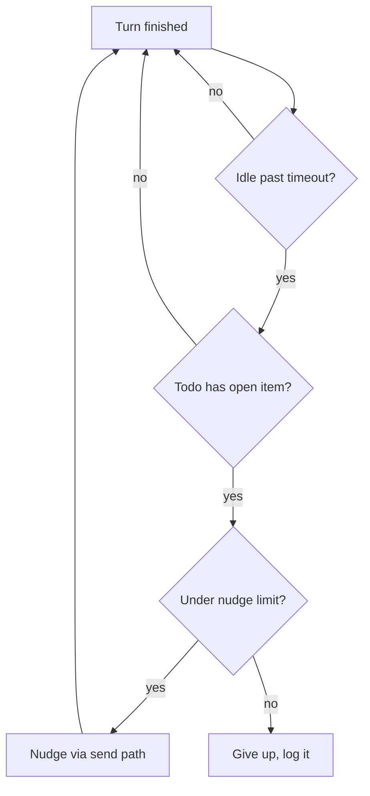

# Routine

A routine is a proactive client that runs inside Shepherd. Shepherd otherwise acts
only when an MCP client calls a tool; a routine acts on a timer, with no client
attached.

## Scenario

An agent is left unattended and ends a turn with work left. It is
not working, not blocked, and not asking anything Shepherd can see, and no MCP
client is supervising it. Without a routine, the pane sits idle until someone
notices. With one, it gets a single nudge line (the profile's `nudge_text`), and
the agent carries on.

## When not to use it

If an MCP client already supervises the pane, with `wait_status` to see that a turn
ended and `send_input` to continue it, leave the routine off. That client can judge
whether the remaining work is worth doing, which a fixed nudge cannot.

## How it is triggered

A timer thread checks every 5 s. It runs only when at least one launch profile sets
a `routine` section, and it watches only panes that this Shepherd process started from
such a profile. Registrations survive a server restart when Shepherd runs under
`openab-shepherd hold`: the profile name and the counters are kept with the pane, and
the new server watches the pane again (see [Restart
survival](operations.md#the-routine-across-a-restart)). A bare `openab-shepherd` owns
its panes, so a restart ends them and there is nothing to watch.

## Conditions

The routine checks these in order on every pass, for each watched pane:

1. The pane's turn has finished and the turn number has sat untouched for
   `idle_timeout_secs`.
2. If the profile sets `todo_file`, that file has an unchecked item.
3. The pane is under `max_consecutive_nudges`, and `cooldown_secs` has passed since
   the last nudge to it.

If all hold, the routine types `nudge_text` through the `send_input` path. The
flowchart below shows the same decision.

## Flow

Without a `todo_file`, the "open item" step always passes.

## Profile fields and limits

The `routine` key of a launch profile (see [Launch profiles](operations.md#launch-profiles)).
It is Shepherd's own liveness check on the profile's panes, checked every 5 s. A
coding CLI's main session sometimes ends a turn with work left and stops: not
working, not blocked, waiting on nothing. When a pane's turn has finished (`done`; for
`opencode`, `idle` after at least one turn, the same rule as `wait_status`) and the
turn number then sits untouched for `idle_timeout_secs`, the routine types
`nudge_text` into the pane through the same path and refusal rules as `send_input`,
and logs the nudge (pane, turn, reason). It never types into a blocked pane and never
answers a dialog. Whether the remaining work is worth doing stays the client's
judgment.

Fields:

- `idle_timeout_secs` (required): 10 to 86400.
- `nudge_text` (required): the text typed, under the `send_input` input rules
  (trimmed, at most 4096 bytes, no control characters except TAB). A bare
  confirmation or menu answer is refused when the profiles file is read:
  a single character, a number of one or two digits, or a word such as
  `yes`, `ok`, `enter`, `allow`, `always`, `deny`, `reject`, `bypass` or
  `trust`. Use a sentence that tells the agent what to do.
- `cooldown_secs` (optional, default `idle_timeout_secs`): 0 to 86400, the
  least time between two nudges to the same pane.
- `max_consecutive_nudges` (optional, default 3): 1 to 100. After that many
  nudges without progress the routine did not cause, the routine stops
  for the pane and logs that it gave up. The cap counts nudges sent. The
  turns a nudge itself causes — up to 3 turn advances after each nudge,
  whether the agent answers with one turn or a follow-up as well — do not
  count as progress and do not clear the count or the stop; a larger
  advance, or one with no nudge outstanding, does. A nudge that produces
  no turn counts like any other. Failed or refused nudge attempts also count
  toward the cap and are spaced by the cooldown, so a pane that refuses
  every nudge is not retried on every check. Without a `todo_file`, every
  finished turn is a nudge candidate, so a pane whose work is in fact
  complete will still be nudged up to this cap; set a `todo_file` when
  that distinction matters.
- `todo_file` (optional): a path relative to the pane's working directory,
  with no `..`. When set, a nudge also needs an unchecked item — a line whose
  first non-blank characters are `- [ ]` — in that file. No unchecked item
  (every item checked, or no items at all) counts as finished work, and the
  pane is never nudged; a file that cannot be read is never nudged either.
  The match is a plain line scan that skips fenced code blocks (a line
  starting with three backticks or tildes opens and closes one). The file is read defensively: it must be a regular file, a
  file over 256 KiB counts as unreadable, and the transition to
  unreadable is logged once. On Unix the working directory is the
  boundary: it is canonicalized and opened as a directory handle once,
  when the pane is registered (so a working directory reached through a
  symlinked ancestor still reads, and swapping it or an ancestor for a
  symlink later is not followed), and a symlink in
  any component of the `todo_file` path below it counts as unreadable.
  On non-Unix the read is a plain open and follows symlinks.

## Unattended panes

Routine profiles are meant for unattended panes. The routine types
into a pane on its own: if a nudge's text is pasted but Enter is then
refused (the native backend's second guarded step), the text is left
on the pane's input line, the routine does not retry it — a retry
would paste a second copy — and it stops for that pane until a turn
advance it did not cause. A person at the pane in the meantime could
submit that pasted text by pressing Enter themselves. A watched pane
whose program has ended is forgotten, not re-checked on every pass.
The routine thread serves every watched pane, so it waits at most 2 s
for a pane's lock: a pane another call holds for longer is skipped for
that check, with nothing sent and nothing counted.
The routine's audit trail is Shepherd's stderr log: every nudge (with
the pane's idle seconds), every give-up and every failed attempt is a
line there, and nowhere else — a client cannot tell a routine nudge
from its own input except that the pane's turn counter advances, which a
routine nudge does like any typed prompt. A registration survives a
server restart under `hold`: the new server rebuilds each watch from the pane's
record, with the nudge count, the give-up flag and the allowance for turns its own
nudges caused. It reads the routine's settings from the current profile, so a pane
whose profile was removed, or no longer has a `routine`, is not watched, and one log
line says so. The idle clock starts again at the restart. A pane that was picked up
after a restart and has not repainted (`pane_replayed`) is skipped, not counted as a
failed nudge.

## Identity and audit

A routine has no client identity: it is not a client from the clients file, and the
record of what it decided is Shepherd's stderr (`routine nudge`, `routine gave up`).
The only trace in the audit log is the fixed system actor `system:routine` on the
send it makes.

## The deprecated `watchdog` key

The profile key was `watchdog` through v0.4.0. It is still accepted as a deprecated
alias of `routine`: a profile that uses it loads as before and Shepherd prints one
warning line to stderr. A profile that sets both keys is refused at startup; remove
`watchdog`.

## Positioning

This is the minimal implementation of the routine idea found in agent products such
as Grok Bot. There, a routine says when to run and a skill says what to do, and
triggers are schedules or events. Shepherd has one trigger today (a finished turn
that sits idle past `idle_timeout_secs`) and one action (type `nudge_text` through
the `send_input` path).

Possible later extensions, none planned:

- other triggers: a schedule, a pane exit, a webhook;
- other actions: a notification, a saved prompt;
- a built-in client name for the routine in the audit log, instead of the current
  stderr-only record.

Any extension would add trigger and action fields inside the same `routine`
section. It needs a concrete scenario first, and a design reviewed by the sol and
opus5 council with a herdr and Orca comparison before any code.
