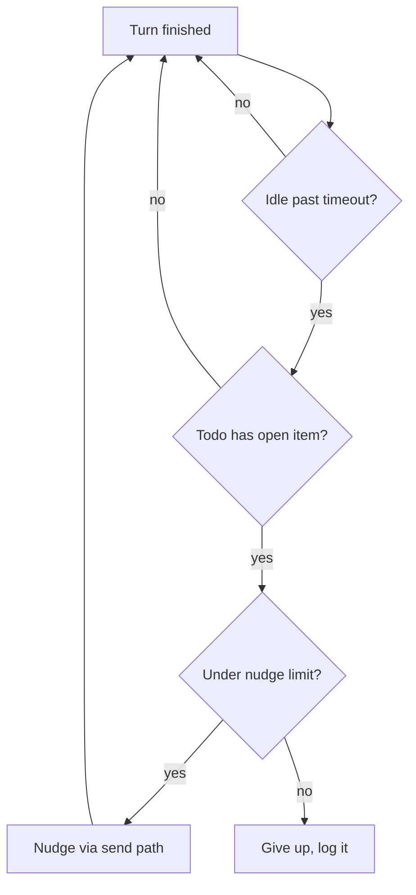

# Routine

A routine is a proactive client that runs inside Shepherd. Shepherd otherwise acts
only when an MCP client calls a tool; a routine acts on a timer, with no client
attached.

There are two kinds, and they do different jobs:

- The **idle routine** is set by the operator in a launch profile (the `routine`
  key). It nudges a pane that ended a turn and then sat idle. It is described in
  the rest of this page up to [Identity and audit](#identity-and-audit).
- An **agent-created routine** is a line that Shepherd types into a pane every N
  seconds. An agent or an MCP client creates it with the `routine_*` tools, on a
  pane whose profile allows it. See [Agent-created routines](#agent-created-routines).

## Scenario

An agent is left unattended and ends a turn with work left. It is
not working, not blocked, and not asking anything Shepherd can see, and no MCP
client is supervising it. Without a routine, the pane sits idle until someone
notices. With one, it gets a single nudge line (the profile's `nudge_text`), and
the agent carries on.

## When not to use it

If an MCP client already supervises the pane, with `wait_status` to see that a turn
ended and `send_input` to continue it, leave the routine off. That client can judge
whether the remaining work is worth doing, which a fixed nudge cannot.

## How it is triggered

A timer thread checks every 5 s. It runs only when at least one launch profile sets
a `routine` section, and it watches only panes that this Shepherd process started from
such a profile. Registrations survive a server restart when Shepherd runs under
`openab-shepherd hold`: the profile name and the counters are kept with the pane, and
the new server watches the pane again (see [Restart
survival](operations.md#the-routine-across-a-restart)). A bare `openab-shepherd` owns
its panes, so a restart ends them and there is nothing to watch.

## Conditions

The routine checks these in order on every pass, for each watched pane:

1. The pane's turn has finished and the turn number has sat untouched for
   `idle_timeout_secs`.
2. If the profile sets `todo_file`, that file has an unchecked item.
3. The pane is under `max_consecutive_nudges`, and `cooldown_secs` has passed since
   the last nudge to it.

If all hold, the routine types `nudge_text` through the `send_input` path. The
flowchart below shows the same decision.

## Flow



Without a `todo_file`, the "open item" step always passes.

## Profile fields and limits

The `routine` key of a launch profile (see [Launch profiles](operations.md#launch-profiles)).
It is Shepherd's own liveness check on the profile's panes, checked every 5 s. A
coding CLI's main session sometimes ends a turn with work left and stops: not
working, not blocked, waiting on nothing. When a pane's turn has finished (`done`; for
`opencode`, `idle` after at least one turn, the same rule as `wait_status`) and the
turn number then sits untouched for `idle_timeout_secs`, the routine types
`nudge_text` into the pane through the same path and refusal rules as `send_input`,
and logs the nudge (pane, turn, reason). It never types into a blocked pane and never
answers a dialog. Whether the remaining work is worth doing stays the client's
judgment.

Fields:

- `idle_timeout_secs` (required): 10 to 86400.
- `nudge_text` (required): the text typed, under the `send_input` input rules
  (trimmed, at most 4096 bytes, no control characters except TAB). A bare
  confirmation or menu answer is refused when the profiles file is read:
  a single character, a number of one or two digits, or a word such as
  `yes`, `ok`, `enter`, `allow`, `always`, `deny`, `reject`, `bypass` or
  `trust`. Use a sentence that tells the agent what to do.
- `cooldown_secs` (optional, default `idle_timeout_secs`): 0 to 86400, the
  least time between two nudges to the same pane.
- `max_consecutive_nudges` (optional, default 3): 1 to 100. After that many
  nudges without progress the routine did not cause, the routine stops
  for the pane and logs that it gave up. The cap counts nudges sent. The
  turns a nudge itself causes — up to 3 turn advances after each nudge,
  whether the agent answers with one turn or a follow-up as well — do not
  count as progress and do not clear the count or the stop; a larger
  advance, or one with no nudge outstanding, does. A nudge that produces
  no turn counts like any other. Failed or refused nudge attempts also count
  toward the cap and are spaced by the cooldown, so a pane that refuses
  every nudge is not retried on every check. Without a `todo_file`, every
  finished turn is a nudge candidate, so a pane whose work is in fact
  complete will still be nudged up to this cap; set a `todo_file` when
  that distinction matters.
- `todo_file` (optional): a path relative to the pane's working directory,
  with no `..`. When set, a nudge also needs an unchecked item — a line whose
  first non-blank characters are `- [ ]` — in that file. No unchecked item
  (every item checked, or no items at all) counts as finished work, and the
  pane is never nudged; a file that cannot be read is never nudged either.
  The match is a plain line scan that skips fenced code blocks (a line
  starting with three backticks or tildes opens and closes one). The file is read defensively: it must be a regular file, a
  file over 256 KiB counts as unreadable, and the transition to
  unreadable is logged once. On Unix the working directory is the
  boundary: it is canonicalized and opened as a directory handle once,
  when the pane is registered (so a working directory reached through a
  symlinked ancestor still reads, and swapping it or an ancestor for a
  symlink later is not followed), and a symlink in
  any component of the `todo_file` path below it counts as unreadable.
  On non-Unix the read is a plain open and follows symlinks.

## Unattended panes

Routine profiles are meant for unattended panes. The routine types
into a pane on its own: if a nudge's text is pasted but Enter is then
refused (the native backend's second guarded step), the text is left
on the pane's input line, the routine does not retry it — a retry
would paste a second copy — and it stops for that pane until a turn
advance it did not cause. A person at the pane in the meantime could
submit that pasted text by pressing Enter themselves. A watched pane
whose program has ended is forgotten, not re-checked on every pass.
The routine thread serves every watched pane, so it waits at most 2 s
for a pane's lock: a pane another call holds for longer is skipped for
that check, with nothing sent and nothing counted.
The routine's audit trail is Shepherd's stderr log (every nudge with
the pane's idle seconds, every give-up and every failed attempt is a
line there) and, when an audit log is configured, a `send_input` `call`
line and an `outcome` line by the actor `system:routine` (see
[Identity and audit](#identity-and-audit)). A client cannot tell a routine nudge
from its own input by looking at the pane, except that the pane's turn counter
advances, which a routine nudge does like any typed prompt. A registration survives a
server restart under `hold`: the new server rebuilds each watch from the pane's
record, with the nudge count, the give-up flag and the allowance for turns its own
nudges caused. It reads the routine's settings from the current profile, so a pane
whose profile was removed, or no longer has a `routine`, is not watched, and one log
line says so. The idle clock starts again at the restart. A pane that was picked up
after a restart and has not repainted (`pane_replayed`) is skipped, not counted as a
failed nudge. So is a pane a person is at (`pane_human_controlled`, `pane_draft_pending`):
the nudge is refused, not queued, counts toward neither the cooldown nor the cap, and
is logged once per episode. When the person is gone the next tick nudges, and the idle
time already elapsed counts.
A server that knows who is at the pane checks before it types: a pane with a lease or a
draft is skipped before the nudge is counted and before any audit `call` line is written,
so the audit file does not fill with one refused call per tick while a person types. The
refusal inside the write stays the authority; the check is only an early exit. A
`draft_clear` by a client with `lease:preempt` lets the next tick nudge.

## Identity and audit

The idle routine has no client identity: it is not a client from the clients file. What it
decided is on Shepherd's stderr (`routine nudge`, `routine gave up`). With an audit log
configured, each nudge it attempts is two lines by the fixed system actor
`system:routine`: a `send_input` `call` line before the send (a nudge whose `call`
line cannot be written is not sent) and an `outcome` line after it, `ok` or
`error:<code>` (for example `error:status_mismatch` when the pane moved first). Both
carry `routine` (`profile`, or the id such as `r3` of an agent-created routine) and
`created_by` (`profile`, or the client that created the routine), and the length of
the text but never the text. A tick that skips (a person at the pane, a replayed pane) writes no
audit line.

## Agent-created routines

An agent can ask Shepherd to type a line into its own pane on a clock: "check
whether any todo work is left, every hour". A routine is a trigger and an action.
In this version the trigger is `every` (a fixed interval in seconds) and the action
is `text` (one line typed into the pane). The idle trigger stays a profile setting
and is not available to the tools. Dynamic routines are off unless the operator opts
in per launch profile, so a profiles file without the `dynamic_routines` key behaves
exactly as before.

### What it does and does not do

- At each grid time (`created_at + n * every_secs`) Shepherd types `text` through
  the same path and refusal rules as `send_input`, only when the pane's turn has
  finished. A pane that is working, blocked, held by a person (lease or draft) or
  still repainting after a restart is skipped. The skip is not queued and not made
  up later: a routine never interrupts a running turn, and a long task simply
  misses ticks. `last_result` in `routine_list` says what happened at the last
  tick (`skipped:working` and so on).
- Ticks missed while Shepherd was down are skipped too. After a restart the
  routine resumes on its original grid, with no burst. A laptop that sleeps is the
  same as a server that was down. There is no calendar syntax, so no time zone and
  no daylight saving rule.
- The text is typed unchanged, with no prefix. A text that starts with `/` is still
  a slash command for the agent.
- At most one nudge per pane per 5 s pass. If two routines are due together, the
  first send turns the pane `working` and the second sees that and skips.
- The consecutive-nudge cap of the idle routine does **not** apply to `every`. An
  hourly routine is driven by the clock, and the cap would stop it after three
  hours without progress. It is bounded by the interval floor, the expiry, the
  per-pane count, `max_runs` and the give-up rule below.
- Three failed sends in a row end the routine as `gave_up`; a success resets the
  count. A paste that was typed but whose Enter was refused (`pasted_unsubmitted`)
  ends it at once, because a retry would paste the line twice. A send that fails
  only because the pane lock was busy for more than 2 s is retried on the next
  pass and does not use the tick.
- A dynamic routine can do nothing that `send_input` cannot: it types one line of at
  most 1024 bytes, never a bare confirmation, through the same guard.

### Opting in: the `dynamic_routines` profile key

```json
"dynamic_routines": { "min_every_secs": 600, "max_per_pane": 3, "max_expires_secs": 604800 }
```

`{}` turns it on with the defaults shown. A profile without the key refuses every
`routine_create` on its panes with `routines_not_allowed`. The key does not need a
`routine` section; a pane with only `dynamic_routines` is watched by the scheduler
alone. Unknown keys are refused when the file is read, so an older Shepherd refuses
a profiles file that uses it; upgrade the server first.

| Key | Meaning | Default | Allowed |
|-----|---------|---------|---------|
| `min_every_secs` | shortest interval a routine may use | 600 | 60 to 604800 |
| `max_per_pane` | active routines on one pane | 3 | 1 to 10 |
| `max_expires_secs` | longest life of a routine; also its default | 604800 (7 days) | 3600 to 2592000 |

Worst case at the defaults: 3 routines every 10 minutes for 7 days is about 1000
typed lines per pane. Set the bounds to what the operator accepts.

### Limits of one routine

| Field | Rule |
|-------|------|
| `trigger` | `{"type": "every", "every_secs": N}`. Any other type is refused |
| `every_secs` | 60 to 604800, and not below the profile's `min_every_secs` |
| `text` | at most 1024 bytes; trimmed; no control characters except TAB; not a bare confirmation (`yes`, `ok`, a digit, ...); not `/yolo` on a Devin pane |
| `todo_file` | optional; a relative path inside the pane's working directory; the line is typed only while the file has an unchecked `- [ ]` item (same reading rules as the idle routine's `todo_file`); refused for a pane without a local working directory |
| `expires_secs` | 60 to 2592000, and not above the profile's `max_expires_secs`; defaults to that maximum, so a routine always expires |
| `max_runs` | optional, 1 to 10000; the routine is `done` after that many sends |

A value outside a limit is refused, not adjusted, and the refusal names the limit.
Finished routines (`expired`, `done`, `gave_up`, `stopped`) do not count toward
`max_per_pane`; the oldest finished ones are dropped once a pane holds more than
twice that many records.

### The tools

All four need the `routine` scope (see [Scopes](operations.md#scopes)) and take the
pane name as `terminal`, like every other tool. A pane started by Shepherd has its
own name in the environment variable `SHEPHERD_PANE`, so an agent knows what to
pass. Panes started before the variable existed lack it; the agent can use the name
`start_pane` or `list_panes` showed.

| Tool | Arguments | Result |
|------|-----------|--------|
| `routine_create` | `terminal`, `trigger`, `text`; optional `todo_file`, `expires_secs`, `max_runs` | `routine` (the record) and `ceiling` (`min_every_secs`, `max_per_pane`, `max_expires_secs`, `active`, `free`) |
| `routine_list` | optional `terminal` (left out: every pane that has routines) | `routines`, each with its `terminal` |
| `routine_update` | `terminal`, `id`, and at least one of `every_secs`, `text`, `todo_file` (null removes it), `expires_secs`, `max_runs` (null removes it) | `routine` |
| `routine_delete` | `terminal`, `id` | `terminal`, `id`, `deleted` |

A routine record shows `id` (`r1`, `r2`, ...; never reused on a pane), `terminal`,
`source` (`agent`, or `profile` for the idle routine), `trigger`, `action`,
`todo_file`, `created_by` (the client id), `created_at`, `expires_at`, `max_runs`,
`runs`, `status`, `stop_reason`, `last_run_at`, `last_result`, `next_due_at`,
`next_due_in_secs` and `expires_in_secs`. Times are Unix seconds.

- `status` is `active`, `expired`, `done`, `gave_up` or `stopped`. `stop_reason` is
  `profile_changed` when a restart found that the profile no longer allows the
  routine (the key was removed, the floor was raised above its interval, or its
  expiry is beyond the new maximum). Such a routine is kept, so the agent can see it
  and delete or recreate it; it never types again.
- `last_result` is `sent`, `skipped:working`, `skipped:blocked`, `skipped:replayed`,
  `skipped:person`, `skipped:todo_done` or `failed:<code>`. It is written when it
  changes.
- Nothing is pushed to the agent when a routine expires, finishes or gives up. The
  agent finds out by calling `routine_list`; the tool descriptions say so.
- `routine_update` with a new `every_secs` or `expires_secs` restarts the grid from
  now. `expires_secs` on a finished routine makes it active again, if there is room
  under `max_per_pane` and the result still fits the limits. There is no `enabled`
  flag: delete and create again to pause.
- `routine_list` also shows the profile's idle routine as `id: "profile"`,
  `source: "profile"`. It is read-only: `routine_update` and `routine_delete` on it
  fail with `routine_read_only`. For it, `runs` is the number of consecutive nudges
  since the agent last made progress, `last_result` is `sent` or `gave_up`, and
  `next_due_in_secs` is the idle time still to run on the finished turn being timed
  (null while none is).

Errors (`structuredContent.error`):

| Code | When | Extra fields |
|------|------|--------------|
| `forbidden` | the client has no `routine` scope (the single legacy token never has it) | the missing scope |
| `routines_not_allowed` | the pane was not started from a profile with `dynamic_routines` | `terminal` |
| `routine_invalid` | a value is outside a limit, or the trigger type is not `every` | `field`, `limit` |
| `routine_limit` | the pane already has `max_per_pane` active routines | `field` (`routines`), `limit`, `max` |
| `routine_not_found` | the pane has no routine with that `id` | `terminal`, `id` |
| `routine_read_only` | update or delete of the profile's routine | `terminal`, `id` |
| `routine_not_saved` | the change could not be kept for a restart, so nothing changed | `backend_detail` |
| `pane_not_live` | the pane's program has ended | `terminal` |
| `audit_unavailable` | the audit line could not be written; nothing was changed | |
| `not_found` | no pane has that name | |

### Storage and restart

A routine is stored in the pane's record in the holder, next to the idle routine's
counters. It lives as long as its pane, and under `openab-shepherd hold` it survives
a server restart: the new server rebuilds the schedule with the same grid. A bare
`openab-shepherd` owns its panes, so a restart ends them and the routines with them.
A routine does not move to another pane and ends when its pane ends.

A write that fails (or one that would make the record too large) is refused with
`routine_not_saved` and changes nothing, because an acknowledged routine that
vanishes at the next restart is the worst outcome for this feature. With no registry
(a bare server) there is nothing to write and the create succeeds in memory.

Rolling back to an older Shepherd after routines exist: an older build ignores the
stored routines and drops them at its next write, and it refuses a clients file that
names the `routine` scope. Accept that, or remove the scope first.

At each restart the current profile is read again. A stored routine that breaks the
current limits becomes `stopped` with `stop_reason: profile_changed` and one line on
stderr. If a lowered `max_per_pane` leaves too many, the newest are stopped.

### Interaction with the idle routine

A dynamic nudge counts as the idle routine's own nudge for its progress logic: the
turns it causes never count as progress, so it cannot clear an idle give-up, and the
idle cooldown also spaces after it. A pane with an idle routine without `todo_file`
plus a dynamic routine can be nudged by both; prefer a `todo_file` or no idle routine
on such a pane.

### Who may use it

`routine` is a separate scope. It does not imply `control`: a holder can only make
Shepherd type a fixed line of at most 1024 bytes, not a bare confirmation, at an
interval of at least the profile's floor, on panes whose profile opted in. It does
not allow `send_input`. The single legacy token holds no `routine` scope; a clients
file can grant it (the `ALL` list includes it). Any client with the scope can create,
list, update and delete on any pane it can name, as `send_input` and `remove_pane`
work; per-client ownership is a non-goal ([trust model](adr/trust-model.md)).
`created_by` is stored and shown, and the audit log has the client id.

For an agent that schedules itself, give it its own client with `routine` and
`observe` (if it should call `list_panes`), and no `control`. Shepherd never puts a
token into a pane's environment; the operator puts the agent's token into the agent
CLI's own MCP configuration. See [credentials.md](credentials.md#an-agent-as-an-mcp-client).

### Audit

`routine_create`, `routine_update` and `routine_delete` write a `call` line before
the change and an `outcome` line after it, under the client's id, and are refused
with `audit_unavailable` when the `call` line cannot be written. The fields are the
pane, the routine `id`, the interval, the length of the text, `expires_secs`,
`max_runs` and whether a `todo_file` is set; never the text. `routine_list` writes
nothing. A nudge is a `send_input` pair by `system:routine`, with `routine` and
`created_by` fields; see [Identity and audit](#identity-and-audit).

### Checking it by hand

[operator-e2e/routine-dynamic.md](operator-e2e/routine-dynamic.md) is the operator
runbook: ten checks on a real server (create, skip while working, restart, downtime,
audit, profile change, audit failure, expiry).

## The deprecated `watchdog` key

The profile key was `watchdog` through v0.4.0. It is still accepted as a deprecated
alias of `routine`: a profile that uses it loads as before and Shepherd prints one
warning line to stderr. A profile that sets both keys is refused at startup; remove
`watchdog`.

## Positioning

This is the small end of the routine idea found in agent products such as Grok Bot.
There, a routine says when to run and a skill says what to do, and triggers are
schedules or events. Shepherd has two triggers, a finished turn that sits idle past
`idle_timeout_secs` (set in a profile) and a fixed interval (`every`, created over
MCP), and one action: type a line into the pane through the `send_input` path.
Asking an agent in plain words ("every hour, check whether any todo work is left")
ends in one `routine_create` call, and `every` plus `text` is the smallest version
of what those products offer. Shepherd adds a ceiling the operator sets per profile.

Possible later extensions, none planned:

- other triggers: a pane exit, a webhook, a calendar schedule;
- other actions: a notification, a saved prompt;
- a dynamic `idle` trigger.

Any extension would add trigger and action fields inside the same routine record. It
needs a concrete scenario first, and a design reviewed by the sol and opus5 council
with a herdr and Orca comparison before any code.
